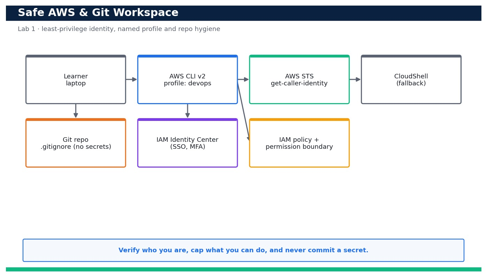

# Lab 1 — Set Up a Safe AWS & Git Working Environment and Verify Identity

**Course:** DevOps Engineering on AWS (TGS-2023040474)  ·  **Day 1**  ·  **Domain 01 — SDLC Automation**  ·  **LO1**  ·  Skills mapped: K1, A1



*Figure — reference architecture for Lab 1.*

## Objective
Stand up a least-privilege AWS CLI/Git workspace and confirm your identity.

## Scenario
Before automating anything you need a workspace you can trust. In this lab you install and configure AWS CLI v2 with a named least-privilege 'devops' profile (or an IAM Identity Center session), prove exactly who you are with STS, pin a Region, attach a permission boundary so the profile can never exceed its remit, and lock down your Git repository so plaintext secrets can never be committed. CloudShell is your always-available fallback.

## What you'll build
A named, MFA-aware, least-privilege 'devops' CLI profile plus a Git repo with a secrets-safe .gitignore, verified with `aws sts get-caller-identity` and a clean secret scan.
**Services:** AWS IAM, AWS CLI v2, IAM Identity Center, CloudShell, Git.

## Prerequisites
- An AWS account you control (an AWS Free Tier / sandbox account is sufficient for most steps).
- AWS CLI v2 installed and configured with a least-privilege named profile: `aws configure --profile devops` (Region e.g. ap-southeast-1).
- Confirm your identity before you start: `aws sts get-caller-identity --profile devops`.
- Git and a code editor; a modern browser for the AWS Management Console.
- Copy `.env.example` to `.env` and fill in YOUR values. `.env` is git-ignored — never commit real credentials.
- Run every command from this lab folder with your `devops` profile (append `--profile devops` or set `AWS_PROFILE=devops`).
- A GitHub account (used from Lab 2 onward via AWS CodeConnections).
- Permission to create IAM policies in your own AWS account (or a sandbox account you control).

## Cost & safety
Everything in this lab is free: IAM users/roles/policies, STS calls, IAM Identity Center and CloudShell incur no charge. There is nothing billable to tear down beyond removing the practice IAM entities you created.

- Use only your own AWS account and the placeholder values in `.env.example`.
- **Never commit real credentials.** Use IAM roles / the AWS CLI profile and the `.env` placeholders only.
- Run the **Clean up** section as soon as you finish to stop ongoing charges.

## Files in this lab
- `identity-check.sh`
- `policies/least-privilege-dev.json`
- `policies/permission-boundary.json`
- `.gitignore`
- `.env.example`
- `lab-01-safe-env-identity.jpg`
- `INSTRUCTIONS.pdf`

## Step-by-step
1. Install AWS CLI v2 (macOS/Linux/Windows) and confirm the major version — v1 is not supported for this course.

   ```bash
   aws --version
   ```
   - **Expected output:** Prints something like aws-cli/2.17.x Python/3.12 — a 2.x version string.

2. Configure a NAMED least-privilege profile called 'devops' (never use root, never the default profile for real work).

   ```bash
   aws configure --profile devops
   ```
   - **Expected output:** You are prompted for Access Key, Secret Key, Default region (ap-southeast-1) and output (json); a ~/.aws/config and ~/.aws/credentials entry named [profile devops] is written.

3. Alternatively, configure IAM Identity Center (SSO) sign-in for the same profile so short-lived, MFA-backed credentials are used instead of static keys.

   ```bash
   aws configure sso --profile devops
   ```
   - **Expected output:** The browser opens for the SSO sign-in + MFA; on success a short-lived session is cached and no long-lived secret key is stored on disk.

4. Prove exactly who you are — this is the single most important check before you touch anything.

   ```bash
   aws sts get-caller-identity --profile devops
   ```
   - **Expected output:** Returns your own UserId, Account (your <your-account-id>) and Arn — confirming the profile maps to the identity you expect.

5. Pin the Region explicitly so nothing lands in the wrong Region by accident.

   ```bash
   aws configure get region --profile devops
   ```
   - **Expected output:** Prints ap-southeast-1 (or your chosen Region) — matching what you set in step 2.

6. Create a least-privilege developer policy from the provided JSON (read-mostly plus the specific write actions this course needs).

   ```bash
   aws iam create-policy --policy-name least-privilege-dev --policy-document file://policies/least-privilege-dev.json --profile devops
   ```
   - **Expected output:** Returns the new policy Arn arn:aws:iam::<your-account-id>:policy/least-privilege-dev.

7. Create a PERMISSION BOUNDARY policy that caps the maximum permissions the devops identity can ever have, even if more policies are attached later.

   ```bash
   aws iam create-policy --policy-name devops-boundary --policy-document file://policies/permission-boundary.json --profile devops
   ```
   - **Expected output:** Returns the boundary policy Arn arn:aws:iam::<your-account-id>:policy/devops-boundary.

8. Confirm the boundary denies privilege escalation by simulating a disallowed IAM action against it.

   ```bash
   aws iam simulate-custom-policy --policy-input-list file://policies/permission-boundary.json --action-names iam:CreateUser --profile devops
   ```
   - **Expected output:** The EvalDecision for iam:CreateUser is implicitDeny — the boundary does not grant admin/IAM-user creation.

9. Understand the MFA posture: list any virtual MFA devices in the account so you can confirm MFA is (or should be) enforced.

   ```bash
   aws iam list-virtual-mfa-devices --profile devops
   ```
   - **Expected output:** Lists MFA devices; a device bound to your user (SerialNumber ending in your username) confirms MFA is enabled for interactive sign-in.

10. Initialise or clone your working Git repo and set your commit identity.

   ```bash
   git init devops-sample-app && cd devops-sample-app && git config user.email you@example.com && git config user.name 'Your Name'
   ```
   - **Expected output:** The repo is initialised and user.name/user.email are set for this repo.

11. Add the hardened .gitignore so credentials, .env files and AWS state can never be staged.

   ```bash
   cp ../.gitignore . && git add .gitignore && git status
   ```
   - **Expected output:** .env, *.pem, .aws/ and credentials patterns are ignored; git status shows only .gitignore staged, never a secret file.

12. Run the identity-check helper script to bundle the STS check, Region check and secret scan into one verifiable command.

   ```bash
   bash identity-check.sh
   ```
   - **Expected output:** Prints the caller ARN, the active Region and 'PROFILE OK' — a single green signal that the workspace is safe to use.

13. Scan the working tree for accidental plaintext keys BEFORE your first commit (AKIA-style access-key IDs).

   ```bash
   git grep -nE 'AKIA[0-9A-Z]{16}' || echo 'no access keys found'
   ```
   - **Expected output:** Prints 'no access keys found' — confirming no AWS access-key IDs are present in tracked files.

14. As a resilience check, open AWS CloudShell in the console and re-run the identity check there (works with no local install).

   ```bash
   aws sts get-caller-identity
   ```
   - **Expected output:** CloudShell already has credentials; it returns the SAME Account/Arn, proving you have a browser-based fallback that needs no local secrets.

## Validation
`aws sts get-caller-identity --profile devops` returns your own account and ARN; the region resolves to your chosen Region; the least-privilege-dev policy and devops-boundary policy exist in IAM; the policy simulation shows IAM-user creation is implicitly denied by the boundary; and `git grep` finds no access-key patterns in tracked files.

## Expected outcome (Test it)
You can run identity-check.sh and get 'PROFILE OK' with the correct ARN and Region, the permission boundary provably blocks privilege escalation, .env and key files are git-ignored, and the same identity check succeeds from CloudShell — proving a safe, verifiable working environment.

## Evidence to capture
- Screenshot of `aws sts get-caller-identity --profile devops` showing your own Account and ARN.
- The identity-check.sh run output ending in 'PROFILE OK' with your Region.
- The IAM console (or CLI output) showing the least-privilege-dev policy and the devops-boundary policy.
- The `git grep` secret-scan output showing 'no access keys found' and .env listed in .gitignore.

## Troubleshooting
- **`aws` reports version 1.x or command not found** — Uninstall AWS CLI v1 and install v2 from the official installer; re-open the shell so the new binary is on PATH.
- **get-caller-identity returns 'Unable to locate credentials'** — You did not pass --profile devops, or the profile is empty — re-run `aws configure --profile devops` (or `aws sso login --profile devops`).
- **.env or a key file keeps showing in `git status`** — It was staged before .gitignore existed — run `git rm --cached <file>` then commit; confirm the pattern is present in .gitignore.

## Clean up
Delete everything you created, in dependency order, to avoid ongoing charges:

```bash
aws iam delete-policy --policy-arn arn:aws:iam::<your-account-id>:policy/least-privilege-dev --profile devops
aws iam delete-policy --policy-arn arn:aws:iam::<your-account-id>:policy/devops-boundary --profile devops
```

Confirm nothing is left running (no active stacks, instances, dashboards or trails for this lab).

## Acceptance criteria
- Every step's **Expected output** is observed, and the **Validation** and **Test it** checks pass.
- The reference architecture is realised using the editable AWS-native source files in this folder.
- GitHub via AWS CodeConnections is used as the source path where a repository is required (CodeCommit optional).
- All **Evidence to capture** items are collected (screenshots / CLI output).
- No live credentials appear in any committed file; `.env` is not committed.
- The **Clean up** step has been run and no billable resources remain.

---
© 2026 Tertiary Infotech Academy Pte Ltd. UEN: 201200696W. For training use only.
