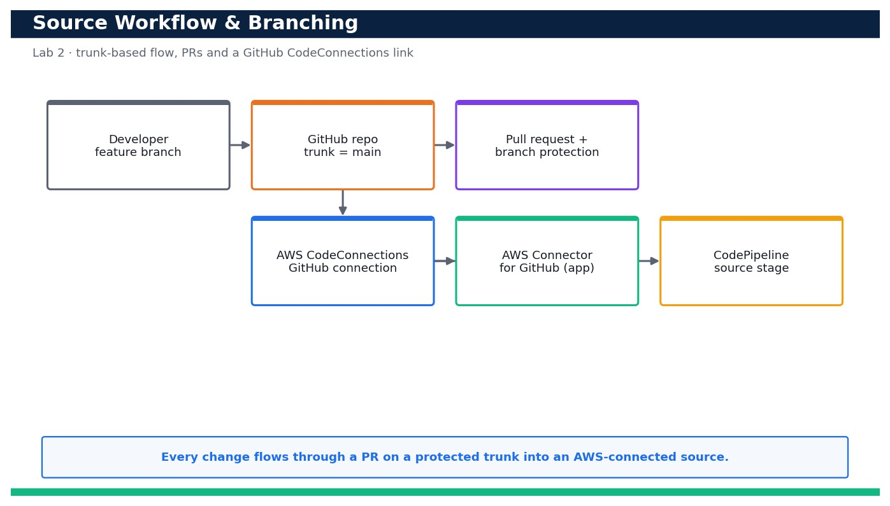

# Lab 2 — Establish a Source-Control Workflow and Branching for the Sample App

**Course:** DevOps Engineering on AWS (TGS-2023040474)  ·  **Day 1**  ·  **Domain 01 — SDLC Automation**  ·  **LO1**  ·  Skills mapped: K1, A1



*Figure — reference architecture for Lab 2.*

## Objective
Adopt a trunk-based Git workflow and connect the repository to AWS with CodeConnections.

## Scenario
Good delivery starts with disciplined source control. In this lab you fork and clone the sample web app, adopt a trunk-based workflow, cut a short-lived feature branch, commit a change, push it, open a pull request and protect the main branch. You then create an AWS CodeConnections connection to GitHub — the modern, secure source path — and confirm it reports AVAILABLE so later labs can trigger builds and pipelines straight from your repo.

## What you'll build
A protected trunk-based GitHub repo with an open/merged PR, plus an AVAILABLE AWS CodeConnections connection to GitHub ready to drive CodeBuild and CodePipeline.
**Services:** GitHub, AWS CodeConnections, Git, AWS CodePipeline (source stage).

## Prerequisites
- An AWS account you control (an AWS Free Tier / sandbox account is sufficient for most steps).
- AWS CLI v2 installed and configured with a least-privilege named profile: `aws configure --profile devops` (Region e.g. ap-southeast-1).
- Confirm your identity before you start: `aws sts get-caller-identity --profile devops`.
- Git and a code editor; a modern browser for the AWS Management Console.
- Copy `.env.example` to `.env` and fill in YOUR values. `.env` is git-ignored — never commit real credentials.
- Run every command from this lab folder with your `devops` profile (append `--profile devops` or set `AWS_PROFILE=devops`).
- A GitHub account with permission to authorise/install the AWS Connector for GitHub on your fork.

## Cost & safety
AWS CodeConnections has no per-connection charge and GitHub is free for public/small repos. There is nothing metered here — the only teardown is deleting the connection and the practice branch.

- Use only your own AWS account and the placeholder values in `.env.example`.
- **Never commit real credentials.** Use IAM roles / the AWS CLI profile and the `.env` placeholders only.
- Run the **Clean up** section as soon as you finish to stop ongoing charges.

## Files in this lab
- `app/index.html`
- `app/version.py`
- `docs/branching-workflow.md`
- `source-connection.sh`
- `.env.example`
- `lab-02-source-workflow-branching.jpg`
- `INSTRUCTIONS.pdf`

## Step-by-step
1. Fork the sample web app into your own GitHub account (via the GitHub UI), then clone YOUR fork locally.

   ```bash
   git clone https://github.com/<your-gh-user>/devops-sample-app.git && cd devops-sample-app
   ```
   - **Expected output:** The repo clones; `git remote -v` shows origin pointing at your fork and app/index.html + app/version.py are present.

2. Confirm main is your trunk and it is up to date before you branch (trunk-based development).

   ```bash
   git checkout main && git pull --ff-only origin main
   ```
   - **Expected output:** You are on branch main and it is already up to date with origin/main.

3. Create a short-lived feature branch named for the change (never commit directly to main).

   ```bash
   git checkout -b feature/bump-version
   ```
   - **Expected output:** Switched to a new branch 'feature/bump-version'.

4. Make a small, reviewable change — bump the app version — and view the diff before committing.

   ```bash
   sed -i '' 's/1.0.0/1.1.0/' app/version.py && git diff app/version.py
   ```
   - **Expected output:** The diff shows VERSION changed from "1.0.0" to "1.1.0".

5. Commit the change with a clear, conventional message.

   ```bash
   git commit -am 'feat: bump app version to 1.1.0'
   ```
   - **Expected output:** One file changed; a commit is created on feature/bump-version.

6. Push the feature branch to your fork to make it reviewable.

   ```bash
   git push -u origin feature/bump-version
   ```
   - **Expected output:** The branch is pushed and GitHub prints a URL to open a pull request.

7. Confirm the branch exists on the remote so a pull request can be opened against it.

   ```bash
   git ls-remote --heads origin feature/bump-version
   ```
   - **Expected output:** The remote branch ref is listed, confirming the branch exists on GitHub and is ready for a PR/review.

8. Enable branch protection on main in GitHub (require a PR and at least one approval before merge) so nobody can push straight to trunk.
   - **Expected output:** In GitHub > Settings > Branches, a protection rule for main requires a pull request and 1 approving review; direct pushes to main are now blocked.

9. Create an AWS CodeConnections connection to GitHub — the primary, modern source path (CodeCommit is an AWS-native alternative, not required).

   ```bash
   aws codeconnections create-connection --provider-type GitHub --connection-name devops-github --profile devops
   ```
   - **Expected output:** Returns a ConnectionArn with ConnectionStatus PENDING.

10. Complete the handshake by authorising the AWS Connector for GitHub app in the browser (Console > Developer Tools > Connections > Update pending connection).
   - **Expected output:** After you authorise and install the AWS Connector on your fork, the connection status changes from PENDING to AVAILABLE.

11. Confirm the connection is AVAILABLE before any later lab wires it into a build or pipeline.

   ```bash
   aws codeconnections get-connection --connection-arn <connection-arn> --query 'Connection.ConnectionStatus' --profile devops
   ```
   - **Expected output:** The command prints "AVAILABLE".

12. List your connections so you can copy the ARN into .env for reuse in Labs 3–5.

   ```bash
   aws codeconnections list-connections --query 'Connections[?ConnectionName==`devops-github`]' --profile devops
   ```
   - **Expected output:** The devops-github connection is listed with its ARN and ConnectionStatus AVAILABLE.

13. Merge the PR in GitHub after approval, then update your local trunk to prove the loop is closed.

   ```bash
   git checkout main && git pull --ff-only origin main && grep VERSION app/version.py
   ```
   - **Expected output:** main now contains VERSION = "1.1.0" — the reviewed change landed on the protected trunk.

14. Commit the branching guide so the team follows the same rules.

   ```bash
   git add docs/branching-workflow.md && git commit -m 'docs: branching workflow' && git push
   ```
   - **Expected output:** docs/branching-workflow.md is committed and the workflow is captured in the repo.

## Validation
Your fork shows a feature branch and a merged PR; main has branch protection requiring a PR + review; `aws codeconnections get-connection` returns AVAILABLE; and the connection ARN is stored in .env for reuse. Direct pushes to main are rejected by the protection rule.

## Expected outcome (Test it)
You can push a feature branch, open and merge a PR into a protected main, and prove an AWS CodeConnections connection to GitHub is AVAILABLE — the source foundation every later pipeline depends on.

## Evidence to capture
- The GitHub PR page for feature/bump-version showing the diff and an approving review.
- The GitHub branch-protection settings for main (require PR + 1 review).
- `aws codeconnections get-connection ...` output printing "AVAILABLE".
- `git grep VERSION app/version.py` on main showing 1.1.0 after the merge.

## Troubleshooting
- **The connection stays PENDING** — You have not finished the browser handshake — in Console > Developer Tools > Connections choose 'Update pending connection' and install the AWS Connector on your repo.
- **`git push` to main is rejected** — That is branch protection working as intended — push a feature branch and open a PR instead of pushing to main.
- **get-connection returns 'ResourceNotFoundException'** — The ARN is wrong or from another Region/account — list connections with `aws codeconnections list-connections --profile devops` and copy the correct ARN.

## Clean up
Delete everything you created, in dependency order, to avoid ongoing charges:

```bash
aws codeconnections delete-connection --connection-arn <connection-arn> --profile devops
git push origin --delete feature/bump-version
```

Confirm nothing is left running (no active stacks, instances, dashboards or trails for this lab).

## Acceptance criteria
- Every step's **Expected output** is observed, and the **Validation** and **Test it** checks pass.
- The reference architecture is realised using the editable AWS-native source files in this folder.
- GitHub via AWS CodeConnections is used as the source path where a repository is required (CodeCommit optional).
- All **Evidence to capture** items are collected (screenshots / CLI output).
- No live credentials appear in any committed file; `.env` is not committed.
- The **Clean up** step has been run and no billable resources remain.

---
© 2026 Tertiary Infotech Academy Pte Ltd. UEN: 201200696W. For training use only.
