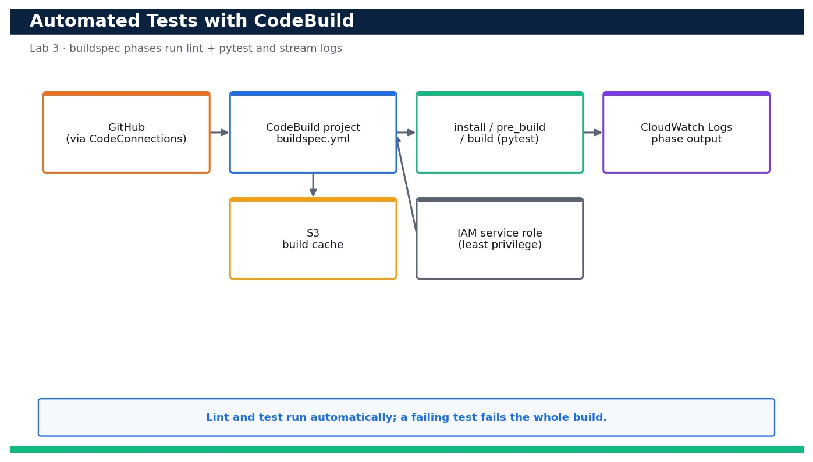

# Lab 3 — Run Automated Tests on Every Commit with AWS CodeBuild

**Course:** DevOps Engineering on AWS (TGS-2023040474)  ·  **Day 1**  ·  **Domain 01 — SDLC Automation**  ·  **LO1**  ·  Skills mapped: K1, A1



*Figure — reference architecture for Lab 3.*

## Objective
Author a buildspec and a CodeBuild project that automatically lints and tests the app.

## Scenario
Automated tests are the gate that keeps broken code out of production. In this lab you author a buildspec.yml with install/pre_build/build phases that install dependencies, run a linter and run pytest, then create a CodeBuild project that pulls the source through your CodeConnections link. You start a build, read the phase-by-phase logs in CloudWatch, deliberately break a test to watch the build fail, then fix it and confirm the build goes green again.

## What you'll build
A CodeBuild project that runs the linter and pytest on demand, streams phase logs to CloudWatch, and fails loudly when a test is broken.
**Services:** AWS CodeBuild, Amazon S3, AWS IAM, Amazon CloudWatch Logs.

## Prerequisites
- An AWS account you control (an AWS Free Tier / sandbox account is sufficient for most steps).
- AWS CLI v2 installed and configured with a least-privilege named profile: `aws configure --profile devops` (Region e.g. ap-southeast-1).
- Confirm your identity before you start: `aws sts get-caller-identity --profile devops`.
- Git and a code editor; a modern browser for the AWS Management Console.
- Copy `.env.example` to `.env` and fill in YOUR values. `.env` is git-ignored — never commit real credentials.
- Run every command from this lab folder with your `devops` profile (append `--profile devops` or set `AWS_PROFILE=devops`).
- The AVAILABLE CodeConnections connection and repo from Lab 2 (its ARN is passed to `aws codebuild create-project`).
- Python 3.12 locally so you can run the green baseline before wiring CodeBuild.

## Cost & safety
CodeBuild bills per build-minute on a small on-demand compute (BUILD_GENERAL1_SMALL); a handful of sub-two-minute builds costs cents. The only stored artifacts are tiny log streams and an optional S3 cache. Delete the project when done.

- Use only your own AWS account and the placeholder values in `.env.example`.
- **Never commit real credentials.** Use IAM roles / the AWS CLI profile and the `.env` placeholders only.
- Run the **Clean up** section as soon as you finish to stop ongoing charges.

## Files in this lab
- `buildspec.yml`
- `tests/test_app.py`
- `requirements.txt`
- `policies/codebuild-logs.json`
- `.env.example`
- `lab-03-codebuild-automated-tests.jpg`
- `INSTRUCTIONS.pdf`

## Step-by-step
1. Review buildspec.yml and confirm it has install, pre_build and build phases that install deps, lint, then run pytest.

   ```bash
   cat buildspec.yml
   ```
   - **Expected output:** You can see runtime-versions python 3.12, `pip install -r requirements.txt`, a pyflakes lint step, and `pytest -q` in the build phase.

2. Run the tests locally first to establish the green baseline before wiring CodeBuild.

   ```bash
   pip install -r requirements.txt && python -m pytest -q
   ```
   - **Expected output:** pytest reports '2 passed' (test_greeting and test_version).

3. Create a least-privilege IAM service role for CodeBuild with a CodeBuild trust policy, then note its ARN.

   ```bash
   aws iam create-role --role-name devops-codebuild-role --assume-role-policy-document '{"Version":"2012-10-17","Statement":[{"Effect":"Allow","Principal":{"Service":"codebuild.amazonaws.com"},"Action":"sts:AssumeRole"}]}' --profile devops
   ```
   - **Expected output:** Returns the role Arn arn:aws:iam::<your-account-id>:role/devops-codebuild-role.

4. Attach the inline least-privilege policy (CloudWatch Logs + read the CodeConnections source) shipped in policies/codebuild-logs.json.

   ```bash
   aws iam put-role-policy --role-name devops-codebuild-role --policy-name codebuild-logs --policy-document file://policies/codebuild-logs.json --profile devops
   ```
   - **Expected output:** The command returns with no error; the role can now write logs and use the connection.

5. Create the CodeBuild project sourced from GitHub through your CodeConnections connection (substitute your connection ARN and account ID).

   ```bash
   aws codebuild create-project --name devops-app-tests --source type=GITHUB,location=https://github.com/<your-gh-user>/devops-sample-app.git,buildspec=buildspec.yml,auth='{type=CODECONNECTIONS,resource=<connection-arn>}' --artifacts type=NO_ARTIFACTS --environment type=LINUX_CONTAINER,image=aws/codebuild/standard:7.0,computeType=BUILD_GENERAL1_SMALL --service-role arn:aws:iam::<your-account-id>:role/devops-codebuild-role --profile devops
   ```
   - **Expected output:** Returns the project with name devops-app-tests, image aws/codebuild/standard:7.0 and source type GITHUB via the connection.

6. Confirm the project points at buildspec.yml and the correct managed image.

   ```bash
   aws codebuild batch-get-projects --names devops-app-tests --query 'projects[0].{image:environment.image,spec:source.buildspec}' --profile devops
   ```
   - **Expected output:** Shows image aws/codebuild/standard:7.0 and buildspec buildspec.yml.

7. Start a build and capture the build ID for log tailing.

   ```bash
   aws codebuild start-build --project-name devops-app-tests --query 'build.id' --output text --profile devops
   ```
   - **Expected output:** Returns a build id like devops-app-tests:<uuid>; the build enters IN_PROGRESS.

8. Watch the build reach SUCCEEDED and confirm each phase passed.

   ```bash
   aws codebuild batch-get-builds --ids <build-id> --query 'builds[0].{status:buildStatus,phases:phases[].{phase:phaseType,status:phaseStatus}}' --profile devops
   ```
   - **Expected output:** buildStatus is SUCCEEDED and INSTALL, PRE_BUILD and BUILD all show SUCCEEDED.

9. Read the phase logs in CloudWatch to see the actual pytest output.

   ```bash
   aws logs tail /aws/codebuild/devops-app-tests --since 10m --profile devops
   ```
   - **Expected output:** The log shows the linter output and 'pytest' reporting '2 passed'.

10. Deliberately break a test to prove the gate works, commit and push it.

   ```bash
   sed -i '' 's/Hello from the DevOps sample app/WRONG/' tests/test_app.py && git commit -am 'test: break greeting assertion' && git push
   ```
   - **Expected output:** The broken assertion is committed and pushed to your branch.

11. Start another build on the broken commit and confirm it FAILS at the build (test) phase.

   ```bash
   aws codebuild start-build --project-name devops-app-tests --query 'build.buildStatus' --profile devops
   ```
   - **Expected output:** The build starts, then batch-get-builds shows buildStatus FAILED with the BUILD phase FAILED — the gate blocked the bad code.

12. Inspect the failure log to see the exact failing assertion (this is what a reviewer would read).

   ```bash
   aws logs tail /aws/codebuild/devops-app-tests --since 5m --profile devops | grep -i -A2 assert
   ```
   - **Expected output:** The log shows the AssertionError for test_greeting and '1 failed'.

13. Fix the test, commit, push and run a final build to return to green.

   ```bash
   git checkout tests/test_app.py && git commit -am 'test: restore greeting assertion' && git push && aws codebuild start-build --project-name devops-app-tests --profile devops
   ```
   - **Expected output:** The new build reaches SUCCEEDED with all phases green again.

14. Confirm the build history so you can show the fail-then-pass story as evidence.

   ```bash
   aws codebuild list-builds-for-project --project-name devops-app-tests --query 'ids[0:3]' --profile devops
   ```
   - **Expected output:** Returns the recent build IDs; batch-get-builds on them shows the SUCCEEDED -> FAILED -> SUCCEEDED sequence.

## Validation
The CodeBuild project builds from GitHub via CodeConnections; a clean commit yields buildStatus SUCCEEDED with INSTALL/PRE_BUILD/BUILD all green and pytest showing '2 passed'; a broken test yields buildStatus FAILED at the BUILD phase; and the CloudWatch logs show the exact assertion failure and the subsequent pass.

## Expected outcome (Test it)
You can start a build that runs the linter and pytest automatically, read the phase logs, break a test to see the build FAIL, and fix it to see the build SUCCEED — proving automated tests gate the code.

## Evidence to capture
- The CodeBuild build page showing buildStatus SUCCEEDED with INSTALL/PRE_BUILD/BUILD green.
- The CloudWatch log excerpt showing pytest '2 passed'.
- The FAILED build page (or CLI output) after breaking the test, with the BUILD phase FAILED.
- The log excerpt showing the AssertionError, then the final SUCCEEDED build after the fix.

## Troubleshooting
- **The build fails at the INSTALL phase** — Check runtime-versions in buildspec.yml and that requirements.txt installs cleanly; read the INSTALL phase log for the pip error.
- **CodeBuild cannot access the source** — The connection is not AVAILABLE or the service role lacks codeconnections:UseConnection — re-check Lab 2 and policies/codebuild-logs.json.
- **No logs appear in CloudWatch** — The service role is missing logs:CreateLogStream/PutLogEvents, or logsConfig groupName does not match the group you are tailing.

## Clean up
Delete everything you created, in dependency order, to avoid ongoing charges:

```bash
aws codebuild delete-project --name devops-app-tests --profile devops
aws logs delete-log-group --log-group-name /aws/codebuild/devops-app-tests --profile devops
aws iam delete-role-policy --role-name devops-codebuild-role --policy-name codebuild-logs --profile devops
aws iam delete-role --role-name devops-codebuild-role --profile devops
```

Confirm nothing is left running (no active stacks, instances, dashboards or trails for this lab).

## Acceptance criteria
- Every step's **Expected output** is observed, and the **Validation** and **Test it** checks pass.
- The reference architecture is realised using the editable AWS-native source files in this folder.
- GitHub via AWS CodeConnections is used as the source path where a repository is required (CodeCommit optional).
- All **Evidence to capture** items are collected (screenshots / CLI output).
- No live credentials appear in any committed file; `.env` is not committed.
- The **Clean up** step has been run and no billable resources remain.

---
© 2026 Tertiary Infotech Academy Pte Ltd. UEN: 201200696W. For training use only.
