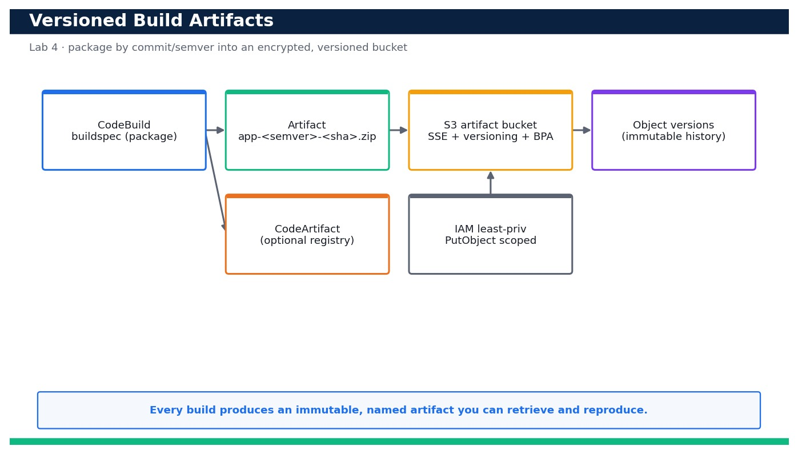

# Lab 4 — Produce and Store Versioned Build Artifacts with a Buildspec

**Course:** DevOps Engineering on AWS (TGS-2023040474)  ·  **Day 1**  ·  **Domain 01 — SDLC Automation**  ·  **LO1**  ·  Skills mapped: K1, A1



*Figure — reference architecture for Lab 4.*

## Objective
Extend the buildspec to package versioned artifacts and store them in an encrypted, versioned bucket.

## Scenario
A pipeline is only trustworthy if you can identify and reproduce exactly what it built. In this lab you extend the buildspec to package the app into a versioned artifact named by commit and semantic version, then upload it to an encrypted S3 artifact bucket with Block Public Access and object versioning enabled. You verify each object version, and prove you can retrieve and reproduce a prior build — the foundation for rollback in Lab 5.

## What you'll build
An encrypted, version-enabled S3 artifact bucket holding immutable, commit/semver-named build artifacts that you can list, retrieve and reproduce.
**Services:** AWS CodeBuild, Amazon S3, AWS CodeArtifact, AWS IAM.

## Prerequisites
- An AWS account you control (an AWS Free Tier / sandbox account is sufficient for most steps).
- AWS CLI v2 installed and configured with a least-privilege named profile: `aws configure --profile devops` (Region e.g. ap-southeast-1).
- Confirm your identity before you start: `aws sts get-caller-identity --profile devops`.
- Git and a code editor; a modern browser for the AWS Management Console.
- Copy `.env.example` to `.env` and fill in YOUR values. `.env` is git-ignored — never commit real credentials.
- Run every command from this lab folder with your `devops` profile (append `--profile devops` or set `AWS_PROFILE=devops`).
- The CodeBuild project from Lab 3 (its artifact-override targets this bucket).
- `zip`/`unzip` available locally for packaging and verification.

## Cost & safety
An S3 artifact bucket with versioning stores small zip files (cents/month) and CodeBuild bills per build-minute. Enabling versioning keeps old objects until you delete them — empty the bucket in cleanup so it stops accruing storage.

- Use only your own AWS account and the placeholder values in `.env.example`.
- **Never commit real credentials.** Use IAM roles / the AWS CLI profile and the `.env` placeholders only.
- Run the **Clean up** section as soon as you finish to stop ongoing charges.

## Files in this lab
- `buildspec.yml`
- `artifact-bucket.yaml`
- `version.sh`
- `.env.example`
- `lab-04-versioned-artifacts-buildspec.jpg`
- `INSTRUCTIONS.pdf`

## Step-by-step
1. Review the extended buildspec.yml and note the packaging step that names the artifact by semver and commit SHA.

   ```bash
   cat buildspec.yml
   ```
   - **Expected output:** The build phase computes SEMVER from app/version.py and SHA from CODEBUILD_RESOLVED_SOURCE_VERSION, then zips the app to app-<semver>-<sha>.zip.

2. Deploy the encrypted, versioned, public-access-blocked artifact bucket from the provided template.

   ```bash
   aws cloudformation deploy --template-file artifact-bucket.yaml --stack-name devops-artifacts --profile devops
   ```
   - **Expected output:** Stack devops-artifacts reaches CREATE_COMPLETE and outputs the ArtifactBucket name devops-cicd-artifacts-<your-account-id>.

3. Confirm default server-side encryption is enabled on the bucket.

   ```bash
   aws s3api get-bucket-encryption --bucket devops-cicd-artifacts-<your-account-id> --profile devops
   ```
   - **Expected output:** Returns a rule with SSEAlgorithm AES256 (or aws:kms) — objects are encrypted at rest.

4. Confirm Block Public Access is fully on so artifacts can never be exposed.

   ```bash
   aws s3api get-public-access-block --bucket devops-cicd-artifacts-<your-account-id> --profile devops
   ```
   - **Expected output:** All four flags (BlockPublicAcls, BlockPublicPolicy, IgnorePublicAcls, RestrictPublicBuckets) are true.

5. Confirm object versioning is enabled so each upload is retained as an immutable version.

   ```bash
   aws s3api get-bucket-versioning --bucket devops-cicd-artifacts-<your-account-id> --profile devops
   ```
   - **Expected output:** Returns Status: Enabled.

6. Package the first artifact locally using version.sh (mirrors what the buildspec does) to see the naming.

   ```bash
   bash version.sh
   ```
   - **Expected output:** Prints the computed name, e.g. devops-sample-app-1.1.0-a1b2c3d.zip, and creates that zip in ./dist.

7. Upload the first versioned artifact to the bucket under a stable key.

   ```bash
   aws s3 cp dist/devops-sample-app-1.1.0-a1b2c3d.zip s3://devops-cicd-artifacts-<your-account-id>/artifacts/app.zip --profile devops
   ```
   - **Expected output:** The object is uploaded and S3 returns a VersionId for artifacts/app.zip.

8. Bump the app version, repackage and upload again to the SAME key to create a second object version.

   ```bash
   sed -i '' 's/1.1.0/1.2.0/' app/version.py && bash version.sh && aws s3 cp dist/devops-sample-app-1.2.0-*.zip s3://devops-cicd-artifacts-<your-account-id>/artifacts/app.zip --profile devops
   ```
   - **Expected output:** A second upload succeeds and returns a new (different) VersionId for the same key.

9. List all object versions to prove the immutable history exists.

   ```bash
   aws s3api list-object-versions --bucket devops-cicd-artifacts-<your-account-id> --prefix artifacts/app.zip --query 'Versions[].{VersionId:VersionId,Latest:IsLatest,Size:Size}' --profile devops
   ```
   - **Expected output:** Two versions are listed; exactly one has IsLatest true (the 1.2.0 build).

10. Also start a real CodeBuild run so the pipeline-produced artifact is stored the same way (belt and braces).

   ```bash
   aws codebuild start-build --project-name devops-app-tests --artifacts-override type=S3,location=devops-cicd-artifacts-<your-account-id>,path=artifacts,name=app.zip,packaging=ZIP --profile devops
   ```
   - **Expected output:** The build runs and uploads its packaged artifact to the artifact bucket, producing another object version.

11. Reproduce a PRIOR version: download the earlier 1.1.0 object version by its VersionId.

   ```bash
   aws s3api get-object --bucket devops-cicd-artifacts-<your-account-id> --key artifacts/app.zip --version-id <old-version-id> restored-app.zip --profile devops
   ```
   - **Expected output:** The exact earlier artifact is downloaded to restored-app.zip.

12. Verify the restored artifact really is the older version by inspecting its contents.

   ```bash
   unzip -p restored-app.zip app/version.py | grep VERSION
   ```
   - **Expected output:** Prints VERSION = "1.1.0" — proving you reproduced the prior build byte-for-byte.

13. (Optional AWS-native registry) Create a CodeArtifact domain + repository if you want a managed package store as well.

   ```bash
   aws codeartifact create-domain --domain devops --profile devops && aws codeartifact create-repository --domain devops --repository app-artifacts --profile devops
   ```
   - **Expected output:** The domain and repository are created; CodeArtifact can host packages alongside the S3 artifact bucket.

14. Confirm nothing is publicly reachable by attempting an unauthenticated read (should be denied).

   ```bash
   curl -s -o /dev/null -w '%{http_code}\n' https://devops-cicd-artifacts-<your-account-id>.s3.amazonaws.com/artifacts/app.zip
   ```
   - **Expected output:** Returns 403 (AccessDenied) — Block Public Access and no public policy mean the artifact is private.

## Validation
The artifact bucket reports SSE enabled, all four Block Public Access flags true, and versioning Enabled; two named artifacts exist as distinct object versions under artifacts/app.zip; you can download a specific prior VersionId and confirm it contains the older VERSION; and an unauthenticated GET returns 403.

## Expected outcome (Test it)
You can produce a commit/semver-named artifact, store it in an encrypted, versioned, private bucket, list its version history, and download and reproduce a prior version — proving artifacts are identifiable, immutable and recoverable.

## Evidence to capture
- `aws s3api get-bucket-versioning` output showing Status: Enabled.
- `aws s3api get-public-access-block` output showing all four flags true.
- `aws s3api list-object-versions` output showing two distinct versions of artifacts/app.zip.
- The `unzip -p ... | grep VERSION` output proving the restored prior version is 1.1.0.

## Troubleshooting
- **The bucket name is already taken** — S3 bucket names are globally unique — the template appends ${AWS::AccountId}; if it still clashes, change BucketBaseName.
- **Only one version appears after two uploads** — Versioning was not enabled before the first upload — confirm get-bucket-versioning is Enabled, then re-upload to create versions.
- **get-object with --version-id returns AccessDenied** — Your role needs s3:GetObjectVersion (not just s3:GetObject) — add it to the least-privilege policy for versioned reads.

## Clean up
Delete everything you created, in dependency order, to avoid ongoing charges:

```bash
aws s3api delete-objects --bucket devops-cicd-artifacts-<your-account-id> --delete "$(aws s3api list-object-versions --bucket devops-cicd-artifacts-<your-account-id> --query '{Objects: Versions[].{Key:Key,VersionId:VersionId}}' --output json --profile devops)" --profile devops
aws cloudformation delete-stack --stack-name devops-artifacts --profile devops
aws codeartifact delete-repository --domain devops --repository app-artifacts --profile devops
aws codeartifact delete-domain --domain devops --profile devops
```

Confirm nothing is left running (no active stacks, instances, dashboards or trails for this lab).

## Acceptance criteria
- Every step's **Expected output** is observed, and the **Validation** and **Test it** checks pass.
- The reference architecture is realised using the editable AWS-native source files in this folder.
- GitHub via AWS CodeConnections is used as the source path where a repository is required (CodeCommit optional).
- All **Evidence to capture** items are collected (screenshots / CLI output).
- No live credentials appear in any committed file; `.env` is not committed.
- The **Clean up** step has been run and no billable resources remain.

---
© 2026 Tertiary Infotech Academy Pte Ltd. UEN: 201200696W. For training use only.
