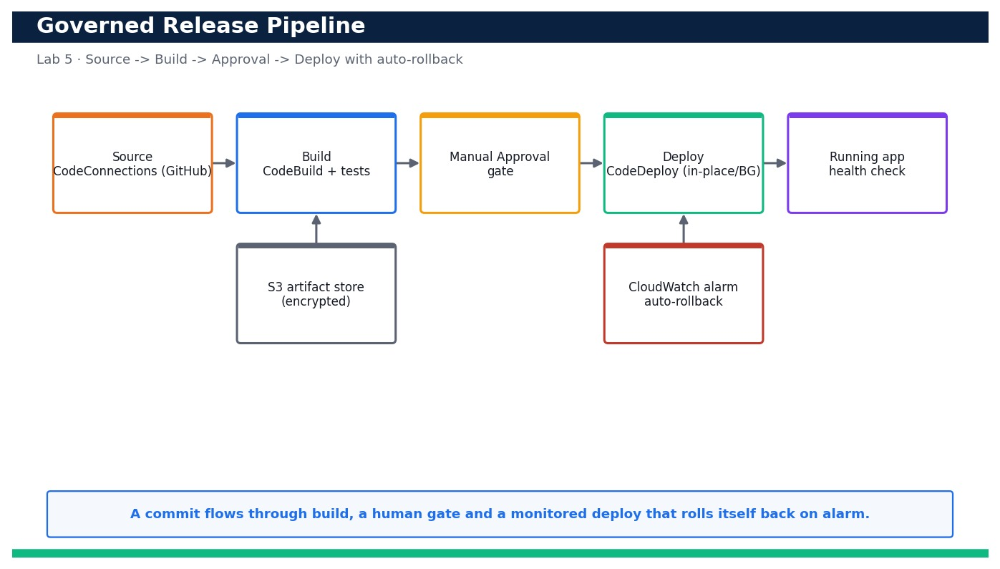

# Lab 5 — Assemble a CodePipeline with Manual Approval and a Deployment Strategy

**Course:** DevOps Engineering on AWS (TGS-2023040474)  ·  **Day 1**  ·  **Domain 01 — SDLC Automation**  ·  **LO1**  ·  Skills mapped: K1, A1



*Figure — reference architecture for Lab 5.*

## Objective
Wire an end-to-end pipeline with a manual approval gate, a deployment strategy and auto-rollback.

## Scenario
Now you connect everything into one governed release path. Using a CloudFormation template plus a pipeline definition, you build Source (CodeConnections) -> Build (CodeBuild) -> Manual Approval -> Deploy (CodeDeploy). You choose between in-place and blue/green deployment, run the pipeline end to end, approve the release, verify the deployed app with a health check, and finally wire an alarm-based automatic rollback so a bad release self-reverts.

## What you'll build
A four-stage CodePipeline (Source -> Build -> Approve -> Deploy) with a manual approval gate, a chosen deployment strategy and alarm-based automatic rollback.
**Services:** AWS CodePipeline, CodeBuild, CodeDeploy, CodeConnections, Amazon S3, Amazon CloudWatch, AWS CloudFormation.

## Prerequisites
- An AWS account you control (an AWS Free Tier / sandbox account is sufficient for most steps).
- AWS CLI v2 installed and configured with a least-privilege named profile: `aws configure --profile devops` (Region e.g. ap-southeast-1).
- Confirm your identity before you start: `aws sts get-caller-identity --profile devops`.
- Git and a code editor; a modern browser for the AWS Management Console.
- Copy `.env.example` to `.env` and fill in YOUR values. `.env` is git-ignored — never commit real credentials.
- Run every command from this lab folder with your `devops` profile (append `--profile devops` or set `AWS_PROFILE=devops`).
- The AVAILABLE CodeConnections connection (Lab 2), the tested build (Lab 3) and the artifact bucket (Lab 4).
- At least one EC2 instance tagged App=devops-sample-app with the CodeDeploy agent installed as the deploy target.
- `curl` for the health check.

## Cost & safety
This lab runs a v2 CodePipeline, CodeBuild minutes, one t3.micro deploy target, an encrypted S3 artifact bucket and a CloudWatch alarm. Kept to a single pipeline and torn down the same day it is a few US$; the deploy instance and build minutes are the main line items.

- Use only your own AWS account and the placeholder values in `.env.example`.
- **Never commit real credentials.** Use IAM roles / the AWS CLI profile and the `.env` placeholders only.
- Run the **Clean up** section as soon as you finish to stop ongoing charges.

## Files in this lab
- `pipeline.yaml`
- `appspec.yml`
- `pipeline-definition.json`
- `scripts/health_check.sh`
- `.env.example`
- `lab-05-codepipeline-approval-deploy.jpg`
- `INSTRUCTIONS.pdf`

## Step-by-step
1. Review pipeline.yaml, pipeline-definition.json and appspec.yml so you understand the four stages and the deploy hooks.

   ```bash
   cat appspec.yml pipeline-definition.json
   ```
   - **Expected output:** appspec.yml shows BeforeInstall/AfterInstall/ApplicationStart/ValidateService hooks; pipeline-definition.json shows Source, Build, Approve and Deploy stages.

2. Decide your deployment strategy: in-place (simplest) vs blue/green (zero-downtime). In-place redeploys onto the same instances; blue/green shifts traffic to a fresh set and keeps the old set for instant rollback.
   - **Expected output:** You have chosen a strategy (IN_PLACE with WITH_TRAFFIC_CONTROL for this lab) and understand its rollback and downtime trade-offs.

3. Deploy the pipeline foundation stack (encrypted artifact bucket, CodeBuild project, CodeDeploy app and least-privilege roles).

   ```bash
   aws cloudformation deploy --template-file pipeline.yaml --stack-name devops-cicd --capabilities CAPABILITY_NAMED_IAM --parameter-overrides ConnectionArn=<connection-arn> --profile devops
   ```
   - **Expected output:** Stack devops-cicd reaches CREATE_COMPLETE and outputs the ArtifactBucket and CodeDeploy application name.

4. Create the CodeDeploy deployment group targeting your tagged instance(s) with the chosen in-place strategy.

   ```bash
   aws deploy create-deployment-group --application-name devops-sample-app --deployment-group-name devops-dg --service-role-arn arn:aws:iam::<your-account-id>:role/devops-codedeploy-role --deployment-style deploymentType=IN_PLACE,deploymentOption=WITH_TRAFFIC_CONTROL --ec2-tag-filters Key=App,Value=devops-sample-app,Type=KEY_AND_VALUE --profile devops
   ```
   - **Expected output:** A deploymentGroupId is returned; the group lists your target instances by tag and shows the chosen deployment type.

5. Create the pipeline from the definition, wiring the Source action to your AVAILABLE CodeConnections connection.

   ```bash
   aws codepipeline create-pipeline --cli-input-json file://pipeline-definition.json --profile devops
   ```
   - **Expected output:** The pipeline devops-cicd-pipeline is created and immediately starts its first execution from the connected repo.

6. Confirm the Source action uses the connection webhook (DetectChanges true), not polling.

   ```bash
   aws codepipeline get-pipeline --name devops-cicd-pipeline --query 'pipeline.stages[0].actions[0].configuration' --profile devops
   ```
   - **Expected output:** Shows ConnectionArn, FullRepositoryId, BranchName and DetectChanges true.

7. Watch the first run: Source then Build should succeed (Build runs the tests from Lab 3).

   ```bash
   aws codepipeline get-pipeline-state --name devops-cicd-pipeline --query 'stageStates[?stageName==`Build`].latestExecution.status' --profile devops
   ```
   - **Expected output:** Source and Build report Succeeded; the pipeline then pauses at the Approve stage.

8. Find the pending approval token so you can approve the release.

   ```bash
   aws codepipeline get-pipeline-state --name devops-cicd-pipeline --query 'stageStates[?stageName==`Approve`].actionStates[0].latestExecution.token' --output text --profile devops
   ```
   - **Expected output:** Returns the approval token for the ManualApproval action (status InProgress/pending).

9. Approve the Manual Approval action so the release proceeds to Deploy.

   ```bash
   aws codepipeline put-approval-result --pipeline-name devops-cicd-pipeline --stage-name Approve --action-name ManualApproval --result summary=ok,status=Approved --token <token> --profile devops
   ```
   - **Expected output:** The Deploy stage transitions to InProgress; CodeDeploy starts deploying the artifact.

10. Confirm CodeDeploy reports a successful deployment with your chosen strategy.

   ```bash
   aws deploy list-deployments --application-name devops-sample-app --query 'deployments[0]' --output text --profile devops
   ```
   - **Expected output:** Returns the latest deployment ID; get-deployment on it shows status Succeeded and the IN_PLACE/BLUE_GREEN style you chose.

11. Verify the deployed app end to end with the health check.

   ```bash
   bash scripts/health_check.sh http://<deploy-target-dns>/
   ```
   - **Expected output:** Prints HTTP 200 and the deployed version — the app is live and healthy.

12. Create a CloudWatch alarm on deployment/app error rate that CodeDeploy can watch for rollback.

   ```bash
   aws cloudwatch put-metric-alarm --alarm-name devops-deploy-errors --namespace AWS/ApplicationELB --metric-name HTTPCode_Target_5XX_Count --statistic Sum --period 60 --evaluation-periods 1 --threshold 5 --comparison-operator GreaterThanThreshold --profile devops
   ```
   - **Expected output:** The alarm devops-deploy-errors is created in state OK.

13. Wire alarm-based automatic rollback into the deployment group so a bad release self-reverts.

   ```bash
   aws deploy update-deployment-group --application-name devops-sample-app --current-deployment-group-name devops-dg --auto-rollback-configuration enabled=true,events=DEPLOYMENT_FAILURE,DEPLOYMENT_STOP_ON_ALARM --alarm-configuration enabled=true,alarms=[{name=devops-deploy-errors}] --profile devops
   ```
   - **Expected output:** The deployment group shows auto-rollback enabled on failure and on the alarm.

14. Prove the whole loop: push a change and watch Source -> Build -> Approve -> Deploy run automatically after approval.

   ```bash
   git commit -am 'feat: headline change' && git push
   ```
   - **Expected output:** A new execution starts within seconds; after you approve, the deployed app serves your change and the health check passes.

15. Prove the safety net: simulate a failing deployment (or trip the alarm) and confirm CodeDeploy rolls back to the last good revision.

   ```bash
   aws deploy get-deployment --deployment-id <bad-deployment-id> --query 'deploymentInfo.rollbackInfo' --profile devops
   ```
   - **Expected output:** rollbackInfo shows a rollback was triggered and the app is restored to the previous, healthy revision.

## Validation
The CodePipeline shows Source, Build, Approve and Deploy; a run reaches the Approve gate and only proceeds after `put-approval-result`; CodeDeploy reports Succeeded with the chosen strategy; the health check returns HTTP 200 with the deployed version; and the deployment group has alarm-based automatic rollback enabled that reverts a failing release.

## Expected outcome (Test it)
You can run the pipeline end to end, be blocked at a manual approval until you approve, see the app deployed and healthy, and watch an alarm-based rollback automatically restore the previous version when a deploy goes bad — a governed, self-healing release path.

## Evidence to capture
- The CodePipeline view showing Source, Build, Approve and Deploy, paused at the Approve gate.
- The `put-approval-result` command and the Deploy stage transitioning to Succeeded afterwards.
- The health_check.sh output showing HTTP 200 and the deployed version.
- The `get-deployment ... rollbackInfo` output proving an alarm/failure triggered an automatic rollback.

## Troubleshooting
- **The Deploy stage never runs** — The pipeline is waiting at the manual Approve gate — fetch the token and run put-approval-result with status=Approved.
- **CodeDeploy fails at ValidateService** — scripts/health_check.sh is failing — confirm the app listens on port 80 and the health path returns 200 on the target instance.
- **Rollback does not trigger on a bad deploy** — The alarm is not wired to the deployment group — confirm alarmConfiguration.enabled is true and the alarm name matches the one you created.

## Clean up
Delete everything you created, in dependency order, to avoid ongoing charges:

```bash
aws codepipeline delete-pipeline --name devops-cicd-pipeline --profile devops
aws deploy delete-deployment-group --application-name devops-sample-app --deployment-group-name devops-dg --profile devops
aws deploy delete-application --application-name devops-sample-app --profile devops
aws cloudwatch delete-alarms --alarm-names devops-deploy-errors --profile devops
aws cloudformation delete-stack --stack-name devops-cicd --profile devops
```

Confirm nothing is left running (no active stacks, instances, dashboards or trails for this lab).

## Acceptance criteria
- Every step's **Expected output** is observed, and the **Validation** and **Test it** checks pass.
- The reference architecture is realised using the editable AWS-native source files in this folder.
- GitHub via AWS CodeConnections is used as the source path where a repository is required (CodeCommit optional).
- All **Evidence to capture** items are collected (screenshots / CLI output).
- No live credentials appear in any committed file; `.env` is not committed.
- The **Clean up** step has been run and no billable resources remain.

---
© 2026 Tertiary Infotech Academy Pte Ltd. UEN: 201200696W. For training use only.
