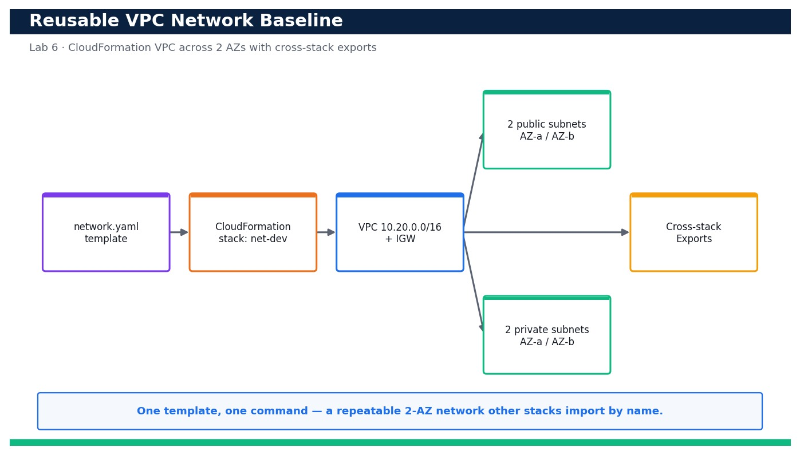

# Lab 6 — Deploy a Reusable VPC Network Baseline with CloudFormation

**Course:** DevOps Engineering on AWS (TGS-2023040474)  ·  **Day 2**  ·  **Domain 02 — Configuration Management and IaC**  ·  **LO2**  ·  Skills mapped: K3, A3



*Figure — reference architecture for Lab 6.*

## Objective
Author, validate and deploy a reusable VPC network baseline with CloudFormation and publish cross-stack exports (LO2, K3, A3).

## Scenario
Your team keeps building VPCs by hand and no two look alike. In this lab you codify a golden network baseline as a single CloudFormation template — a VPC with two public and two private subnets spread across two Availability Zones, an Internet Gateway and route tables — and publish its identifiers as cross-stack Exports so every downstream stack can import them. You validate the template, deploy it from a parameter file and inspect the resulting outputs and exports.

## What you'll build
A version-controlled network.yaml that deploys a 2-AZ VPC (2 public + 2 private subnets, IGW, route tables) and publishes VpcId, subnet IDs and the VPC CIDR as reusable cross-stack Exports.
**Services:** AWS CloudFormation, Amazon VPC, Amazon EC2.

## Prerequisites
- An AWS account you control (an AWS Free Tier / sandbox account is sufficient for most steps).
- AWS CLI v2 installed and configured with a least-privilege named profile: `aws configure --profile devops` (Region e.g. ap-southeast-1).
- Confirm your identity before you start: `aws sts get-caller-identity --profile devops`.
- Git and a code editor; a modern browser for the AWS Management Console.
- Copy `.env.example` to `.env` and fill in YOUR values. `.env` is git-ignored — never commit real credentials.
- Run every command from this lab folder with your `devops` profile (append `--profile devops` or set `AWS_PROFILE=devops`).
- Optional: cfn-lint installed (`pip install cfn-lint`) to lint the template before deploying.
- python3 available on PATH (deploy.sh uses it to expand the JSON parameter file).

## Cost & safety
A VPC, subnets, route tables and an Internet Gateway are all free of charge; no NAT Gateway or EC2 is created in this lab, so it is effectively $0. Delete the stack when finished to keep your account tidy.

- Use only your own AWS account and the placeholder values in `.env.example`.
- **Never commit real credentials.** Use IAM roles / the AWS CLI profile and the `.env` placeholders only.
- Run the **Clean up** section as soon as you finish to stop ongoing charges.

## Files in this lab
- `network.yaml`
- `parameters-dev.json`
- `parameters-test.json`
- `deploy.sh`
- `.env.example`
- `lab-06-cloudformation-network-baseline.jpg`
- `INSTRUCTIONS.pdf`

## Step-by-step
1. Change into the lab folder and confirm your identity and Region before you touch anything.

   ```bash
   aws sts get-caller-identity --profile devops
   ```
   - **Expected output:** Your own Account, UserId and Arn are printed — confirming you are operating in the right account.

2. Validate the template syntax and capabilities before deploying so you catch errors locally.

   ```bash
   aws cloudformation validate-template --template-body file://network.yaml --profile devops
   ```
   - **Expected output:** The command returns the template Description and the list of Parameters with no error.

3. Lint the template's logical structure with the CloudFormation linter (cfn-lint) if installed.

   ```bash
   cfn-lint network.yaml
   ```
   - **Expected output:** cfn-lint exits 0 with no findings, confirming the template is well-formed.

4. Review the dev parameter file so you know exactly what values will be injected.

   ```bash
   cat parameters-dev.json
   ```
   - **Expected output:** The file lists EnvName=dev and VpcCidr=10.20.0.0/16 as ParameterKey/ParameterValue pairs.

5. Deploy the network baseline as a named stack using the deploy helper script (it wraps aws cloudformation deploy).

   ```bash
   bash deploy.sh dev
   ```
   - **Expected output:** The script prints 'Deploying net-dev...' and CloudFormation reports the stack reaching CREATE_COMPLETE.

6. Confirm the stack finished successfully.

   ```bash
   aws cloudformation describe-stacks --stack-name net-dev --query 'Stacks[0].StackStatus' --profile devops
   ```
   - **Expected output:** The command prints "CREATE_COMPLETE".

7. Inspect the stack Outputs to see the identifiers the baseline produced.

   ```bash
   aws cloudformation describe-stacks --stack-name net-dev --query 'Stacks[0].Outputs' --profile devops
   ```
   - **Expected output:** You see OutputKeys VpcId, PublicSubnetAId, PublicSubnetBId, PrivateSubnetAId, PrivateSubnetBId and VpcCidr with real IDs.

8. List the cross-stack Exports so you can confirm they are published for other stacks to import.

   ```bash
   aws cloudformation list-exports --query "Exports[?starts_with(Name,'dev-')]" --profile devops
   ```
   - **Expected output:** Exports dev-VpcId, dev-PublicSubnetAId, dev-PublicSubnetBId, dev-PrivateSubnetAId, dev-PrivateSubnetBId and dev-VpcCidr are listed with their values.

9. Confirm the VPC exists and DNS support is enabled.

   ```bash
   aws ec2 describe-vpcs --filters Name=tag:Name,Values=dev-vpc --query 'Vpcs[0].{Id:VpcId,Cidr:CidrBlock,Dns:EnableDnsSupport}' --profile devops
   ```
   - **Expected output:** The VPC is returned with CIDR 10.20.0.0/16 and Dns set to true.

10. Verify the four subnets landed in two distinct Availability Zones.

   ```bash
   aws ec2 describe-subnets --filters Name=vpc-id,Values=<vpc-id> --query 'Subnets[].{Az:AvailabilityZone,Cidr:CidrBlock,Public:MapPublicIpOnLaunch}' --profile devops
   ```
   - **Expected output:** Four subnets are listed across two AZs; the two public subnets show Public=true and the two private show Public=false.

11. Check that the Internet Gateway is attached to the VPC.

   ```bash
   aws ec2 describe-internet-gateways --filters Name=attachment.vpc-id,Values=<vpc-id> --query 'InternetGateways[0].Attachments[0].State' --profile devops
   ```
   - **Expected output:** The attachment State is "available", confirming the IGW is attached.

12. Confirm the public route table has a default route (0.0.0.0/0) to the Internet Gateway.

   ```bash
   aws ec2 describe-route-tables --filters Name=vpc-id,Values=<vpc-id> --query 'RouteTables[].Routes[?DestinationCidrBlock==`0.0.0.0/0`]' --profile devops
   ```
   - **Expected output:** One route table shows a 0.0.0.0/0 route whose GatewayId is your igw-... , confirming internet egress for public subnets.

13. Prove reusability: deploy a second, isolated copy of the same baseline for the test environment.

   ```bash
   bash deploy.sh test
   ```
   - **Expected output:** A separate stack net-test reaches CREATE_COMPLETE using VpcCidr 10.30.0.0/16 and publishes test-* exports.

14. Detect drift immediately after deployment to establish a clean baseline for later labs.

   ```bash
   aws cloudformation detect-stack-drift --stack-name net-dev --profile devops
   ```
   - **Expected output:** A StackDriftDetectionId is returned; a follow-up describe shows StackDriftStatus IN_SYNC.

15. Render a change-free change set to prove the deployed stack matches the template exactly.

   ```bash
   aws cloudformation deploy --template-file network.yaml --stack-name net-dev --parameter-overrides EnvName=dev VpcCidr=10.20.0.0/16 --no-execute-changeset --profile devops
   ```
   - **Expected output:** CloudFormation reports 'No changes to deploy' (or an empty change set), confirming template and stack are in sync.

## Validation
In the CloudFormation console stack net-dev shows CREATE_COMPLETE with an Outputs tab listing the VPC, subnet and CIDR values, and the Exports appear under CloudFormation → Exports as dev-*. describe-vpcs, describe-subnets and describe-route-tables confirm a 2-AZ VPC with a public route to the IGW, and drift detection reports IN_SYNC.

## Expected outcome (Test it)
Deploying network.yaml with parameters-dev.json produces a reusable 2-AZ VPC whose IDs are published as cross-stack Exports; re-running the deploy reports no changes and a second (test) deployment reproduces an identical, isolated network — proving the baseline is repeatable and importable.

## Evidence to capture
- describe-stacks output showing net-dev at CREATE_COMPLETE with the Outputs tab populated.
- list-exports output listing the dev-* cross-stack exports with real IDs.
- describe-subnets output proving 4 subnets across 2 AZs (2 public, 2 private).
- detect-stack-drift result reporting StackDriftStatus IN_SYNC.

## Troubleshooting
- **validate-template returns a YAML error** — Check indentation and that every Resource has a Type and Properties; re-run cfn-lint to pinpoint the line.
- **Stack rolls back with a CIDR conflict** — Two subnet CIDRs overlap or fall outside VpcCidr — the !Cidr splits assume a /16; keep VpcCidr a /16.
- **list-exports shows no dev-* exports** — The stack may have rolled back; confirm StackStatus is CREATE_COMPLETE and the Outputs block declares the Export names.

## Clean up
Delete everything you created, in dependency order, to avoid ongoing charges:

```bash
aws cloudformation delete-stack --stack-name net-test --profile devops
aws cloudformation delete-stack --stack-name net-dev --profile devops
aws cloudformation wait stack-delete-complete --stack-name net-dev --profile devops
```

Confirm nothing is left running (no active stacks, instances, dashboards or trails for this lab).

## Acceptance criteria
- Every step's **Expected output** is observed, and the **Validation** and **Test it** checks pass.
- The reference architecture is realised using the editable AWS-native source files in this folder.
- GitHub via AWS CodeConnections is used as the source path where a repository is required (CodeCommit optional).
- All **Evidence to capture** items are collected (screenshots / CLI output).
- No live credentials appear in any committed file; `.env` is not committed.
- The **Clean up** step has been run and no billable resources remain.

---
© 2026 Tertiary Infotech Academy Pte Ltd. UEN: 201200696W. For training use only.
