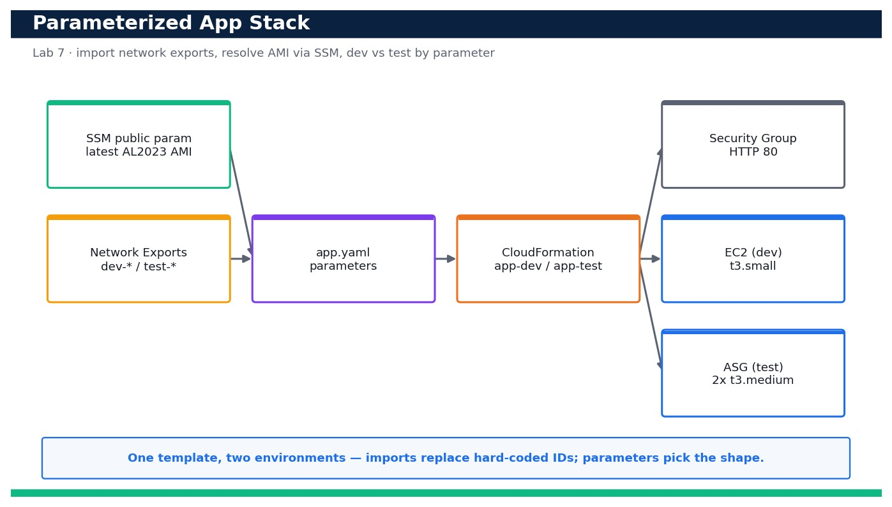

# Lab 7 — Deploy a Parameterized Application Stack that Imports Network Exports

**Course:** DevOps Engineering on AWS (TGS-2023040474)  ·  **Day 2**  ·  **Domain 02 — Configuration Management and IaC**  ·  **LO2**  ·  Skills mapped: K3, A3



*Figure — reference architecture for Lab 7.*

## Objective
Deploy a parameterized application stack that consumes cross-stack exports and reuse it for dev and test via parameter files (LO2, K3, A3).

## Scenario
With the network baseline from Lab 6 in place, you now deploy the application tier on top of it — without copy-pasting a single subnet or VPC ID. The app template uses Fn::ImportValue to pull the network's exports, an SSM public parameter to always resolve the latest Amazon Linux AMI, and CloudFormation Parameters (with a Mappings-driven instance size and a Conditions-driven Auto Scaling group) so the very same template produces a dev single instance and a test Auto Scaling group just by swapping a parameter file.

## What you'll build
A parameterized app.yaml that imports the network exports, resolves the latest AMI via SSM and deploys a security group plus either a single EC2 instance (dev) or an Auto Scaling group (test) from the same template.
**Services:** AWS CloudFormation, Amazon EC2, AWS Systems Manager (SSM public parameters).

## Prerequisites
- An AWS account you control (an AWS Free Tier / sandbox account is sufficient for most steps).
- AWS CLI v2 installed and configured with a least-privilege named profile: `aws configure --profile devops` (Region e.g. ap-southeast-1).
- Confirm your identity before you start: `aws sts get-caller-identity --profile devops`.
- Git and a code editor; a modern browser for the AWS Management Console.
- Copy `.env.example` to `.env` and fill in YOUR values. `.env` is git-ignored — never commit real credentials.
- Run every command from this lab folder with your `devops` profile (append `--profile devops` or set `AWS_PROFILE=devops`).
- Lab 6 completed: the net-dev (and net-test) stacks and their exports must exist in this Region.

## Cost & safety
Dev deploys one t3.small; the test path deploys two t3.medium instances in an Auto Scaling group, billed per second while running. Delete both stacks the same day; the security group and SSM lookup are free.

- Use only your own AWS account and the placeholder values in `.env.example`.
- **Never commit real credentials.** Use IAM roles / the AWS CLI profile and the `.env` placeholders only.
- Run the **Clean up** section as soon as you finish to stop ongoing charges.

## Files in this lab
- `app.yaml`
- `parameters.json`
- `params-test.json`
- `.env.example`
- `lab-07-parameterized-app-stack.jpg`
- `INSTRUCTIONS.pdf`

## Step-by-step
1. Confirm the Lab 6 network stack still exists and its exports are available to import.

   ```bash
   aws cloudformation list-exports --query "Exports[?Name=='dev-VpcId']" --profile devops
   ```
   - **Expected output:** The dev-VpcId export is listed with a vpc-... value, confirming the network baseline is present.

2. Validate the app template before deploying.

   ```bash
   aws cloudformation validate-template --template-body file://app.yaml --profile devops
   ```
   - **Expected output:** The Description and Parameters (EnvName, InstanceSize, DeployMode) are returned with no error.

3. Inspect the dev parameter file to see the values that select a single instance.

   ```bash
   cat parameters.json
   ```
   - **Expected output:** The file sets EnvName=dev, InstanceSize=small and DeployMode=single.

4. Preview which AMI the SSM public parameter will resolve to, so you know the deployment is using the latest image.

   ```bash
   aws ssm get-parameters --names /aws/service/ami-amazon-linux-latest/al2023-ami-kernel-default-x86_64 --query 'Parameters[0].Value' --profile devops
   ```
   - **Expected output:** A current ami-... ID for Amazon Linux 2023 is printed.

5. Deploy the dev application stack; it will import the network exports automatically.

   ```bash
   aws cloudformation deploy --template-file app.yaml --stack-name app-dev --parameter-overrides EnvName=dev InstanceSize=small DeployMode=single --capabilities CAPABILITY_NAMED_IAM --profile devops
   ```
   - **Expected output:** Stack app-dev reaches CREATE_COMPLETE.

6. Confirm the security group was created in the imported VPC (not a default VPC).

   ```bash
   aws cloudformation describe-stack-resources --stack-name app-dev --logical-resource-id AppSg --query 'StackResources[0].PhysicalResourceId' --profile devops
   ```
   - **Expected output:** A sg-... ID is returned; describe-security-groups shows it belongs to the dev VPC.

7. Verify the dev stack created exactly one EC2 instance (single mode) placed in an imported public subnet.

   ```bash
   aws ec2 describe-instances --filters Name=tag:aws:cloudformation:stack-name,Values=app-dev Name=instance-state-name,Values=running --query 'Reservations[].Instances[].{Id:InstanceId,Subnet:SubnetId,Type:InstanceType}' --profile devops
   ```
   - **Expected output:** Exactly one running instance of type t3.small is returned in the dev-public-a subnet.

8. Read the stack Outputs to get the app endpoint.

   ```bash
   aws cloudformation describe-stacks --stack-name app-dev --query 'Stacks[0].Outputs' --profile devops
   ```
   - **Expected output:** An AppEndpoint output (public DNS name) and the SecurityGroupId are returned.

9. Confirm the app is serving over HTTP once the instance has bootstrapped.

   ```bash
   curl -fsS http://<app-dev-public-dns>/ | head -n 1
   ```
   - **Expected output:** The instance returns HTTP 200 and a line such as 'OK from ip-10-20-1-xx' proving the web server is up.

10. Now reuse the SAME template for the test environment with a different parameter file that selects an Auto Scaling group.

   ```bash
   aws cloudformation deploy --template-file app.yaml --stack-name app-test --parameter-overrides file://params-test.json --capabilities CAPABILITY_NAMED_IAM --profile devops
   ```
   - **Expected output:** Stack app-test reaches CREATE_COMPLETE using DeployMode=asg and InstanceSize=medium.

11. Prove the Conditions logic worked: the test stack has an Auto Scaling group instead of a standalone instance.

   ```bash
   aws autoscaling describe-auto-scaling-groups --query "AutoScalingGroups[?contains(AutoScalingGroupName,'app-test')].{Name:AutoScalingGroupName,Desired:DesiredCapacity,Instances:length(Instances)}" --profile devops
   ```
   - **Expected output:** One ASG for app-test is listed with DesiredCapacity 2 and 2 healthy instances.

12. Confirm the ASG spread its instances across BOTH imported private subnets (multi-AZ).

   ```bash
   aws ec2 describe-instances --filters Name=tag:aws:cloudformation:stack-name,Values=app-test --query 'Reservations[].Instances[].Placement.AvailabilityZone' --profile devops
   ```
   - **Expected output:** Two distinct Availability Zones are returned, confirming the ASG used both imported subnets.

13. Demonstrate safe change management: change only a parameter (bump the dev instance size) and let CloudFormation compute the update.

   ```bash
   aws cloudformation deploy --template-file app.yaml --stack-name app-dev --parameter-overrides EnvName=dev InstanceSize=medium DeployMode=single --capabilities CAPABILITY_NAMED_IAM --profile devops
   ```
   - **Expected output:** app-dev reaches UPDATE_COMPLETE and the instance type is replaced with t3.medium via the Mappings lookup.

14. Confirm the two environments are truly independent by comparing their statuses.

   ```bash
   aws cloudformation describe-stacks --query "Stacks[?StackName=='app-dev'||StackName=='app-test'].{Name:StackName,Status:StackStatus}" --profile devops
   ```
   - **Expected output:** Both app-dev and app-test are listed independently at *_COMPLETE, proving one template drives two isolated environments.

## Validation
CloudFormation shows app-dev and app-test both at a *_COMPLETE status; the dev stack contains a single EC2 instance in an imported subnet while the test stack contains a 2-instance, multi-AZ Auto Scaling group — all built from the same app.yaml, differing only by parameter file. The security groups live in the imported VPC and the app answers HTTP 200.

## Expected outcome (Test it)
The same app.yaml, deployed with parameters.json, yields a dev single instance, and with params-test.json yields a multi-AZ Auto Scaling group — both importing the network exports and resolving the latest AMI via SSM. Changing a single parameter drives a controlled UPDATE_COMPLETE, proving the stack is fully parameterized.

## Evidence to capture
- describe-stacks output showing app-dev and app-test both at a *_COMPLETE status.
- describe-instances output proving the dev stack has one instance and the test stack has two across 2 AZs.
- The curl HTTP 200 response from the dev app endpoint.
- The UPDATE_COMPLETE event after changing only the InstanceSize parameter on app-dev.

## Troubleshooting
- **Deploy fails: 'No export named dev-VpcId found'** — Lab 6's network stack is missing or in another Region — deploy net-dev first and run in the same Region.
- **Instance running but curl times out** — The security group must allow port 80 and the instance needs a public IP; single mode uses a public subnet (MapPublicIpOnLaunch=true).
- **Update wants to replace the instance unexpectedly** — Changing InstanceType is in-place for most families, but AMI or subnet changes force replacement — review the change set before executing.

## Clean up
Delete everything you created, in dependency order, to avoid ongoing charges:

```bash
aws cloudformation delete-stack --stack-name app-test --profile devops
aws cloudformation delete-stack --stack-name app-dev --profile devops
aws cloudformation wait stack-delete-complete --stack-name app-dev --profile devops
```

Confirm nothing is left running (no active stacks, instances, dashboards or trails for this lab).

## Acceptance criteria
- Every step's **Expected output** is observed, and the **Validation** and **Test it** checks pass.
- The reference architecture is realised using the editable AWS-native source files in this folder.
- GitHub via AWS CodeConnections is used as the source path where a repository is required (CodeCommit optional).
- All **Evidence to capture** items are collected (screenshots / CLI output).
- No live credentials appear in any committed file; `.env` is not committed.
- The **Clean up** step has been run and no billable resources remain.

---
© 2026 Tertiary Infotech Academy Pte Ltd. UEN: 201200696W. For training use only.
