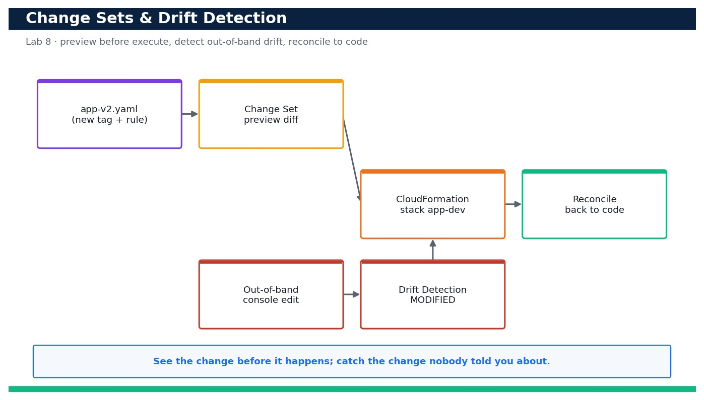

# Lab 8 — Preview Changes with Change Sets and Detect & Reconcile Drift

**Course:** DevOps Engineering on AWS (TGS-2023040474)  ·  **Day 2**  ·  **Domain 02 — Configuration Management and IaC**  ·  **LO2**  ·  Skills mapped: K3, A3



*Figure — reference architecture for Lab 8.*

## Objective
Preview a stack modification safely with a change set before executing, then detect out-of-band drift and reconcile it (LO2, K3, A3).

## Scenario
Production changes are risky when you cannot see them coming, and infrastructure silently drifts when people click in the console. In this lab you take the app stack from Lab 7, generate a change set to preview a before-you-execute diff, execute it, then deliberately make an out-of-band change directly on a resource. You run CloudFormation drift detection to catch the drift, inspect exactly what differs, and reconcile the stack back to its declared state.

## What you'll build
A repeatable workflow: create-change-set.sh renders a reviewable preview of a stack change, and drift-check.sh detects and reports out-of-band drift so you can reconcile infrastructure back to code.
**Services:** AWS CloudFormation.

## Prerequisites
- An AWS account you control (an AWS Free Tier / sandbox account is sufficient for most steps).
- AWS CLI v2 installed and configured with a least-privilege named profile: `aws configure --profile devops` (Region e.g. ap-southeast-1).
- Confirm your identity before you start: `aws sts get-caller-identity --profile devops`.
- Git and a code editor; a modern browser for the AWS Management Console.
- Copy `.env.example` to `.env` and fill in YOUR values. `.env` is git-ignored — never commit real credentials.
- Run every command from this lab folder with your `devops` profile (append `--profile devops` or set `AWS_PROFILE=devops`).
- Lab 7 completed: the app-dev single-instance stack must exist (deployed with DeployMode=single).

## Cost & safety
This lab reuses the Lab 7 app-dev stack and only adds a tag and a tightened security-group rule; there are no new billable resources beyond the existing instance. Change sets and drift detection are free.

- Use only your own AWS account and the placeholder values in `.env.example`.
- **Never commit real credentials.** Use IAM roles / the AWS CLI profile and the `.env` placeholders only.
- Run the **Clean up** section as soon as you finish to stop ongoing charges.

## Files in this lab
- `app-v2.yaml`
- `create-change-set.sh`
- `drift-check.sh`
- `.env.example`
- `lab-08-changesets-drift-detection.jpg`
- `INSTRUCTIONS.pdf`

## Step-by-step
1. Confirm the app-dev stack from Lab 7 is present and healthy before you change it.

   ```bash
   aws cloudformation describe-stacks --stack-name app-dev --query 'Stacks[0].StackStatus' --profile devops
   ```
   - **Expected output:** The status is CREATE_COMPLETE or UPDATE_COMPLETE.

2. Diff the new template against the current one locally so you understand your intended change.

   ```bash
   diff app.yaml app-v2.yaml || true
   ```
   - **Expected output:** The diff shows an added CostCenter tag and a narrowed SSH ingress rule (203.0.113.0/24 instead of 0.0.0.0/0).

3. Create a change set to PREVIEW the modification without applying it (using the helper script).

   ```bash
   bash create-change-set.sh app-dev cs-add-guardrails
   ```
   - **Expected output:** The script reports the change set cs-add-guardrails reaching CREATE_COMPLETE and prints a summary of changes.

4. Inspect exactly what the change set will do before you commit to it.

   ```bash
   aws cloudformation describe-change-set --stack-name app-dev --change-set-name cs-add-guardrails --query 'Changes[].ResourceChange.{Action:Action,Resource:LogicalResourceId,Replace:Replacement}' --profile devops
   ```
   - **Expected output:** The change list shows AppSg being Modify with Replacement=False and no resource deletions — a safe change.

5. Execute the change set now that you have reviewed it.

   ```bash
   aws cloudformation execute-change-set --stack-name app-dev --change-set-name cs-add-guardrails --profile devops
   ```
   - **Expected output:** The stack transitions to UPDATE_IN_PROGRESS then UPDATE_COMPLETE.

6. Confirm the tag and tightened rule are in effect.

   ```bash
   aws cloudformation describe-stacks --stack-name app-dev --query 'Stacks[0].Tags' --profile devops
   ```
   - **Expected output:** The Tags list now includes CostCenter=devops-training.

7. Now simulate a colleague making an out-of-band change: add an unmanaged ingress rule directly to the security group.

   ```bash
   aws ec2 authorize-security-group-ingress --group-id <app-sg-id> --protocol tcp --port 22 --cidr 0.0.0.0/0 --profile devops
   ```
   - **Expected output:** AWS confirms the SecurityGroupRules were added — the live resource no longer matches the template.

8. Kick off drift detection on the stack.

   ```bash
   bash drift-check.sh app-dev
   ```
   - **Expected output:** The script starts detection, polls until it finishes, and prints StackDriftStatus DRIFTED.

9. List which resources drifted.

   ```bash
   aws cloudformation describe-stack-resource-drifts --stack-name app-dev --stack-resource-drift-status-filters MODIFIED --query 'StackResourceDrifts[].{Resource:LogicalResourceId,Status:StackResourceDriftStatus}' --profile devops
   ```
   - **Expected output:** AppSg is reported as MODIFIED.

10. Drill into the exact property difference so you know what changed out-of-band.

   ```bash
   aws cloudformation describe-stack-resource-drifts --stack-name app-dev --query 'StackResourceDrifts[?LogicalResourceId==`AppSg`].PropertyDifferences' --profile devops
   ```
   - **Expected output:** A PropertyDifference of type ADD is shown for the SecurityGroupIngress list — the extra port-22 rule that is not in the template.

11. Reconcile the drift the correct way: remove the out-of-band rule so the resource matches code again.

   ```bash
   aws ec2 revoke-security-group-ingress --group-id <app-sg-id> --protocol tcp --port 22 --cidr 0.0.0.0/0 --profile devops
   ```
   - **Expected output:** AWS confirms the rule was revoked, restoring the security group to its declared state.

12. Re-run drift detection to prove the stack is reconciled.

   ```bash
   bash drift-check.sh app-dev
   ```
   - **Expected output:** StackDriftStatus is now IN_SYNC.

13. As an alternative reconciliation path, prove that re-applying the template also removes drift.

   ```bash
   aws cloudformation deploy --template-file app-v2.yaml --stack-name app-dev --parameter-overrides EnvName=dev InstanceSize=medium DeployMode=single --capabilities CAPABILITY_NAMED_IAM --profile devops
   ```
   - **Expected output:** CloudFormation reports either 'No changes' (already reconciled) or overwrites any remaining drift back to the template.

14. Clean up the change set you created (executed change sets remain listed until deleted).

   ```bash
   aws cloudformation delete-change-set --stack-name app-dev --change-set-name cs-add-guardrails --profile devops
   ```
   - **Expected output:** The change set is deleted; the stack itself remains at UPDATE_COMPLETE and IN_SYNC.

## Validation
The change set is visible under the stack's Change sets tab with a readable diff before execution; after executing, the stack is UPDATE_COMPLETE with the CostCenter tag. After the out-of-band rule is added, drift detection reports DRIFTED with AppSg MODIFIED and shows the exact extra ingress rule; after reconciliation, drift detection reports IN_SYNC.

## Expected outcome (Test it)
A change set previews the modification (added tag + narrowed rule) with no unexpected replacements before it is executed; an out-of-band security-group edit is caught by drift detection as MODIFIED with the precise property difference; and removing the rule (or re-applying the template) returns the stack to IN_SYNC.

## Evidence to capture
- describe-change-set output showing the previewed changes with Replacement=False (no destructive changes).
- The UPDATE_COMPLETE stack event and the new CostCenter tag on the stack.
- drift-check.sh output reporting StackDriftStatus DRIFTED with AppSg MODIFIED.
- drift-check.sh output reporting StackDriftStatus IN_SYNC after reconciliation.

## Troubleshooting
- **change-set-create-complete wait fails** — The change set may be empty (FAILED with 'No updates'); this means the template already matches the stack — change something first.
- **Drift detection returns UNKNOWN for a resource** — Not every resource type supports drift detection; check the supported-resource list and focus on the security group and instance.
- **Reconciliation via deploy reports no changes but drift persists** — Drift caused outside CloudFormation is only fixed by reverting the actual resource or forcing an update to that property — revoke the out-of-band rule directly.

## Clean up
Delete everything you created, in dependency order, to avoid ongoing charges:

```bash
aws cloudformation delete-change-set --stack-name app-dev --change-set-name cs-add-guardrails --profile devops
aws cloudformation delete-stack --stack-name app-dev --profile devops
aws cloudformation wait stack-delete-complete --stack-name app-dev --profile devops
```

Confirm nothing is left running (no active stacks, instances, dashboards or trails for this lab).

## Acceptance criteria
- Every step's **Expected output** is observed, and the **Validation** and **Test it** checks pass.
- The reference architecture is realised using the editable AWS-native source files in this folder.
- GitHub via AWS CodeConnections is used as the source path where a repository is required (CodeCommit optional).
- All **Evidence to capture** items are collected (screenshots / CLI output).
- No live credentials appear in any committed file; `.env` is not committed.
- The **Clean up** step has been run and no billable resources remain.

---
© 2026 Tertiary Infotech Academy Pte Ltd. UEN: 201200696W. For training use only.
