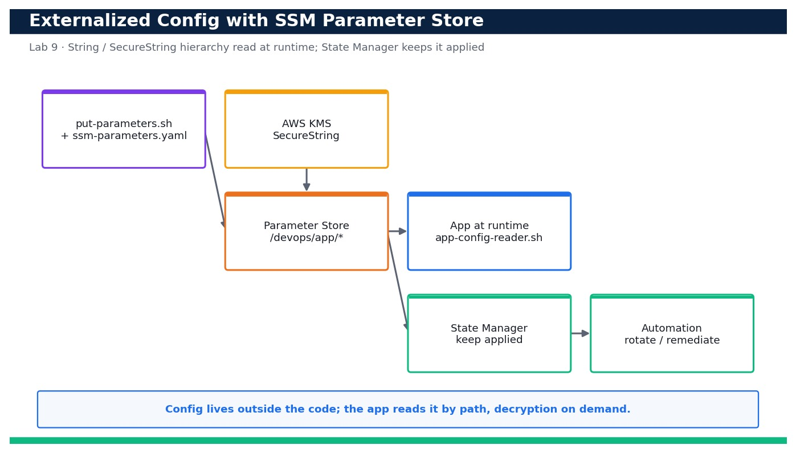

# Lab 9 — Externalize Configuration with SSM Parameter Store

**Course:** DevOps Engineering on AWS (TGS-2023040474)  ·  **Day 2**  ·  **Domain 02 — Configuration Management and IaC**  ·  **LO2**  ·  Skills mapped: K3, A3



*Figure — reference architecture for Lab 9.*

## Objective
Externalize application configuration into SSM Parameter Store (String and SecureString), read it at runtime, and compare Parameter Store with Secrets Manager (LO2, K3, A3).

## Scenario
Hard-coding configuration and credentials into code and templates is a recipe for leaks and rebuilds. In this lab you externalize your application's configuration into AWS Systems Manager Parameter Store — plain String and String List values for non-sensitive settings and a KMS-encrypted SecureString for a sensitive value. You create a hierarchy of parameters (deployed both by CLI and by CloudFormation), have an app read them at runtime, learn where State Manager and Automation fit for keeping configuration applied, and compare Parameter Store with Secrets Manager to choose the right tool.

## What you'll build
A /devops/app/* parameter hierarchy in SSM (String, StringList and KMS-encrypted SecureString) plus an app-config-reader.sh that pulls the whole configuration at runtime with decryption.
**Services:** AWS Systems Manager (Parameter Store, State Manager, Automation), AWS KMS, AWS CloudFormation.

## Prerequisites
- An AWS account you control (an AWS Free Tier / sandbox account is sufficient for most steps).
- AWS CLI v2 installed and configured with a least-privilege named profile: `aws configure --profile devops` (Region e.g. ap-southeast-1).
- Confirm your identity before you start: `aws sts get-caller-identity --profile devops`.
- Git and a code editor; a modern browser for the AWS Management Console.
- Copy `.env.example` to `.env` and fill in YOUR values. `.env` is git-ignored — never commit real credentials.
- Run every command from this lab folder with your `devops` profile (append `--profile devops` or set `AWS_PROFILE=devops`).
- Permission to use the AWS-managed KMS key alias/aws/ssm for SecureString encryption/decryption.

## Cost & safety
Standard-tier Parameter Store parameters and the AWS-managed KMS key are free; you are billed only for API calls at negligible volumes. Advanced-tier parameters and higher throughput would cost more but are not used here. Delete the parameters when finished.

- Use only your own AWS account and the placeholder values in `.env.example`.
- **Never commit real credentials.** Use IAM roles / the AWS CLI profile and the `.env` placeholders only.
- Run the **Clean up** section as soon as you finish to stop ongoing charges.

## Files in this lab
- `put-parameters.sh`
- `ssm-parameters.yaml`
- `app-config-reader.sh`
- `.env.example`
- `lab-09-ssm-parameter-store-config.jpg`
- `INSTRUCTIONS.pdf`

## Step-by-step
1. Confirm your identity and the Region where the parameters will live.

   ```bash
   aws sts get-caller-identity --profile devops
   ```
   - **Expected output:** Your Account and Arn are printed.

2. Create the non-sensitive configuration values (String and StringList) using the put-parameters helper.

   ```bash
   bash put-parameters.sh
   ```
   - **Expected output:** The script reports each parameter created: /devops/app/log-level, /devops/app/feature-flags and /devops/app/db/endpoint.

3. Create the sensitive value as a KMS-encrypted SecureString (the AWS-managed alias/aws/ssm key).

   ```bash
   aws ssm put-parameter --name /devops/app/db/password --type SecureString --value '<placeholder-set-your-own>' --key-id alias/aws/ssm --overwrite --profile devops
   ```
   - **Expected output:** A Version number is returned; the value is stored encrypted at rest.

4. List the whole parameter hierarchy by path to confirm the tree.

   ```bash
   aws ssm get-parameters-by-path --path /devops/app --recursive --query 'Parameters[].{Name:Name,Type:Type}' --profile devops
   ```
   - **Expected output:** The four parameters are listed with types String, StringList and SecureString under /devops/app.

5. Read a non-sensitive parameter the way an app would.

   ```bash
   aws ssm get-parameter --name /devops/app/log-level --query 'Parameter.Value' --profile devops
   ```
   - **Expected output:** The command prints "INFO".

6. Show that a SecureString is NOT decrypted by default (safe-by-default behaviour).

   ```bash
   aws ssm get-parameter --name /devops/app/db/password --query 'Parameter.Value' --profile devops
   ```
   - **Expected output:** An encrypted, base64-looking ciphertext is returned — not the plaintext.

7. Now read it WITH decryption, as the app's IAM role would (requires ssm:GetParameter + kms:Decrypt).

   ```bash
   aws ssm get-parameter --name /devops/app/db/password --with-decryption --query 'Parameter.Value' --profile devops
   ```
   - **Expected output:** The plaintext value is returned only because --with-decryption was supplied and you have kms:Decrypt.

8. Run the app config reader to pull the entire configuration at runtime in one place.

   ```bash
   bash app-config-reader.sh
   ```
   - **Expected output:** The script prints LOG_LEVEL=INFO, FEATURE_FLAGS=beta,newui and a masked DB_PASSWORD, proving runtime config loading.

9. Deploy an additional parameter via CloudFormation so config is also version-controlled as IaC.

   ```bash
   aws cloudformation deploy --template-file ssm-parameters.yaml --stack-name app-config --parameter-overrides EnvName=dev --profile devops
   ```
   - **Expected output:** Stack app-config reaches CREATE_COMPLETE and creates /devops/app/dev/max-connections.

10. Confirm the CloudFormation-managed parameter exists.

   ```bash
   aws ssm get-parameter --name /devops/app/dev/max-connections --query 'Parameter.Value' --profile devops
   ```
   - **Expected output:** The command prints "100".

11. Update a parameter value and observe the version increment (parameters keep a history).

   ```bash
   aws ssm put-parameter --name /devops/app/log-level --type String --value DEBUG --overwrite --profile devops
   ```
   - **Expected output:** Version 2 is returned; the value is now DEBUG.

12. View the parameter's version history to prove auditable configuration change.

   ```bash
   aws ssm get-parameter-history --name /devops/app/log-level --query 'Parameters[].{Version:Version,Value:Value}' --profile devops
   ```
   - **Expected output:** Two entries are listed: Version 1 = INFO and Version 2 = DEBUG.

13. Concept check — list State Manager associations so you understand how SSM keeps configuration continuously applied to targets.

   ```bash
   aws ssm list-associations --query 'Associations[].{Name:Name,Targets:Targets}' --profile devops
   ```
   - **Expected output:** Existing associations (if any) are listed; you note that State Manager enforces desired config on a schedule and Automation runbooks remediate/rotate.

14. Compare with Secrets Manager: confirm the API is available and note the trade-off (built-in rotation vs cost).

   ```bash
   aws secretsmanager list-secrets --query 'SecretList[].Name' --profile devops
   ```
   - **Expected output:** The (possibly empty) secret list returns successfully — you record that Secrets Manager adds managed rotation and cross-service integration at a per-secret cost, whereas SecureString is cheaper for simple encrypted config.

## Validation
get-parameters-by-path shows the /devops/app hierarchy with String, StringList and SecureString types; the SecureString returns ciphertext without --with-decryption and plaintext with it; app-config-reader.sh loads the full configuration at runtime; the CloudFormation-managed parameter exists; and get-parameter-history proves versioned, auditable changes.

## Expected outcome (Test it)
An application reads all of its configuration from the /devops/app/* Parameter Store hierarchy at runtime — plain values in the clear and the sensitive value only after KMS decryption — with no config baked into code. You can state when to use Parameter Store SecureString versus Secrets Manager, and where State Manager and Automation keep that configuration continuously applied.

## Evidence to capture
- get-parameters-by-path output showing the /devops/app hierarchy with String, StringList and SecureString types.
- Side-by-side output of the SecureString returning ciphertext without --with-decryption and plaintext with it.
- app-config-reader.sh output showing config loaded at runtime with the password masked.
- get-parameter-history output showing Version 1 (INFO) and Version 2 (DEBUG) for log-level.

## Troubleshooting
- **AccessDenied when reading a SecureString** — The identity needs both ssm:GetParameter and kms:Decrypt on the key; add kms:Decrypt on alias/aws/ssm to the role.
- **ParameterAlreadyExists on put** — Add --overwrite to update an existing parameter (this also creates a new version).
- **CloudFormation fails: parameter name already exists** — A CLI-created parameter clashes with the template Name; delete the CLI one or change the EnvName so the paths differ.

## Clean up
Delete everything you created, in dependency order, to avoid ongoing charges:

```bash
aws cloudformation delete-stack --stack-name app-config --profile devops
aws ssm delete-parameters --names /devops/app/log-level /devops/app/feature-flags /devops/app/db/endpoint /devops/app/db/password --profile devops
```

Confirm nothing is left running (no active stacks, instances, dashboards or trails for this lab).

## Acceptance criteria
- Every step's **Expected output** is observed, and the **Validation** and **Test it** checks pass.
- The reference architecture is realised using the editable AWS-native source files in this folder.
- GitHub via AWS CodeConnections is used as the source path where a repository is required (CodeCommit optional).
- All **Evidence to capture** items are collected (screenshots / CLI output).
- No live credentials appear in any committed file; `.env` is not committed.
- The **Clean up** step has been run and no billable resources remain.

---
© 2026 Tertiary Infotech Academy Pte Ltd. UEN: 201200696W. For training use only.
