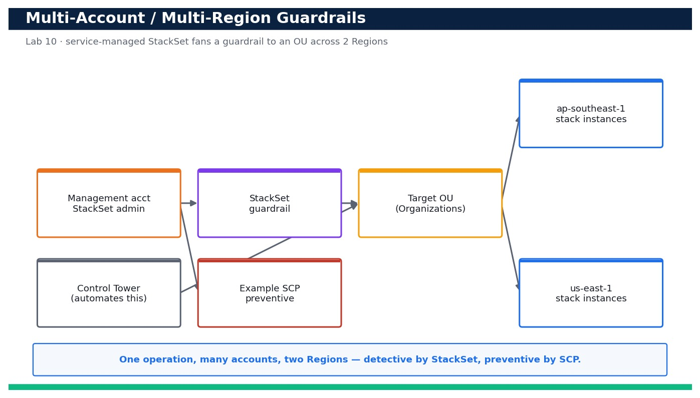

# Lab 10 — Multi-Account, Multi-Region Guardrails with CloudFormation StackSets

**Course:** DevOps Engineering on AWS (TGS-2023040474)  ·  **Day 2**  ·  **Domain 02 — Configuration Management and IaC**  ·  **LO2**  ·  Skills mapped: K3, A3



*Figure — reference architecture for Lab 10.*

## Objective
Design and deploy a multi-account, multi-Region guardrail using CloudFormation StackSets with AWS Organizations service-managed permissions, and express a preventive guardrail as an SCP (LO2, K3, A3).

## Scenario
Scaling infrastructure to many accounts by hand does not work. In this lab you build a governance blueprint: using CloudFormation StackSets with AWS Organizations service-managed permissions, you deploy a detective guardrail stack (an AWS Config managed rule and an SNS notification topic) to every account in an Organizational Unit across two Regions from a single operation. You then express a matching preventive guardrail as a Service Control Policy, and note where AWS Control Tower automates this whole pattern. Where you lack a real Organization, the same commands and templates form a ready-to-run blueprint.

## What you'll build
A StackSet (service-managed) that fans a guardrail stack out to an OU across two Regions in one operation, plus an example SCP that enforces the same guardrail preventively.
**Services:** AWS CloudFormation StackSets, AWS Organizations, AWS Control Tower (concept).

## Prerequisites
- An AWS account you control (an AWS Free Tier / sandbox account is sufficient for most steps).
- AWS CLI v2 installed and configured with a least-privilege named profile: `aws configure --profile devops` (Region e.g. ap-southeast-1).
- Confirm your identity before you start: `aws sts get-caller-identity --profile devops`.
- Git and a code editor; a modern browser for the AWS Management Console.
- Copy `.env.example` to `.env` and fill in YOUR values. `.env` is git-ignored — never commit real credentials.
- Run every command from this lab folder with your `devops` profile (append `--profile devops` or set `AWS_PROFILE=devops`).
- An AWS Organization with all features enabled and access to the management or delegated-admin account (or treat this lab as a blueprint if you only have a single account).
- SERVICE_CONTROL_POLICY policy type enabled on the Organization root.

## Cost & safety
The guardrail stack deploys an AWS Config managed rule and an SNS topic per account per Region; Config rule evaluations and SNS are low-cost but multiply by the number of target accounts and Regions. Deploy to a small OU (or a single sandbox account) and delete the stack instances promptly to control spend.

- Use only your own AWS account and the placeholder values in `.env.example`.
- **Never commit real credentials.** Use IAM roles / the AWS CLI profile and the `.env` placeholders only.
- Run the **Clean up** section as soon as you finish to stop ongoing charges.

## Files in this lab
- `stackset-template.yaml`
- `deploy-stackset.sh`
- `example-scp.json`
- `.env.example`
- `lab-10-multiaccount-region-stacksets.jpg`
- `INSTRUCTIONS.pdf`

## Step-by-step
1. Confirm you are operating from the Organizations management (or delegated administrator) account.

   ```bash
   aws organizations describe-organization --query 'Organization.{Id:Id,Feature:FeatureSet}' --profile devops
   ```
   - **Expected output:** The organization Id and FeatureSet ALL are returned (ALL is required for service-managed StackSets and SCPs).

2. Enable trusted access so CloudFormation StackSets can deploy across the Organization.

   ```bash
   aws cloudformation activate-organizations-access --profile devops
   ```
   - **Expected output:** The call succeeds with no error; StackSets can now use service-managed permissions.

3. Identify the target Organizational Unit you will deploy the guardrail to.

   ```bash
   aws organizations list-organizational-units-for-parent --parent-id <root-id> --query 'OrganizationalUnits[].{Name:Name,Id:Id}' --profile devops
   ```
   - **Expected output:** Your OUs are listed; note the OU Id (ou-xxxx-xxxxxxxx) of the workloads OU.

4. Validate the guardrail template before creating the StackSet.

   ```bash
   aws cloudformation validate-template --template-body file://stackset-template.yaml --profile devops
   ```
   - **Expected output:** The Description and Parameters are returned with no error.

5. Create the StackSet with service-managed permissions and auto-deployment enabled.

   ```bash
   aws cloudformation create-stack-set --stack-set-name org-guardrails --template-body file://stackset-template.yaml --permission-model SERVICE_MANAGED --auto-deployment Enabled=true,RetainStacksOnAccountRemoval=false --capabilities CAPABILITY_NAMED_IAM --profile devops
   ```
   - **Expected output:** A StackSetId is returned, confirming the StackSet was created under service-managed permissions.

6. Deploy stack instances to the target OU across BOTH Regions in a single operation (the deploy-stackset script wraps this).

   ```bash
   bash deploy-stackset.sh org-guardrails <ou-id> ap-southeast-1 us-east-1
   ```
   - **Expected output:** An OperationId is returned and the script reports instances being created for the OU in both Regions.

7. Track the deployment operation until it succeeds.

   ```bash
   aws cloudformation describe-stack-set-operation --stack-set-name org-guardrails --operation-id <operation-id> --query 'StackSetOperation.Status' --profile devops
   ```
   - **Expected output:** The Status progresses to SUCCEEDED.

8. List the stack instances to confirm the guardrail landed in each target account and Region.

   ```bash
   aws cloudformation list-stack-instances --stack-set-name org-guardrails --query 'Summaries[].{Account:Account,Region:Region,Status:Status}' --profile devops
   ```
   - **Expected output:** One row per account-and-Region pair is listed with Status CURRENT — proving fan-out to the OU across two Regions.

9. Confirm the detective guardrail (Config rule) is actually present in a target account/Region.

   ```bash
   aws configservice describe-config-rules --config-rule-names s3-bucket-public-read-prohibited --profile devops
   ```
   - **Expected output:** The managed Config rule s3-bucket-public-read-prohibited is returned in ACTIVE state (view from within a target account).

10. Now express the SAME guardrail preventively as a Service Control Policy — review the example SCP first.

   ```bash
   cat example-scp.json
   ```
   - **Expected output:** The SCP denies removing the S3 public-access block and denies public-ACL puts, complementing the detective Config rule.

11. Create the SCP in the Organization (SCPs must be enabled as a policy type first).

   ```bash
   aws organizations create-policy --name deny-public-s3 --type SERVICE_CONTROL_POLICY --description 'Preventive S3 public-access guardrail' --content file://example-scp.json --profile devops
   ```
   - **Expected output:** A PolicyId (p-xxxxxxxx) is returned for the new SCP.

12. Attach the SCP to the same target OU so prevention and detection cover the same scope.

   ```bash
   aws organizations attach-policy --policy-id <policy-id> --target-id <ou-id> --profile devops
   ```
   - **Expected output:** The attach call succeeds; the SCP now constrains every account in the OU.

13. Verify the SCP is attached to the OU.

   ```bash
   aws organizations list-policies-for-target --target-id <ou-id> --filter SERVICE_CONTROL_POLICY --query 'Policies[].Name' --profile devops
   ```
   - **Expected output:** deny-public-s3 (plus FullAWSAccess) is listed for the OU.

14. Prove the blueprint scales to new accounts automatically: describe the StackSet's auto-deployment setting.

   ```bash
   aws cloudformation describe-stack-set --stack-set-name org-guardrails --query 'StackSet.AutoDeployment' --profile devops
   ```
   - **Expected output:** AutoDeployment shows Enabled=true — any account later added to the OU receives the guardrail automatically (the pattern AWS Control Tower automates end-to-end).

## Validation
list-stack-instances shows the guardrail stack CURRENT in every target account across ap-southeast-1 and us-east-1 from a single operation; the AWS Config managed rule is ACTIVE in a target account; the example SCP is created and attached to the OU (visible via list-policies-for-target); and the StackSet's AutoDeployment is Enabled so new accounts inherit the guardrail.

## Expected outcome (Test it)
From the management account you deploy one guardrail stack to an entire OU across two Regions in a single StackSet operation (detective control), attach a matching SCP to the same OU (preventive control), and confirm auto-deployment will extend the guardrail to any newly added account — the multi-account, multi-Region pattern AWS Control Tower operationalizes.

## Evidence to capture
- list-stack-instances output showing the guardrail CURRENT in each account across both Regions.
- describe-stack-set-operation output showing the fan-out operation SUCCEEDED.
- list-policies-for-target output showing deny-public-s3 attached to the target OU.
- describe-stack-set output showing AutoDeployment Enabled=true.

## Troubleshooting
- **create-stack-set fails: 'accounts access not enabled'** — Run aws cloudformation activate-organizations-access from the management account, then retry.
- **create-policy fails: policy type not enabled** — Enable the SERVICE_CONTROL_POLICY type in Organizations (enable-policy-type on the root) before creating SCPs.
- **Stack instance shows OUTDATED or FAILED** — Re-run the operation; check the target account has a Config recorder and no conflicting resource names, then update-stack-instances.

## Clean up
Delete everything you created, in dependency order, to avoid ongoing charges:

```bash
aws organizations detach-policy --policy-id <policy-id> --target-id <ou-id> --profile devops
aws organizations delete-policy --policy-id <policy-id> --profile devops
aws cloudformation delete-stack-instances --stack-set-name org-guardrails --deployment-targets OrganizationalUnitIds=<ou-id> --regions ap-southeast-1 us-east-1 --no-retain-stacks --profile devops
aws cloudformation delete-stack-set --stack-set-name org-guardrails --profile devops
```

Confirm nothing is left running (no active stacks, instances, dashboards or trails for this lab).

## Acceptance criteria
- Every step's **Expected output** is observed, and the **Validation** and **Test it** checks pass.
- The reference architecture is realised using the editable AWS-native source files in this folder.
- GitHub via AWS CodeConnections is used as the source path where a repository is required (CodeCommit optional).
- All **Evidence to capture** items are collected (screenshots / CLI output).
- No live credentials appear in any committed file; `.env` is not committed.
- The **Clean up** step has been run and no billable resources remain.

---
© 2026 Tertiary Infotech Academy Pte Ltd. UEN: 201200696W. For training use only.
