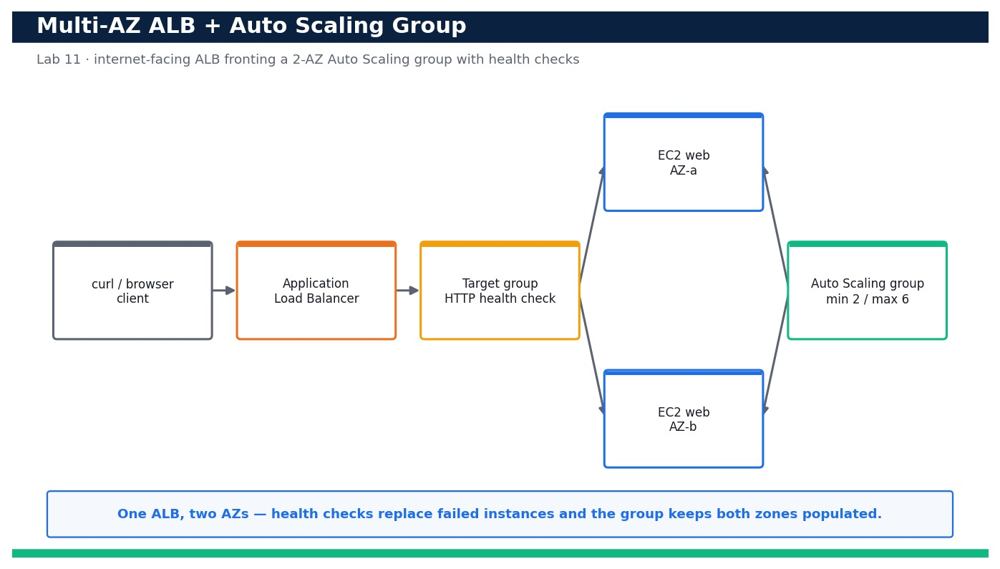

# Lab 11 — Deploy a Multi-AZ Application Load Balancer with an Auto Scaling Group

**Course:** DevOps Engineering on AWS (TGS-2023040474)  ·  **Day 3**  ·  **Domain 03 — Resilient Cloud Solutions**  ·  **LO3**  ·  Skills mapped: K2, K4, A2



*Figure — reference architecture for Lab 11.*

## Objective
Deploy a highly available multi-AZ Application Load Balancer fronting an Auto Scaling group and prove requests are served from both Availability Zones (LO3, K2, K4, A2).

## Scenario
A single instance in a single Availability Zone is a single point of failure. In this lab you codify a highly available web tier as one CloudFormation template: an internet-facing Application Load Balancer spanning two AZs, a launch template describing identical instances, an Auto Scaling group that keeps a minimum of two instances balanced across both AZs, and ELB health checks that replace anything unhealthy. You then curl the load balancer repeatedly and confirm responses come back from instances in both AZs.

## What you'll build
A running multi-AZ stack — an ALB, a target group with health checks, a launch template and an Auto Scaling group (min 2 / max 6) spread across two AZs — whose DNS name serves traffic from instances in both AZs.
**Services:** Amazon EC2, Elastic Load Balancing (ELBv2 / ALB), AWS Auto Scaling, AWS CloudFormation.

## Prerequisites
- An AWS account you control (an AWS Free Tier / sandbox account is sufficient for most steps).
- AWS CLI v2 installed and configured with a least-privilege named profile: `aws configure --profile devops` (Region e.g. ap-southeast-1).
- Confirm your identity before you start: `aws sts get-caller-identity --profile devops`.
- Git and a code editor; a modern browser for the AWS Management Console.
- Copy `.env.example` to `.env` and fill in YOUR values. `.env` is git-ignored — never commit real credentials.
- Run every command from this lab folder with your `devops` profile (append `--profile devops` or set `AWS_PROFILE=devops`).
- A VPC with at least two public subnets in two different Availability Zones (the account default VPC is fine).
- This stack (ALB DNS name and the devops-ha-asg Auto Scaling group) is REUSED by Lab 12 and Lab 15 — keep it running between labs.

## Cost & safety
Two t3.micro instances plus one Application Load Balancer run for the duration of the lab; the ALB is billed per hour plus a small LCU charge and the instances per second. Keeping DesiredCapacity at 2 and deleting the stack the same day keeps this to roughly US$1–2. Delete the stack when finished.

- Use only your own AWS account and the placeholder values in `.env.example`.
- **Never commit real credentials.** Use IAM roles / the AWS CLI profile and the `.env` placeholders only.
- Run the **Clean up** section as soon as you finish to stop ongoing charges.

## Files in this lab
- `ha-asg.yaml`
- `user-data.sh`
- `smoke-test.sh`
- `.env.example`
- `lab-11-multiaz-alb-autoscaling.jpg`
- `INSTRUCTIONS.pdf`

## Step-by-step
1. Change into the lab folder and confirm your identity and Region before you touch anything.

   ```bash
   aws sts get-caller-identity --profile devops
   ```
   - **Expected output:** Your own Account, UserId and Arn are printed, confirming you are operating in the right account and Region.

2. List the default VPC subnets and pick two in two different Availability Zones for the ALB and Auto Scaling group.

   ```bash
   aws ec2 describe-subnets --filters Name=default-for-az,Values=true --query 'Subnets[].{Az:AvailabilityZone,Id:SubnetId}' --profile devops
   ```
   - **Expected output:** At least two subnets are listed, each in a distinct AZ (e.g. ap-southeast-1a and ap-southeast-1b).

3. Validate the high-availability template before deploying so you catch errors locally.

   ```bash
   aws cloudformation validate-template --template-body file://ha-asg.yaml --profile devops
   ```
   - **Expected output:** The command returns the template Description and its Parameters (VpcId, SubnetAId, SubnetBId) with no error.

4. Deploy the stack, passing the VPC and the two AZ subnet IDs you selected.

   ```bash
   aws cloudformation deploy --template-file ha-asg.yaml --stack-name ha-web --parameter-overrides VpcId=<vpc-id> SubnetAId=<subnet-a> SubnetBId=<subnet-b> --capabilities CAPABILITY_IAM --profile devops
   ```
   - **Expected output:** CloudFormation reports the stack ha-web reaching CREATE_COMPLETE.

5. Read the stack Outputs and capture the load balancer DNS name and the Auto Scaling group name.

   ```bash
   aws cloudformation describe-stacks --stack-name ha-web --query 'Stacks[0].Outputs' --profile devops
   ```
   - **Expected output:** Outputs AlbDnsName (an *.elb.amazonaws.com name) and AsgName (devops-ha-asg) are returned.

6. Confirm the Auto Scaling group is configured for both AZs and a minimum of two instances.

   ```bash
   aws autoscaling describe-auto-scaling-groups --auto-scaling-group-names devops-ha-asg --query 'AutoScalingGroups[0].{Min:MinSize,Desired:DesiredCapacity,Max:MaxSize,AZs:AvailabilityZones}' --profile devops
   ```
   - **Expected output:** Min=2, Desired=2, Max=6 and AvailabilityZones lists the two AZs you chose.

7. Confirm the launch template exists and defines the instance type and AMI.

   ```bash
   aws ec2 describe-launch-templates --query "LaunchTemplates[?LaunchTemplateName=='devops-ha-lt'].LaunchTemplateId" --profile devops
   ```
   - **Expected output:** A launch template ID (lt-...) is returned for devops-ha-lt.

8. Wait until both instances are InService and healthy behind the target group.

   ```bash
   aws autoscaling describe-auto-scaling-groups --auto-scaling-group-names devops-ha-asg --query 'AutoScalingGroups[0].Instances[].{Id:InstanceId,Az:AvailabilityZone,State:LifecycleState,Health:HealthStatus}' --profile devops
   ```
   - **Expected output:** Two instances are listed, one per AZ, each with LifecycleState=InService and HealthStatus=Healthy.

9. Check the target group health directly from the load balancer's point of view.

   ```bash
   aws elbv2 describe-target-health --target-group-arn <target-group-arn> --query 'TargetHealthDescriptions[].{Id:Target.Id,State:TargetHealth.State}' --profile devops
   ```
   - **Expected output:** Both registered targets report TargetHealth.State=healthy.

10. Curl the load balancer once and confirm it returns HTTP 200 from a web instance.

   ```bash
   curl -fsS http://<alb-dns-name>/
   ```
   - **Expected output:** The response body is 'OK from ip-10-...' (the private hostname of whichever instance served the request).

11. Hit the load balancer 20 times in a row and count how many distinct instances answered — the proof of load balancing.

   ```bash
   for i in $(seq 20); do curl -s http://<alb-dns-name>/; echo; done | sort | uniq -c
   ```
   - **Expected output:** The output shows two distinct 'OK from ip-...' lines with counts that add up to 20, proving requests hit instances in BOTH AZs.

12. Confirm the health-check settings on the target group so you understand what marks an instance unhealthy.

   ```bash
   aws elbv2 describe-target-groups --names devops-ha-tg --query 'TargetGroups[0].{Path:HealthCheckPath,Interval:HealthCheckIntervalSeconds,Healthy:HealthyThresholdCount,Unhealthy:UnhealthyThresholdCount}' --profile devops
   ```
   - **Expected output:** The target group shows HealthCheckPath=/ , a 15s interval and healthy/unhealthy thresholds (2 and 3).

13. Confirm the Auto Scaling group uses the ELB health-check type so ALB health drives replacement, not just EC2 status.

   ```bash
   aws autoscaling describe-auto-scaling-groups --auto-scaling-group-names devops-ha-asg --query 'AutoScalingGroups[0].{HealthCheckType:HealthCheckType,Grace:HealthCheckGracePeriod}' --profile devops
   ```
   - **Expected output:** HealthCheckType=ELB and HealthCheckGracePeriod is 60, confirming failed health checks trigger replacement.

14. Manually raise DesiredCapacity to 3 and watch a third instance launch into whichever AZ is under-populated.

   ```bash
   aws autoscaling set-desired-capacity --auto-scaling-group-name devops-ha-asg --desired-capacity 3 --profile devops
   ```
   - **Expected output:** A third instance launches; describe-auto-scaling-groups shows three InService instances still balanced across the two AZs.

15. Return DesiredCapacity to 2 so the lab stays near-free ahead of the scaling exercise in Lab 12.

   ```bash
   aws autoscaling set-desired-capacity --auto-scaling-group-name devops-ha-asg --desired-capacity 2 --profile devops
   ```
   - **Expected output:** The group scales back to two InService instances, one in each AZ.

## Validation
In the EC2 console the Auto Scaling group devops-ha-asg shows two (or three) InService instances split across two AZs, the target group shows all targets healthy, and the Load Balancers view shows the ALB active in both AZs. From the CLI, curling the ALB DNS name repeatedly returns responses from more than one instance and HealthCheckType is ELB.

## Expected outcome (Test it)
Curling the ALB DNS name 20 times returns responses from two distinct instances located in two different Availability Zones, target health is healthy for both, and raising then lowering DesiredCapacity adds and removes an instance while keeping both AZs populated — proving the tier is genuinely multi-AZ and self-balancing.

## Evidence to capture
- describe-stacks output showing stack ha-web at CREATE_COMPLETE with AlbDnsName and AsgName in the Outputs.
- describe-auto-scaling-groups output showing two InService/Healthy instances, one in each AZ.
- describe-target-health output showing both targets in state=healthy.
- The `curl ... | sort | uniq -c` output showing two distinct 'OK from ip-...' responders adding up to 20.

## Troubleshooting
- **All 20 curls return the same instance** — A keep-alive connection may be re-used or one instance is unhealthy; check describe-target-health and add `-H 'Connection: close'` to curl to force new connections.
- **Targets stay 'unhealthy'** — The instance security group must allow port 80 from the ALB security group and httpd must be running; confirm the UserData installed and started httpd and HealthCheckPath is /.
- **Only one AZ shows instances** — VPCZoneIdentifier lists only one subnet, or the second subnet is in the same AZ; pass two subnet IDs from two different AvailabilityZones.

## Clean up
Delete everything you created, in dependency order, to avoid ongoing charges:

```bash
aws cloudformation delete-stack --stack-name ha-web --profile devops
aws cloudformation wait stack-delete-complete --stack-name ha-web --profile devops
```

Confirm nothing is left running (no active stacks, instances, dashboards or trails for this lab).

## Acceptance criteria
- Every step's **Expected output** is observed, and the **Validation** and **Test it** checks pass.
- The reference architecture is realised using the editable AWS-native source files in this folder.
- GitHub via AWS CodeConnections is used as the source path where a repository is required (CodeCommit optional).
- All **Evidence to capture** items are collected (screenshots / CLI output).
- No live credentials appear in any committed file; `.env` is not committed.
- The **Clean up** step has been run and no billable resources remain.

---
© 2026 Tertiary Infotech Academy Pte Ltd. UEN: 201200696W. For training use only.
