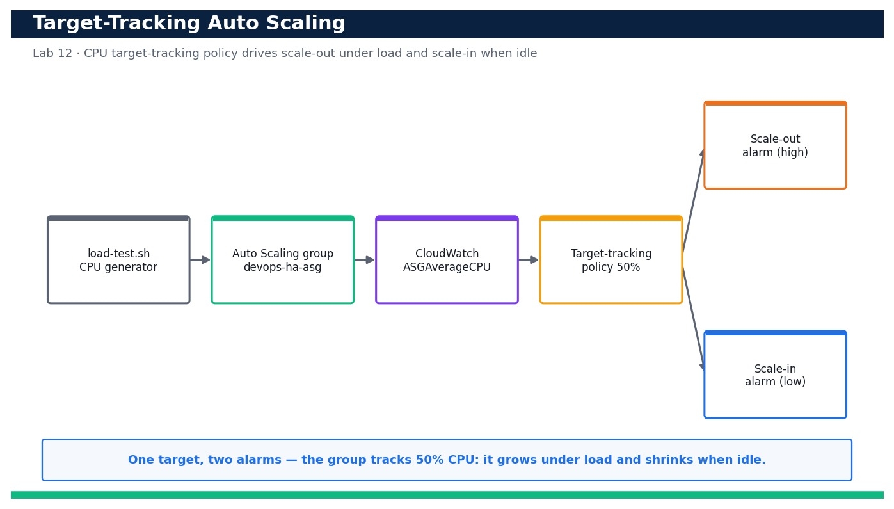

# Lab 12 — Attach Target-Tracking Auto Scaling and Validate Scale-Out Under Load

**Course:** DevOps Engineering on AWS (TGS-2023040474)  ·  **Day 3**  ·  **Domain 03 — Resilient Cloud Solutions**  ·  **LO3**  ·  Skills mapped: K2, K4, A2



*Figure — reference architecture for Lab 12.*

## Objective
Attach a target-tracking scaling policy to an Auto Scaling group and validate automatic scale-out under generated load and scale-in when the load stops (LO3, K2, K4, A2).

## Scenario
A static two-instance web tier survives an AZ failure but not a traffic spike. In this lab you attach a target-tracking scaling policy that keeps average CPU at 50% to the Auto Scaling group you built in Lab 11, generate CPU load on the instances, and watch CloudWatch alarms trip and the group scale out. When the load stops, you confirm the group scales back in to its minimum — proving the tier grows and shrinks with demand.

## What you'll build
A target-tracking scaling policy (50% average CPU) on devops-ha-asg with its two auto-created CloudWatch alarms, plus a repeatable load test that drives observable scale-out and scale-in.
**Services:** AWS Auto Scaling, Amazon CloudWatch, Amazon EC2.

## Prerequisites
- An AWS account you control (an AWS Free Tier / sandbox account is sufficient for most steps).
- AWS CLI v2 installed and configured with a least-privilege named profile: `aws configure --profile devops` (Region e.g. ap-southeast-1).
- Confirm your identity before you start: `aws sts get-caller-identity --profile devops`.
- Git and a code editor; a modern browser for the AWS Management Console.
- Copy `.env.example` to `.env` and fill in YOUR values. `.env` is git-ignored — never commit real credentials.
- Run every command from this lab folder with your `devops` profile (append `--profile devops` or set `AWS_PROFILE=devops`).
- Lab 11 completed and its devops-ha-asg Auto Scaling group + ALB still running.
- The instance role must include AmazonSSMManagedInstanceCore so Session Manager / Run Command can reach the instances.

## Cost & safety
Scaling out temporarily adds t3.micro instances (billed per second) and creates two CloudWatch alarms (a few cents/month). Keeping MaxSize modest, running the load test only briefly and letting the group scale back in keeps this well under US$1. The alarms are removed with the policy at cleanup.

- Use only your own AWS account and the placeholder values in `.env.example`.
- **Never commit real credentials.** Use IAM roles / the AWS CLI profile and the `.env` placeholders only.
- Run the **Clean up** section as soon as you finish to stop ongoing charges.

## Files in this lab
- `scaling-policy.json`
- `put-scaling-policy.sh`
- `load-test.sh`
- `.env.example`
- `lab-12-target-tracking-load-validation.jpg`
- `INSTRUCTIONS.pdf`

## Step-by-step
1. Confirm the Lab 11 Auto Scaling group is present and currently at its minimum of two instances.

   ```bash
   aws autoscaling describe-auto-scaling-groups --auto-scaling-group-names devops-ha-asg --query 'AutoScalingGroups[0].{Desired:DesiredCapacity,Min:MinSize,Max:MaxSize}' --profile devops
   ```
   - **Expected output:** The group reports Desired=2, Min=2, Max=6.

2. Review the scaling-policy.json document so you understand the target metric and value before applying it.

   ```bash
   cat scaling-policy.json
   ```
   - **Expected output:** The file defines PolicyType TargetTrackingScaling, PredefinedMetricType ASGAverageCPUUtilization and TargetValue 50.0.

3. Attach the target-tracking scaling policy with the helper script (it wraps put-scaling-policy).

   ```bash
   bash put-scaling-policy.sh
   ```
   - **Expected output:** put-scaling-policy returns a PolicyARN and Alarms — a high (scale-out) and a low (scale-in) CloudWatch alarm auto-created for the policy.

4. Confirm the policy is attached to the group.

   ```bash
   aws autoscaling describe-policies --auto-scaling-group-name devops-ha-asg --query 'ScalingPolicies[].{Name:PolicyName,Type:PolicyType,Target:TargetTrackingConfiguration.TargetValue}' --profile devops
   ```
   - **Expected output:** The policy cpu-target-tracking-50 is listed with PolicyType TargetTrackingScaling and Target 50.0.

5. List the CloudWatch alarms the policy created so you can watch them trip.

   ```bash
   aws cloudwatch describe-alarms --alarm-name-prefix TargetTracking-devops-ha-asg --query 'MetricAlarms[].{Name:AlarmName,State:StateValue,Threshold:Threshold}' --profile devops
   ```
   - **Expected output:** Two alarms are listed (an AlarmHigh and an AlarmLow), both currently in state OK or INSUFFICIENT_DATA.

6. Record the baseline average CPU across the group before generating load.

   ```bash
   aws cloudwatch get-metric-statistics --namespace AWS/EC2 --metric-name CPUUtilization --dimensions Name=AutoScalingGroupName,Value=devops-ha-asg --statistics Average --period 60 --start-time $(date -u -v-10M +%FT%TZ) --end-time $(date -u +%FT%TZ) --profile devops
   ```
   - **Expected output:** Datapoints show a low Average CPU (typically under 10%), establishing the idle baseline.

7. Connect to an instance via SSM Session Manager so you can drive CPU load from inside the group.

   ```bash
   aws ssm start-session --target <instance-id> --profile devops
   ```
   - **Expected output:** An interactive Session Manager shell opens on the instance without needing SSH or a key pair.

8. Generate sustained CPU load on the group using Run Command so every instance is stressed at once.

   ```bash
   aws ssm send-command --document-name AWS-RunShellScript --targets Key=tag:aws:autoscaling:groupName,Values=devops-ha-asg --parameters commands='for c in 1 2 3 4; do (yes > /dev/null &) ; done; sleep 600; pkill yes' --profile devops
   ```
   - **Expected output:** A CommandId is returned; the `yes` loops peg CPU on the instances for ~10 minutes to force scale-out.

9. Watch the scale-out alarm move into ALARM as average CPU crosses 50%.

   ```bash
   aws cloudwatch describe-alarms --alarm-name-prefix TargetTracking-devops-ha-asg-AlarmHigh --query 'MetricAlarms[0].StateValue' --profile devops
   ```
   - **Expected output:** Within a few minutes the AlarmHigh StateValue transitions from OK to "ALARM".

10. Confirm the Auto Scaling group increased DesiredCapacity in response.

   ```bash
   aws autoscaling describe-auto-scaling-groups --auto-scaling-group-names devops-ha-asg --query 'AutoScalingGroups[0].{Desired:DesiredCapacity,Instances:length(Instances)}' --profile devops
   ```
   - **Expected output:** DesiredCapacity has risen above 2 (e.g. 3 or 4) and additional instances are launching to bring CPU back toward 50%.

11. Review the scaling activity log to see the human-readable reason the group scaled out.

   ```bash
   aws autoscaling describe-scaling-activities --auto-scaling-group-name devops-ha-asg --max-items 5 --query 'Activities[].{Cause:Cause,Status:StatusCode}' --profile devops
   ```
   - **Expected output:** A recent activity shows a successful launch with a Cause referencing the target-tracking policy monitor alarm in ALARM.

12. Stop the load and confirm CPU falls back below the target.

   ```bash
   aws ssm send-command --document-name AWS-RunShellScript --targets Key=tag:aws:autoscaling:groupName,Values=devops-ha-asg --parameters commands='pkill yes || true' --profile devops
   ```
   - **Expected output:** A CommandId is returned; average CPU begins dropping back toward the idle baseline over the next few minutes.

13. Watch the scale-in (low) alarm trip and the group begin removing instances.

   ```bash
   aws cloudwatch describe-alarms --alarm-name-prefix TargetTracking-devops-ha-asg-AlarmLow --query 'MetricAlarms[0].StateValue' --profile devops
   ```
   - **Expected output:** The AlarmLow StateValue transitions to "ALARM", signalling the policy to reduce capacity.

14. Confirm the group scaled back in toward its minimum of two.

   ```bash
   aws autoscaling describe-auto-scaling-groups --auto-scaling-group-names devops-ha-asg --query 'AutoScalingGroups[0].DesiredCapacity' --profile devops
   ```
   - **Expected output:** DesiredCapacity returns to 2 (respecting MinSize) once CPU has stayed below the target through the cooldown.

15. Confirm the service stayed available throughout by curling the load balancer during the exercise.

   ```bash
   curl -fsS http://<alb-dns-name>/
   ```
   - **Expected output:** The ALB continues to return HTTP 200 'OK from ip-...' throughout scale-out and scale-in, proving no downtime.

## Validation
describe-policies shows cpu-target-tracking-50 attached to devops-ha-asg, describe-alarms shows the auto-created AlarmHigh and AlarmLow, and describe-scaling-activities records a scale-out caused by the policy under load and a later scale-in when the load stopped. DesiredCapacity is observed rising above 2 and returning to 2.

## Expected outcome (Test it)
Under generated CPU load the AlarmHigh trips, the group scales out above two instances, and when the load stops the AlarmLow trips and the group scales back in to its minimum — all while the ALB keeps returning HTTP 200 — proving demand-driven, zero-downtime elasticity.

## Evidence to capture
- describe-policies output showing cpu-target-tracking-50 attached with TargetValue 50.0.
- describe-alarms output showing the AlarmHigh in ALARM during the load test.
- describe-scaling-activities output whose Cause references the target-tracking policy scaling the group out.
- Two describe-auto-scaling-groups snapshots showing DesiredCapacity above 2 under load and back to 2 afterwards.

## Troubleshooting
- **The group never scales out** — The load test may not be raising average CPU across the group; confirm workers are running on the instances and give CloudWatch 3–5 minutes to aggregate the 1-minute datapoints past the 50% threshold.
- **Scale-in never happens** — Target-tracking scale-in is deliberately conservative; ensure DisableScaleIn is false and wait out the cooldown — CPU must stay below target across several evaluation periods.
- **send-command reports no targets** — The tag filter must match aws:autoscaling:groupName=devops-ha-asg and the instances need the SSM agent and an instance profile with AmazonSSMManagedInstanceCore.

## Clean up
Delete everything you created, in dependency order, to avoid ongoing charges:

```bash
aws autoscaling delete-policy --auto-scaling-group-name devops-ha-asg --policy-name cpu-target-tracking-50 --profile devops
aws autoscaling set-desired-capacity --auto-scaling-group-name devops-ha-asg --desired-capacity 2 --profile devops
```

Confirm nothing is left running (no active stacks, instances, dashboards or trails for this lab).

## Acceptance criteria
- Every step's **Expected output** is observed, and the **Validation** and **Test it** checks pass.
- The reference architecture is realised using the editable AWS-native source files in this folder.
- GitHub via AWS CodeConnections is used as the source path where a repository is required (CodeCommit optional).
- All **Evidence to capture** items are collected (screenshots / CLI output).
- No live credentials appear in any committed file; `.env` is not committed.
- The **Clean up** step has been run and no billable resources remain.

---
© 2026 Tertiary Infotech Academy Pte Ltd. UEN: 201200696W. For training use only.
