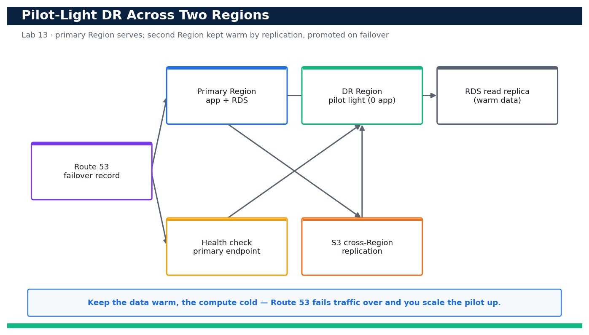

# Lab 13 — Select a DR Strategy by RTO/RPO and Implement a Pilot-Light Skeleton

**Course:** DevOps Engineering on AWS (TGS-2023040474)  ·  **Day 3**  ·  **Domain 03 — Resilient Cloud Solutions**  ·  **LO3**  ·  Skills mapped: K2, K4, A2



*Figure — reference architecture for Lab 13.*

## Objective
Compare the four AWS disaster-recovery strategies against RTO/RPO targets, select an appropriate pattern, and implement a pilot-light skeleton in a second Region (LO3, K2, K4, A2).

## Scenario
Not every workload needs active-active — and not every business can accept a day-long restore. In this lab you complete an RTO/RPO worksheet, compare the four AWS DR strategies (backup & restore, pilot light, warm standby, active-active) against those targets, and then stand up a pilot-light skeleton in a second Region: a minimal network and a scaled-to-zero application tier kept warm by cross-Region data replication, with a Route 53 health check and failover record ready to promote it.

## What you'll build
A completed DR selection worksheet plus a deployed pilot-light skeleton in a second Region (minimal VPC, a scaled-to-zero app tier and an S3 cross-Region replication path) fronted by a Route 53 failover record set.
**Services:** Amazon Route 53, Amazon RDS, AWS CloudFormation, Amazon S3 (Cross-Region Replication).

## Prerequisites
- An AWS account you control (an AWS Free Tier / sandbox account is sufficient for most steps).
- AWS CLI v2 installed and configured with a least-privilege named profile: `aws configure --profile devops` (Region e.g. ap-southeast-1).
- Confirm your identity before you start: `aws sts get-caller-identity --profile devops`.
- Git and a code editor; a modern browser for the AWS Management Console.
- Copy `.env.example` to `.env` and fill in YOUR values. `.env` is git-ignored — never commit real credentials.
- Run every command from this lab folder with your `devops` profile (append `--profile devops` or set `AWS_PROFILE=devops`).
- A Route 53 hosted zone you control (for the failover record set); a private test zone is fine.
- An IAM role (devops-s3-replication-role) that S3 can assume for cross-Region replication.
- A distinct DR Region enabled on the account (e.g. ap-southeast-2).

## Cost & safety
Pilot light is deliberately cheap: the DR Region runs only a minimal network, replicated S3 objects and a small RDS instance/replica — no running app fleet. Expect low single-digit US$ for the duration of the lab; the RDS instance and cross-Region replication are the only meaningful line items. Delete both stacks after.

- Use only your own AWS account and the placeholder values in `.env.example`.
- **Never commit real credentials.** Use IAM roles / the AWS CLI profile and the `.env` placeholders only.
- Run the **Clean up** section as soon as you finish to stop ongoing charges.

## Files in this lab
- `dr-plan.md`
- `pilot-light.yaml`
- `s3-crr.json`
- `failover-notes.md`
- `.env.example`
- `lab-13-rto-rpo-dr-selection.jpg`
- `INSTRUCTIONS.pdf`

## Step-by-step
1. Open the DR worksheet and record the workload's target RTO and RPO before choosing anything.

   ```bash
   cat dr-plan.md
   ```
   - **Expected output:** The worksheet shows the four strategies with typical RTO/RPO ranges and blank fields for your workload's targets and chosen pattern.

2. Confirm your primary Region and pick a distinct DR Region for the second copy.

   ```bash
   aws configure get region --profile devops
   ```
   - **Expected output:** Your primary Region prints (e.g. ap-southeast-1); you choose a different DR Region such as ap-southeast-2.

3. Validate the pilot-light template that will run in the DR Region.

   ```bash
   aws cloudformation validate-template --template-body file://pilot-light.yaml --profile devops
   ```
   - **Expected output:** The command returns the template Description and Parameters (EnvName, DrVpcCidr) with no error.

4. Create an S3 source bucket in the primary Region with versioning enabled (required for replication).

   ```bash
   aws s3api create-bucket --bucket devops-dr-src-<account-id> --region ap-southeast-1 --create-bucket-configuration LocationConstraint=ap-southeast-1 --profile devops && aws s3api put-bucket-versioning --bucket devops-dr-src-<account-id> --versioning-configuration Status=Enabled --profile devops
   ```
   - **Expected output:** The source bucket is created and versioning reports Status=Enabled.

5. Create the destination bucket in the DR Region, also versioned, and block public access.

   ```bash
   aws s3api create-bucket --bucket devops-dr-dst-<account-id> --region ap-southeast-2 --create-bucket-configuration LocationConstraint=ap-southeast-2 --profile devops && aws s3api put-public-access-block --bucket devops-dr-dst-<account-id> --public-access-block-configuration BlockPublicAcls=true,IgnorePublicAcls=true,BlockPublicPolicy=true,RestrictPublicBuckets=true --profile devops
   ```
   - **Expected output:** The destination bucket exists in the DR Region with Block Public Access fully enabled.

6. Apply the cross-Region replication configuration so new objects flow to the DR Region automatically.

   ```bash
   aws s3api put-bucket-replication --bucket devops-dr-src-<account-id> --replication-configuration file://s3-crr.json --profile devops
   ```
   - **Expected output:** The command returns with no error; the source bucket now has a replication rule targeting the DR bucket.

7. Prove replication works by uploading a test object and checking it appears in the DR bucket.

   ```bash
   aws s3 cp dr-plan.md s3://devops-dr-src-<account-id>/dr-plan.md --profile devops && sleep 30 && aws s3 ls s3://devops-dr-dst-<account-id>/ --profile devops
   ```
   - **Expected output:** After a short delay dr-plan.md is listed in the destination bucket, confirming cross-Region replication (RPO for object data).

8. Deploy the pilot-light skeleton stack in the DR Region (minimal VPC + a scaled-to-zero Auto Scaling group).

   ```bash
   aws cloudformation deploy --template-file pilot-light.yaml --stack-name dr-pilot --region ap-southeast-2 --parameter-overrides EnvName=dr --capabilities CAPABILITY_IAM --profile devops
   ```
   - **Expected output:** CloudFormation reports stack dr-pilot reaching CREATE_COMPLETE in the DR Region.

9. Confirm the DR app tier is present but running zero instances (pilot light = warm data, cold compute).

   ```bash
   aws autoscaling describe-auto-scaling-groups --auto-scaling-group-names dr-pilot-asg --region ap-southeast-2 --query 'AutoScalingGroups[0].{Min:MinSize,Desired:DesiredCapacity}' --profile devops
   ```
   - **Expected output:** The DR Auto Scaling group shows MinSize=0 and DesiredCapacity=0 — no compute cost while idle.

10. Create a Route 53 health check against the primary endpoint (an HTTP check on / every 30s) that will drive failover.

   ```bash
   aws route53 create-health-check --caller-reference dr-$(date +%s) --health-check-config Type=HTTP,ResourcePath=/,FullyQualifiedDomainName=<primary-alb-dns-name>,Port=80,RequestInterval=30,FailureThreshold=3 --profile devops
   ```
   - **Expected output:** A HealthCheck Id is returned; it monitors the primary endpoint over HTTP.

11. Create the primary and secondary failover record sets in your hosted zone.

   ```bash
   aws route53 change-resource-record-sets --hosted-zone-id <hosted-zone-id> --change-batch file://failover-records.json --profile devops
   ```
   - **Expected output:** A ChangeInfo with Status PENDING is returned; the zone now has a PRIMARY (health-checked) and a SECONDARY failover record.

12. Read failover-notes.md and rehearse the promotion runbook so the team knows exactly what to do on failover.

   ```bash
   cat failover-notes.md
   ```
   - **Expected output:** The runbook lists the ordered steps: promote/restore data, scale the DR Auto Scaling group up from 0, verify health, and confirm Route 53 has shifted traffic.

13. Rehearse promoting the pilot light: scale the DR Auto Scaling group up from zero to serve traffic.

   ```bash
   aws autoscaling update-auto-scaling-group --auto-scaling-group-name dr-pilot-asg --min-size 2 --desired-capacity 2 --region ap-southeast-2 --profile devops
   ```
   - **Expected output:** The DR group scales from 0 to 2 InService instances, demonstrating the pilot light can be brought to full capacity.

14. Scale the DR tier back to zero to return to the cheap pilot-light steady state after the rehearsal.

   ```bash
   aws autoscaling update-auto-scaling-group --auto-scaling-group-name dr-pilot-asg --min-size 0 --desired-capacity 0 --region ap-southeast-2 --profile devops
   ```
   - **Expected output:** The DR group returns to 0 instances, confirming the pilot light is warm-data / cold-compute again.

## Validation
The dr-plan.md worksheet records the workload RTO/RPO and a justified strategy choice; the S3 source bucket replicates objects to the DR Region; the dr-pilot stack is CREATE_COMPLETE with a scaled-to-zero Auto Scaling group; and Route 53 has a PRIMARY (health-checked) plus SECONDARY failover record. The rehearsal shows the DR group can scale from 0 to 2 and back.

## Expected outcome (Test it)
A test object uploaded to the primary bucket appears in the DR Region bucket (data is warm), and the DR Auto Scaling group can be promoted from 0 to 2 instances and returned to 0 — proving the pilot-light pattern meets the chosen RTO/RPO at minimal steady-state cost.

## Evidence to capture
- The completed dr-plan.md worksheet showing the workload RTO/RPO and the justified strategy choice.
- s3 ls of the DR-Region destination bucket showing the replicated dr-plan.md object.
- describe-stacks (DR Region) showing dr-pilot at CREATE_COMPLETE with a MinSize=0 Auto Scaling group.
- change-resource-record-sets output showing the PRIMARY and SECONDARY failover records created.

## Troubleshooting
- **put-bucket-replication fails with an IAM error** — Replication needs an IAM role that S3 can assume with s3:GetObjectVersion on the source and s3:ReplicateObject on the destination; create devops-s3-replication-role first and reference its ARN in s3-crr.json.
- **Objects don't replicate** — Both buckets must have versioning enabled and the object must be created AFTER the replication rule; pre-existing objects are not replicated unless you run S3 Batch Replication.
- **Route 53 failover never switches** — The PRIMARY record must have a health check attached and Failover=PRIMARY; the SECONDARY must be Failover=SECONDARY with the same record name and type, and the health check must actually be evaluating your endpoint.

## Clean up
Delete everything you created, in dependency order, to avoid ongoing charges:

```bash
aws route53 change-resource-record-sets --hosted-zone-id <hosted-zone-id> --change-batch file://failover-records-delete.json --profile devops
aws cloudformation delete-stack --stack-name dr-pilot --region ap-southeast-2 --profile devops
aws s3 rm s3://devops-dr-src-<account-id> --recursive --profile devops
aws s3 rm s3://devops-dr-dst-<account-id> --recursive --profile devops
aws s3api delete-bucket --bucket devops-dr-src-<account-id> --profile devops
aws s3api delete-bucket --bucket devops-dr-dst-<account-id> --region ap-southeast-2 --profile devops
```

Confirm nothing is left running (no active stacks, instances, dashboards or trails for this lab).

## Acceptance criteria
- Every step's **Expected output** is observed, and the **Validation** and **Test it** checks pass.
- The reference architecture is realised using the editable AWS-native source files in this folder.
- GitHub via AWS CodeConnections is used as the source path where a repository is required (CodeCommit optional).
- All **Evidence to capture** items are collected (screenshots / CLI output).
- No live credentials appear in any committed file; `.env` is not committed.
- The **Clean up** step has been run and no billable resources remain.

---
© 2026 Tertiary Infotech Academy Pte Ltd. UEN: 201200696W. For training use only.
