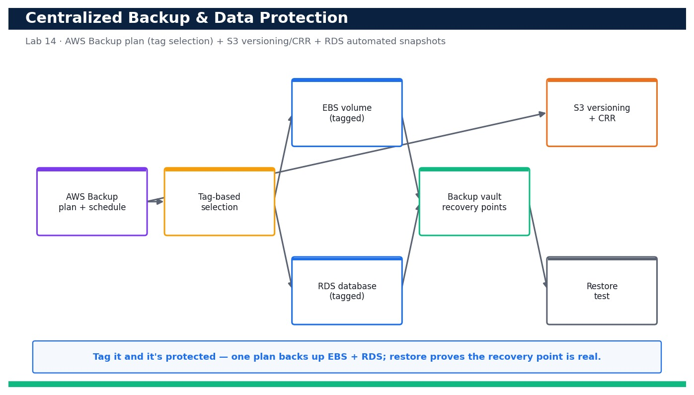

# Lab 14 — Automate Backup, Restore and Data Protection with AWS Backup

**Course:** DevOps Engineering on AWS (TGS-2023040474)  ·  **Day 3**  ·  **Domain 03 — Resilient Cloud Solutions**  ·  **LO3**  ·  Skills mapped: K2, K4, A2



*Figure — reference architecture for Lab 14.*

## Objective
Automate centralized backups with AWS Backup (plan + tag-based selection), test a restore, and add S3 versioning with cross-Region replication and RDS automated snapshots for defense in depth (LO3, K2, K4, A2).

## Scenario
Resilience is not only about staying up — it is about getting your data back. In this lab you build a centralized AWS Backup plan with a scheduled rule and a tag-based resource selection so every tagged EBS volume and RDS database is backed up automatically. You then run an on-demand backup, restore from a recovery point to prove the backup is usable, and layer in S3 versioning + cross-Region replication and RDS automated snapshots so data is protected at multiple levels.

## What you'll build
An AWS Backup plan with a tag-based selection protecting EBS and RDS, a verified restore from a recovery point, plus S3 versioning + cross-Region replication and RDS automated snapshots enabled.
**Services:** AWS Backup, Amazon RDS, Amazon S3, Amazon EBS.

## Prerequisites
- An AWS account you control (an AWS Free Tier / sandbox account is sufficient for most steps).
- AWS CLI v2 installed and configured with a least-privilege named profile: `aws configure --profile devops` (Region e.g. ap-southeast-1).
- Confirm your identity before you start: `aws sts get-caller-identity --profile devops`.
- Git and a code editor; a modern browser for the AWS Management Console.
- Copy `.env.example` to `.env` and fill in YOUR values. `.env` is git-ignored — never commit real credentials.
- Run every command from this lab folder with your `devops` profile (append `--profile devops` or set `AWS_PROFILE=devops`).
- A small test EBS volume and a small RDS instance (devops-db) to protect.
- An IAM role (devops-s3-replication-role) S3 can assume for cross-Region replication and a destination bucket in the DR Region.

## Cost & safety
Backup storage in the vault, RDS snapshot storage and S3 replication all bill on stored GB but a tiny test database/volume keeps this to a few cents. The main safety note: delete recovery points and snapshots at cleanup or they continue to accrue storage charges. Keep test data small.

- Use only your own AWS account and the placeholder values in `.env.example`.
- **Never commit real credentials.** Use IAM roles / the AWS CLI profile and the `.env` placeholders only.
- Run the **Clean up** section as soon as you finish to stop ongoing charges.

## Files in this lab
- `backup-plan.yaml`
- `restore.sh`
- `restore-metadata.json`
- `s3-replication.json`
- `.env.example`
- `lab-14-backup-restore-data-protection.jpg`
- `INSTRUCTIONS.pdf`

## Step-by-step
1. Tag the EBS volume and RDS instance you want protected so the plan's selection can find them.

   ```bash
   aws ec2 create-tags --resources <volume-id> --tags Key=backup,Value=daily --profile devops && aws rds add-tags-to-resource --resource-name <rds-arn> --tags Key=backup,Value=daily --profile devops
   ```
   - **Expected output:** Both resources now carry the tag backup=daily; no error is returned.

2. Create a dedicated backup vault to hold the recovery points.

   ```bash
   aws backup create-backup-vault --backup-vault-name devops-vault --profile devops
   ```
   - **Expected output:** The vault devops-vault is created and its BackupVaultArn is returned.

3. Review the backup-plan.yaml so you understand the schedule, lifecycle and tag selection before deploying.

   ```bash
   cat backup-plan.yaml
   ```
   - **Expected output:** The template defines a plan with a daily rule (35-day retention), a tag-based selection on backup=daily and the AWS Backup service role.

4. Deploy the backup plan and its tag-based selection with CloudFormation.

   ```bash
   aws cloudformation deploy --template-file backup-plan.yaml --stack-name devops-backup --capabilities CAPABILITY_NAMED_IAM --profile devops
   ```
   - **Expected output:** Stack devops-backup reaches CREATE_COMPLETE and outputs the BackupPlanId, SelectionId and BackupRoleArn.

5. Confirm the plan and its rule are in place.

   ```bash
   aws backup get-backup-plan --backup-plan-id <backup-plan-id> --query 'BackupPlan.{Name:BackupPlanName,Rules:Rules[].{Rule:RuleName,Schedule:ScheduleExpression}}' --profile devops
   ```
   - **Expected output:** The plan devops-daily-plan is returned with a rule whose ScheduleExpression is a daily cron.

6. Confirm the tag-based resource selection is attached to the plan.

   ```bash
   aws backup list-backup-selections --backup-plan-id <backup-plan-id> --query 'BackupSelectionsList[].SelectionName' --profile devops
   ```
   - **Expected output:** The selection tag-backup-daily is listed under the plan.

7. Start an on-demand backup of the EBS volume so you have a recovery point without waiting for the schedule.

   ```bash
   aws backup start-backup-job --backup-vault-name devops-vault --resource-arn <volume-arn> --iam-role-arn <backup-role-arn> --profile devops
   ```
   - **Expected output:** A BackupJobId is returned; describe-backup-job will show it moving from RUNNING to COMPLETED.

8. Wait for the backup job to complete and note the recovery point.

   ```bash
   aws backup list-recovery-points-by-backup-vault --backup-vault-name devops-vault --query 'RecoveryPoints[].{Arn:RecoveryPointArn,Status:Status}' --profile devops
   ```
   - **Expected output:** At least one recovery point is listed with Status=COMPLETED.

9. Restore the recovery point to prove the backup is actually usable (the real test of a backup).

   ```bash
   aws backup start-restore-job --recovery-point-arn <recovery-point-arn> --iam-role-arn <backup-role-arn> --metadata file://restore-metadata.json --profile devops
   ```
   - **Expected output:** A RestoreJobId is returned; list-restore-jobs shows it reaching COMPLETED and creating a new volume.

10. Verify the restore produced a usable resource (a new EBS volume in the correct AZ).

   ```bash
   aws backup describe-restore-job --restore-job-id <restore-job-id> --query '{Status:Status,Created:CreatedResourceArn}' --profile devops
   ```
   - **Expected output:** Status=COMPLETED and CreatedResourceArn points at a new EBS volume, proving the recovery point restores cleanly.

11. Enable versioning on the application S3 bucket so overwritten/deleted objects remain recoverable.

   ```bash
   aws s3api put-bucket-versioning --bucket devops-app-data-<account-id> --versioning-configuration Status=Enabled --profile devops
   ```
   - **Expected output:** Versioning reports Status=Enabled; overwriting an object now keeps prior versions.

12. Add cross-Region replication to the versioned bucket for off-Region data protection.

   ```bash
   aws s3api put-bucket-replication --bucket devops-app-data-<account-id> --replication-configuration file://s3-replication.json --profile devops
   ```
   - **Expected output:** The command returns with no error; new objects now replicate to the destination bucket in the DR Region.

13. Confirm RDS automated backups (snapshots) are enabled with a sensible retention window.

   ```bash
   aws rds modify-db-instance --db-instance-identifier devops-db --backup-retention-period 7 --apply-immediately --profile devops
   ```
   - **Expected output:** The instance shows BackupRetentionPeriod=7, so RDS takes daily automated snapshots kept for 7 days.

14. Verify RDS automated snapshots exist for the database.

   ```bash
   aws rds describe-db-snapshots --db-instance-identifier devops-db --snapshot-type automated --query 'DBSnapshots[].{Id:DBSnapshotIdentifier,Status:Status}' --profile devops
   ```
   - **Expected output:** One or more automated snapshots are listed with Status=available.

15. Confirm object-level protection end to end: overwrite an S3 object and list its versions.

   ```bash
   aws s3 cp restore.sh s3://devops-app-data-<account-id>/restore.sh --profile devops && aws s3api list-object-versions --bucket devops-app-data-<account-id> --prefix restore.sh --query 'Versions[].{Id:VersionId,Latest:IsLatest}' --profile devops
   ```
   - **Expected output:** Two or more versions of restore.sh are listed, confirming versioning retains the previous copy for recovery.

## Validation
AWS Backup shows the devops-daily-plan with a tag-based selection, at least one COMPLETED recovery point in devops-vault, and a COMPLETED restore job that created a new resource. S3 versioning is Enabled with a replication rule, and RDS reports a 7-day backup retention with automated snapshots available.

## Expected outcome (Test it)
An on-demand backup produces a COMPLETED recovery point that restores cleanly into a new EBS volume, S3 retains multiple object versions and replicates them cross-Region, and RDS holds available automated snapshots — proving data is protected and, crucially, recoverable at multiple layers.

## Evidence to capture
- get-backup-plan output showing devops-daily-plan with its daily rule and 35-day lifecycle.
- list-recovery-points-by-backup-vault output showing a COMPLETED recovery point in devops-vault.
- describe-restore-job output showing Status=COMPLETED and a CreatedResourceArn for the new volume.
- list-object-versions output showing multiple versions of a replicated S3 object.

## Troubleshooting
- **start-backup-job fails with AccessDenied** — The --iam-role-arn must be the AWS Backup service role with the AWSBackupServiceRolePolicyForBackup managed policy; use the BackupRoleArn output from the stack.
- **The plan backs up nothing** — The tag-based selection only protects resources tagged exactly backup=daily; confirm the EBS volume and RDS instance carry that tag (case-sensitive).
- **Restore job fails for RDS** — RDS restores create a NEW instance and cannot reuse the original identifier; supply a fresh DBInstanceIdentifier in the restore metadata rather than restoring in place.

## Clean up
Delete everything you created, in dependency order, to avoid ongoing charges:

```bash
aws backup delete-recovery-point --backup-vault-name devops-vault --recovery-point-arn <recovery-point-arn> --profile devops
aws cloudformation delete-stack --stack-name devops-backup --profile devops
aws backup delete-backup-vault --backup-vault-name devops-vault --profile devops
aws rds modify-db-instance --db-instance-identifier devops-db --backup-retention-period 1 --apply-immediately --profile devops
```

Confirm nothing is left running (no active stacks, instances, dashboards or trails for this lab).

## Acceptance criteria
- Every step's **Expected output** is observed, and the **Validation** and **Test it** checks pass.
- The reference architecture is realised using the editable AWS-native source files in this folder.
- GitHub via AWS CodeConnections is used as the source path where a repository is required (CodeCommit optional).
- All **Evidence to capture** items are collected (screenshots / CLI output).
- No live credentials appear in any committed file; `.env` is not committed.
- The **Clean up** step has been run and no billable resources remain.

---
© 2026 Tertiary Infotech Academy Pte Ltd. UEN: 201200696W. For training use only.
