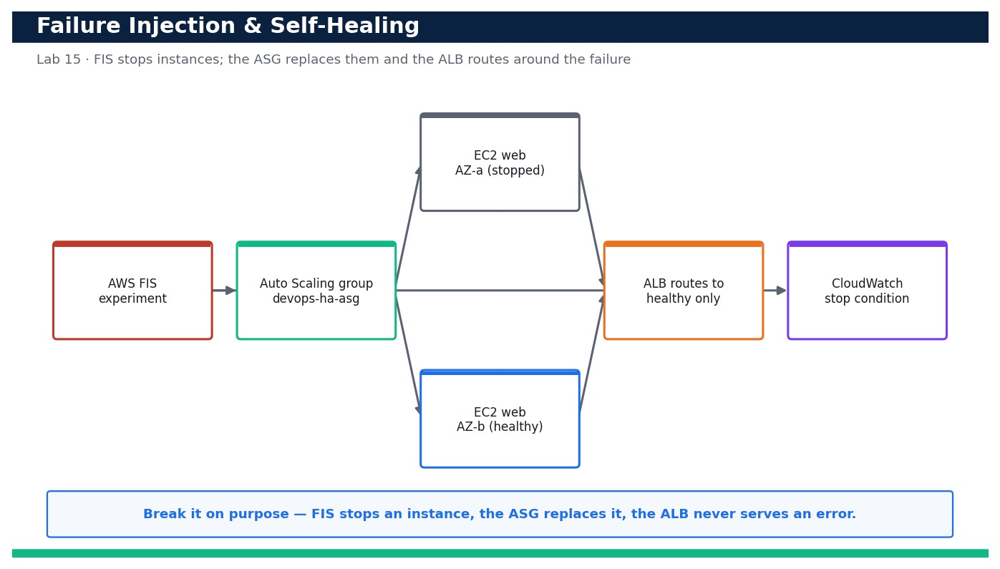

# Lab 15 — Inject Failure and Verify Self-Healing with AWS FIS

**Course:** DevOps Engineering on AWS (TGS-2023040474)  ·  **Day 3**  ·  **Domain 03 — Resilient Cloud Solutions**  ·  **LO3**  ·  Skills mapped: K2, K4, A2



*Figure — reference architecture for Lab 15.*

## Objective
Prove the multi-AZ tier self-heals by terminating an instance and watching the Auto Scaling group replace it, then run an AWS FIS experiment and confirm the ALB routes around the impaired instances (LO3, K2, K4, A2).

## Scenario
A resilient design is only proven when you break it on purpose. In this lab you first terminate an instance manually and watch the Auto Scaling group launch a replacement to restore capacity. You then run a controlled AWS Fault Injection Service (FIS) experiment that stops instances and confirm the Application Load Balancer keeps serving traffic by routing only to healthy targets — turning chaos engineering into evidence that the tier from Lab 11 genuinely self-heals.

## What you'll build
A verified self-healing web tier: a manual instance termination is auto-replaced by the Auto Scaling group, and an AWS FIS experiment stops instances while the ALB continues to serve traffic with zero errors.
**Services:** AWS Fault Injection Service (FIS), AWS Auto Scaling, Amazon EC2, Amazon CloudWatch.

## Prerequisites
- An AWS account you control (an AWS Free Tier / sandbox account is sufficient for most steps).
- AWS CLI v2 installed and configured with a least-privilege named profile: `aws configure --profile devops` (Region e.g. ap-southeast-1).
- Confirm your identity before you start: `aws sts get-caller-identity --profile devops`.
- Git and a code editor; a modern browser for the AWS Management Console.
- Copy `.env.example` to `.env` and fill in YOUR values. `.env` is git-ignored — never commit real credentials.
- Run every command from this lab folder with your `devops` profile (append `--profile devops` or set `AWS_PROFILE=devops`).
- Lab 11 completed and its devops-ha-asg Auto Scaling group + ALB still running and healthy.
- A CloudWatch alarm (devops-ha-5xx-guard) on ALB 5XX to act as the FIS stop condition / safety control.

## Cost & safety
FIS bills per action-minute (cents) and the replacement instances are ordinary t3.micro time. A short experiment with a CloudWatch stop condition keeps this to well under US$1. The stop condition is the key safety control — it aborts the experiment automatically if things go wrong. Clean up the templates after.

- Use only your own AWS account and the placeholder values in `.env.example`.
- **Never commit real credentials.** Use IAM roles / the AWS CLI profile and the `.env` placeholders only.
- Run the **Clean up** section as soon as you finish to stop ongoing charges.

## Files in this lab
- `fis-experiment.json`
- `fis-trust-policy.json`
- `inject-failure.sh`
- `verify-recovery.sh`
- `.env.example`
- `lab-15-failure-injection-self-healing.jpg`
- `INSTRUCTIONS.pdf`

## Step-by-step
1. Confirm the Lab 11 tier is healthy with two InService instances before you break anything.

   ```bash
   aws autoscaling describe-auto-scaling-groups --auto-scaling-group-names devops-ha-asg --query 'AutoScalingGroups[0].Instances[].{Id:InstanceId,Az:AvailabilityZone,State:LifecycleState}' --profile devops
   ```
   - **Expected output:** Two instances are listed, one per AZ, both LifecycleState=InService.

2. Establish a steady-state baseline: the ALB returns HTTP 200 right now.

   ```bash
   curl -fsS http://<alb-dns-name>/
   ```
   - **Expected output:** The response is HTTP 200 with body 'OK from ip-...', confirming the tier is serving before the experiment.

3. Manually terminate ONE instance to test the most basic self-healing behaviour of the group.

   ```bash
   aws autoscaling terminate-instance-in-auto-scaling-group --instance-id <instance-id> --no-should-decrement-desired-capacity --profile devops
   ```
   - **Expected output:** The instance enters Terminating and a scaling activity begins launching a replacement (desired capacity is preserved).

4. Watch the Auto Scaling group launch a replacement to restore capacity.

   ```bash
   aws autoscaling describe-scaling-activities --auto-scaling-group-name devops-ha-asg --max-items 3 --query 'Activities[].{Desc:Description,Status:StatusCode}' --profile devops
   ```
   - **Expected output:** A recent activity shows 'Launching a new EC2 instance' with StatusCode Successful, replacing the terminated one.

5. Confirm the group is back to two InService instances across both AZs.

   ```bash
   aws autoscaling describe-auto-scaling-groups --auto-scaling-group-names devops-ha-asg --query 'AutoScalingGroups[0].{Desired:DesiredCapacity,InService:length(Instances[?LifecycleState==`InService`])}' --profile devops
   ```
   - **Expected output:** DesiredCapacity=2 and two instances are InService again, proving the group self-heals after a termination.

6. Create an IAM role for FIS to assume so it can act on your instances safely.

   ```bash
   aws iam create-role --role-name devops-fis-role --assume-role-policy-document file://fis-trust-policy.json --profile devops
   ```
   - **Expected output:** The role devops-fis-role is created and its Arn is returned.

7. Attach the FIS-required permissions so the experiment can stop EC2 instances.

   ```bash
   aws iam attach-role-policy --role-name devops-fis-role --policy-arn arn:aws:iam::aws:policy/service-role/AWSFaultInjectionSimulatorEC2Access --profile devops
   ```
   - **Expected output:** The command returns with no error; the FIS role can now perform EC2 stop/start actions.

8. Review the FIS experiment template so you understand the target, action and stop condition before running it.

   ```bash
   cat fis-experiment.json
   ```
   - **Expected output:** The template targets one instance in the group, uses the aws:ec2:stop-instances action, and has a CloudWatch alarm stop condition to abort automatically.

9. Create the FIS experiment template.

   ```bash
   aws fis create-experiment-template --cli-input-json file://fis-experiment.json --profile devops
   ```
   - **Expected output:** An experiment template id (EXT...) is returned.

10. Start the experiment to stop an instance and begin observing how the tier responds.

   ```bash
   aws fis start-experiment --experiment-template-id <experiment-template-id> --profile devops
   ```
   - **Expected output:** An experiment id (EXP...) is returned with state initiating, then running.

11. While the experiment runs, prove the ALB routes AROUND the impaired instance with no user-visible errors.

   ```bash
   for i in $(seq 30); do curl -s -o /dev/null -w '%{http_code}\n' http://<alb-dns-name>/; sleep 1; done | sort | uniq -c
   ```
   - **Expected output:** Every (or nearly every) request returns 200 — the ALB stopped sending traffic to the stopped/unhealthy target and served from the healthy AZ.

12. Watch the target group react to the stopped instance.

   ```bash
   aws elbv2 describe-target-health --target-group-arn <target-group-arn> --query 'TargetHealthDescriptions[].{Id:Target.Id,State:TargetHealth.State}' --profile devops
   ```
   - **Expected output:** The stopped instance shows unhealthy/unused while the remaining/replacement target shows healthy, confirming traffic is only routed to healthy instances.

13. Confirm the FIS experiment reached a terminal state (completed, or stopped by its safety alarm).

   ```bash
   aws fis get-experiment --id <experiment-id> --query '{State:state.status,Reason:state.reason}' --profile devops
   ```
   - **Expected output:** The experiment State is completed (or stopped if the CloudWatch stop condition fired), demonstrating a controlled blast radius.

14. Run the verify-recovery.sh script to confirm the tier is fully recovered after the experiment.

   ```bash
   ALB_DNS=<alb-dns-name> ASG_NAME=devops-ha-asg bash verify-recovery.sh
   ```
   - **Expected output:** The script reports two InService instances, all targets healthy, and 30/30 HTTP 200 responses — a clean recovery.

15. Confirm the whole exercise caused no sustained availability loss by checking CloudWatch for ALB 5XX errors during the window.

   ```bash
   aws cloudwatch get-metric-statistics --namespace AWS/ApplicationELB --metric-name HTTPCode_ELB_5XX_Count --dimensions Name=LoadBalancer,Value=<alb-arn-suffix> --statistics Sum --period 60 --start-time $(date -u -v-15M +%FT%TZ) --end-time $(date -u +%FT%TZ) --profile devops
   ```
   - **Expected output:** The Sum of ELB 5XX errors is 0 (or negligible) across the experiment window, proving the failure was absorbed without downtime.

## Validation
A manually terminated instance is automatically replaced (describe-scaling-activities shows a successful launch) and the group returns to two InService instances. The FIS experiment reaches a terminal state with a CloudWatch stop condition configured, target health shows only healthy instances receiving traffic, and ALB 5XX count stays at ~0 throughout.

## Expected outcome (Test it)
Terminating an instance and running a FIS stop-instances experiment both leave the ALB serving HTTP 200 with zero sustained 5XX errors while the Auto Scaling group launches replacements and the load balancer routes around the impaired targets — proving the tier self-heals under real injected failure.

## Evidence to capture
- describe-scaling-activities output showing a successful 'Launching a new EC2 instance' after the manual termination.
- The `for ... curl ... http_code | uniq -c` output showing 30/30 (or near) HTTP 200 during the FIS experiment.
- get-experiment output showing the FIS experiment reached completed (or stopped by its safety alarm).
- get-metric-statistics output showing ALB HTTPCode_ELB_5XX_Count summed to 0 across the experiment window.

## Troubleshooting
- **start-experiment fails with an IAM error** — The roleArn in fis-experiment.json must be devops-fis-role with AWSFaultInjectionSimulatorEC2Access attached and a trust policy allowing fis.amazonaws.com to assume it.
- **The experiment can't find targets** — The resourceTags must match aws:autoscaling:groupName=devops-ha-asg exactly; confirm the group still has running instances carrying that ASG-managed tag.
- **The ALB returns 5XX during the experiment** — Only one instance may have been healthy to start; ensure both AZs had a healthy target before injecting, and that selectionMode stops just one instance (COUNT(1)) so capacity remains in the other AZ.

## Clean up
Delete everything you created, in dependency order, to avoid ongoing charges:

```bash
aws fis delete-experiment-template --id <experiment-template-id> --profile devops
aws iam detach-role-policy --role-name devops-fis-role --policy-arn arn:aws:iam::aws:policy/service-role/AWSFaultInjectionSimulatorEC2Access --profile devops
aws iam delete-role --role-name devops-fis-role --profile devops
```

Confirm nothing is left running (no active stacks, instances, dashboards or trails for this lab).

## Acceptance criteria
- Every step's **Expected output** is observed, and the **Validation** and **Test it** checks pass.
- The reference architecture is realised using the editable AWS-native source files in this folder.
- GitHub via AWS CodeConnections is used as the source path where a repository is required (CodeCommit optional).
- All **Evidence to capture** items are collected (screenshots / CLI output).
- No live credentials appear in any committed file; `.env` is not committed.
- The **Clean up** step has been run and no billable resources remain.

---
© 2026 Tertiary Infotech Academy Pte Ltd. UEN: 201200696W. For training use only.
