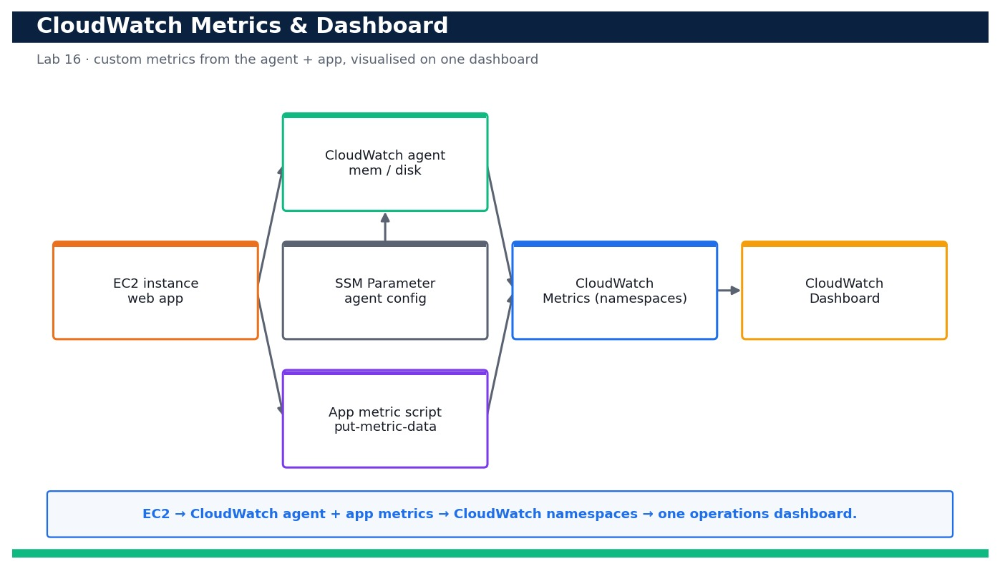

# Lab 16 — Collect Custom Metrics with the CloudWatch Agent and Build an Operations Dashboard

**Course:** DevOps Engineering on AWS (TGS-2023040474)  ·  **Day 4**  ·  **Domain 04 — Monitoring and Logging**  ·  **LO4**  ·  Skills mapped: K5, A6



*Figure — reference architecture for Lab 16.*

## Objective
Instrument an EC2 workload with memory/disk and application metrics, then visualise CPU, latency, errors and request count on a CloudWatch dashboard (LO4, K5, A6).

## Scenario
Your team runs a web app on EC2 but only has the default hypervisor CPU metric — you are blind to memory pressure, disk usage and application latency. In this lab you install and configure the CloudWatch agent to publish memory and disk custom metrics, push an application latency/request metric with put-metric-data, then assemble a single operations dashboard that shows CPU, p90 latency, error count and request count side by side.

## What you'll build
A running CloudWatch agent emitting memory/disk custom metrics, a script publishing app latency/request/error metrics, and a CloudWatch dashboard visualising CPU, p90 latency, errors and request count.
**Services:** Amazon CloudWatch, CloudWatch agent, Amazon EC2, AWS Systems Manager (SSM Parameter Store), IAM.

## Prerequisites
- An AWS account you control (an AWS Free Tier / sandbox account is sufficient for most steps).
- AWS CLI v2 installed and configured with a least-privilege named profile: `aws configure --profile devops` (Region e.g. ap-southeast-1).
- Confirm your identity before you start: `aws sts get-caller-identity --profile devops`.
- Git and a code editor; a modern browser for the AWS Management Console.
- Copy `.env.example` to `.env` and fill in YOUR values. `.env` is git-ignored — never commit real credentials.
- Run every command from this lab folder with your `devops` profile (append `--profile devops` or set `AWS_PROFILE=devops`).
- A running EC2 instance from Lab 3 (or any tagged t3.micro) that you can attach an instance profile to and SSH/SSM into.
- SSM Agent running on the instance (default on Amazon Linux 2023) so you can install the agent via Run Command.

## Cost & safety
Uses one t3.micro EC2 instance plus a handful of CloudWatch custom metrics, dashboards and API calls. Custom metrics and dashboards past the free allowance are a few US cents/month; delete the dashboard and custom metrics stop being written when you tear the instance down. Stay near-free by reusing a Day 3 instance.

- Use only your own AWS account and the placeholder values in `.env.example`.
- **Never commit real credentials.** Use IAM roles / the AWS CLI profile and the `.env` placeholders only.
- Run the **Clean up** section as soon as you finish to stop ongoing charges.

## Files in this lab
- `cw-agent-config.json`
- `put-metric.sh`
- `ec2-trust.json`
- `dashboard.json`
- `.env.example`
- `lab-16-cloudwatch-metrics-dashboard.jpg`
- `INSTRUCTIONS.pdf`

## Step-by-step
1. Confirm your identity and note the instance you will instrument (reuse a tagged Day 3 instance or launch one t3.micro).

   ```bash
   aws ec2 describe-instances --filters Name=tag:Name,Values=devops-web --query 'Reservations[].Instances[].InstanceId' --profile devops
   ```
   - **Expected output:** One or more running InstanceId values are returned for the devops-web tag.

2. Create an IAM role for the instance that allows the agent to publish metrics and read its config, then attach it via an instance profile.

   ```bash
   aws iam create-role --role-name devops-cwagent-role --assume-role-policy-document file://ec2-trust.json --profile devops
   ```
   - **Expected output:** A Role with RoleName devops-cwagent-role is created and its Arn is returned.

3. Attach the AWS-managed CloudWatchAgentServerPolicy so the agent can PutMetricData and read the SSM config parameter.

   ```bash
   aws iam attach-role-policy --role-name devops-cwagent-role --policy-arn arn:aws:iam::aws:policy/CloudWatchAgentServerPolicy --profile devops
   ```
   - **Expected output:** The command returns with no error; list-attached-role-policies now shows CloudWatchAgentServerPolicy.

4. Store the agent configuration in SSM Parameter Store so the agent can be fetched consistently across instances.

   ```bash
   aws ssm put-parameter --name /devops/cwagent/config --type String --value file://cw-agent-config.json --profile devops
   ```
   - **Expected output:** A Version number is returned, confirming the parameter /devops/cwagent/config was stored.

5. Install the CloudWatch agent on the instance (via SSM Run Command / package manager on Amazon Linux 2023).

   ```bash
   sudo dnf install -y amazon-cloudwatch-agent
   ```
   - **Expected output:** The amazon-cloudwatch-agent package installs successfully and its files appear under /opt/aws/amazon-cloudwatch-agent.

6. Start the agent using the configuration you stored in SSM Parameter Store.

   ```bash
   sudo /opt/aws/amazon-cloudwatch-agent/bin/amazon-cloudwatch-agent-ctl -a fetch-config -m ec2 -c ssm:/devops/cwagent/config -s
   ```
   - **Expected output:** The agent reports 'Configuration validation first phase succeeded' and the status becomes running.

7. Verify the agent is running and healthy on the instance.

   ```bash
   sudo /opt/aws/amazon-cloudwatch-agent/bin/amazon-cloudwatch-agent-ctl -a status
   ```
   - **Expected output:** Status shows "status": "running" for the amazon-cloudwatch-agent.

8. Confirm the custom memory metric is now flowing into CloudWatch under your namespace.

   ```bash
   aws cloudwatch list-metrics --namespace CWAgent --metric-name mem_used_percent --profile devops
   ```
   - **Expected output:** The response lists a mem_used_percent metric in the CWAgent namespace with an InstanceId dimension.

9. Confirm the custom disk-used metric is also present.

   ```bash
   aws cloudwatch list-metrics --namespace CWAgent --metric-name disk_used_percent --profile devops
   ```
   - **Expected output:** A disk_used_percent metric is listed with device/path dimensions for the instance.

10. Publish an application latency metric with put-metric-data to model your app emitting a p90 latency observation.

   ```bash
   aws cloudwatch put-metric-data --namespace DevOps/App --metric-name LatencyMs --value 142 --unit Milliseconds --profile devops
   ```
   - **Expected output:** The command returns with no output (exit code 0); the LatencyMs metric appears in the DevOps/App namespace.

11. Publish request-count and error-count application metrics (the provided script sends a small batch so the dashboard has data).

   ```bash
   bash put-metric.sh
   ```
   - **Expected output:** The script prints 'published N samples' and RequestCount / AppErrorCount now appear under DevOps/App.

12. Query the p90 statistic back from CloudWatch to prove the latency metric is queryable at the percentile you will chart.

   ```bash
   aws cloudwatch get-metric-statistics --namespace DevOps/App --metric-name LatencyMs --start-time $(date -u -d '-15 min' +%FT%TZ) --end-time $(date -u +%FT%TZ) --period 60 --extended-statistics p90 --profile devops
   ```
   - **Expected output:** Datapoints are returned with an ExtendedStatistics p90 value for the recent window.

13. Create the operations dashboard from the provided dashboard.json (CPU, p90 latency, errors, request count).

   ```bash
   aws cloudwatch put-dashboard --dashboard-name DevOpsOps --dashboard-body file://dashboard.json --profile devops
   ```
   - **Expected output:** DashboardValidationMessages is empty ([]), confirming the four widgets validated successfully.

14. List the dashboard to confirm it was created and is retrievable.

   ```bash
   aws cloudwatch list-dashboards --query 'DashboardEntries[?DashboardName==`DevOpsOps`]' --profile devops
   ```
   - **Expected output:** One entry named DevOpsOps is returned with a DashboardArn and LastModified timestamp.

15. Open the dashboard in the console and confirm all four widgets render live data.

   ```bash
   # Console: CloudWatch > Dashboards > DevOpsOps
   ```
   - **Expected output:** The dashboard shows CPUUtilization, LatencyMs (p90), AppErrorCount (Sum) and RequestCount (Sum) plotting recent datapoints.

16. Set the dashboard auto-refresh and time range, then re-run put-metric.sh and watch the widgets update.

   ```bash
   bash put-metric.sh
   ```
   - **Expected output:** Within the refresh interval the latency, request and error widgets step up to reflect the newly published samples.

## Validation
`aws cloudwatch list-metrics` shows mem_used_percent and disk_used_percent under CWAgent and LatencyMs/RequestCount/AppErrorCount under DevOps/App; put-dashboard returns an empty DashboardValidationMessages array; and the DevOpsOps dashboard renders all four widgets with live data.

## Expected outcome (Test it)
Publishing a fresh batch of samples with put-metric.sh causes the latency (p90), request-count and error-count widgets to move within one refresh cycle, and the memory/disk widgets track the instance — proving end-to-end custom-metric collection and visualisation.

## Evidence to capture
- Output of `amazon-cloudwatch-agent-ctl -a status` showing the agent running.
- `aws cloudwatch list-metrics` showing mem_used_percent and disk_used_percent under CWAgent.
- The put-dashboard call returning an empty DashboardValidationMessages array.
- Screenshot of the DevOpsOps dashboard rendering CPU, p90 latency, errors and request count.

## Troubleshooting
- **No CWAgent metrics appear** — Confirm the instance role has CloudWatchAgentServerPolicy and the agent fetched the SSM config (re-run fetch-config with -s).
- **put-metric-data succeeds but the widget is empty** — Match the Region in dashboard.json to the Region you published to, and widen the dashboard time range.
- **p90 widget shows nothing** — Percentiles need several datapoints in the period — run put-metric.sh a few times and use ExtendedStatistics, not Statistics.

## Clean up
Delete everything you created, in dependency order, to avoid ongoing charges:

```bash
aws cloudwatch delete-dashboards --dashboard-names DevOpsOps --profile devops
aws ssm delete-parameter --name /devops/cwagent/config --profile devops
aws iam detach-role-policy --role-name devops-cwagent-role --policy-arn arn:aws:iam::aws:policy/CloudWatchAgentServerPolicy --profile devops
aws iam delete-role --role-name devops-cwagent-role --profile devops
```

Confirm nothing is left running (no active stacks, instances, dashboards or trails for this lab).

## Acceptance criteria
- Every step's **Expected output** is observed, and the **Validation** and **Test it** checks pass.
- The reference architecture is realised using the editable AWS-native source files in this folder.
- GitHub via AWS CodeConnections is used as the source path where a repository is required (CodeCommit optional).
- All **Evidence to capture** items are collected (screenshots / CLI output).
- No live credentials appear in any committed file; `.env` is not committed.
- The **Clean up** step has been run and no billable resources remain.

---
© 2026 Tertiary Infotech Academy Pte Ltd. UEN: 201200696W. For training use only.
