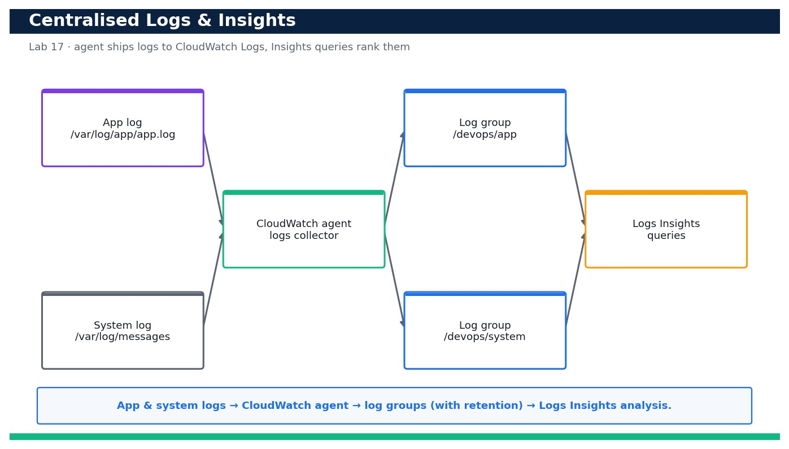

# Lab 17 — Centralise Logs in CloudWatch Logs and Analyse Them with Logs Insights

**Course:** DevOps Engineering on AWS (TGS-2023040474)  ·  **Day 4**  ·  **Domain 04 — Monitoring and Logging**  ·  **LO4**  ·  Skills mapped: K5, A6



*Figure — reference architecture for Lab 17.*

## Objective
Ship application and system logs into CloudWatch Logs with retention, then use Logs Insights queries to find the slowest and most error-prone requests (LO4, K5, A6).

## Scenario
When an incident hits, grepping across scattered instances wastes precious minutes. In this lab you centralise your application and system logs into CloudWatch Logs — creating log groups with a sensible retention policy and extending the CloudWatch agent to ship log files — then use CloudWatch Logs Insights queries to rank requests by latency, count errors by type and pinpoint the slowest and most error-prone endpoints.

## What you'll build
Centralised app and system log groups (with retention) fed by the CloudWatch agent, plus a set of saved Logs Insights queries that surface the slowest and most error-prone requests.
**Services:** Amazon CloudWatch Logs, CloudWatch Logs Insights, CloudWatch agent, Amazon EC2, IAM.

## Prerequisites
- An AWS account you control (an AWS Free Tier / sandbox account is sufficient for most steps).
- AWS CLI v2 installed and configured with a least-privilege named profile: `aws configure --profile devops` (Region e.g. ap-southeast-1).
- Confirm your identity before you start: `aws sts get-caller-identity --profile devops`.
- Git and a code editor; a modern browser for the AWS Management Console.
- Copy `.env.example` to `.env` and fill in YOUR values. `.env` is git-ignored — never commit real credentials.
- Run every command from this lab folder with your `devops` profile (append `--profile devops` or set `AWS_PROFILE=devops`).
- The CloudWatch agent already installed from Lab 16 (extend its config here rather than reinstalling).
- An app on the instance writing to /var/log/app/app.log (or run app-logger.py to seed sample lines).

## Cost & safety
CloudWatch Logs charges for ingestion, storage and Insights scans. A single instance emitting light logs with a short retention (7–14 days) costs a few US cents; Insights bills per GB scanned so keep query time ranges tight. Setting retention (not 'Never expire') and deleting the log groups on teardown keeps this near-free.

- Use only your own AWS account and the placeholder values in `.env.example`.
- **Never commit real credentials.** Use IAM roles / the AWS CLI profile and the `.env` placeholders only.
- Run the **Clean up** section as soon as you finish to stop ongoing charges.

## Files in this lab
- `cw-agent-logs.json`
- `create-log-group.sh`
- `logs-insights-queries.txt`
- `app-logger.py`
- `.env.example`
- `lab-17-centralized-logs-insights.jpg`
- `INSTRUCTIONS.pdf`

## Step-by-step
1. Confirm your identity and the instance whose logs you will centralise.

   ```bash
   aws sts get-caller-identity --profile devops
   ```
   - **Expected output:** Your own Account, UserId and Arn are printed (no error).

2. Create the application log group with the provided helper script.

   ```bash
   bash create-log-group.sh /devops/app
   ```
   - **Expected output:** The script reports the log group /devops/app was created (or already exists).

3. Create the system log group the same way.

   ```bash
   bash create-log-group.sh /devops/system
   ```
   - **Expected output:** The script reports the log group /devops/system was created.

4. Set a 14-day retention policy on the application log group so logs do not accumulate cost forever.

   ```bash
   aws logs put-retention-policy --log-group-name /devops/app --retention-in-days 14 --profile devops
   ```
   - **Expected output:** The command returns with no output; describe-log-groups now shows retentionInDays 14 for /devops/app.

5. Set retention on the system log group as well.

   ```bash
   aws logs put-retention-policy --log-group-name /devops/system --retention-in-days 14 --profile devops
   ```
   - **Expected output:** retentionInDays 14 is applied to /devops/system.

6. Extend the CloudWatch agent configuration to collect the app and system log files and start it.

   ```bash
   sudo /opt/aws/amazon-cloudwatch-agent/bin/amazon-cloudwatch-agent-ctl -a fetch-config -m ec2 -c file:/opt/cw-agent-logs.json -s
   ```
   - **Expected output:** The agent validates the config and restarts; it begins tailing /var/log/app/app.log and /var/log/messages.

7. Generate some sample traffic so the app writes structured request log lines (some slow, some errors).

   ```bash
   for i in $(seq 1 50); do curl -s http://localhost/ >/dev/null; done
   ```
   - **Expected output:** The app writes 50 request lines to /var/log/app/app.log including a mix of latencies and a few ERROR lines.

8. Confirm a log stream now exists in the application log group.

   ```bash
   aws logs describe-log-streams --log-group-name /devops/app --order-by LastEventTime --descending --profile devops
   ```
   - **Expected output:** At least one logStream (named for the instance) is listed with a recent lastEventTimestamp.

9. Tail the most recent events to confirm the request log format is arriving.

   ```bash
   aws logs tail /devops/app --since 10m --profile devops
   ```
   - **Expected output:** Recent lines print showing timestamp, request path, status and latency_ms fields.

10. Run a Logs Insights query to rank the slowest requests by parsing latency_ms (query text is in logs-insights-queries.txt).

   ```bash
   aws logs start-query --log-group-name /devops/app --start-time $(date -u -d '-30 min' +%s) --end-time $(date -u +%s) --query-string 'fields @timestamp, path, latency_ms | sort latency_ms desc | limit 20' --profile devops
   ```
   - **Expected output:** A queryId is returned; the query begins running against /devops/app.

11. Fetch the query results and read the slowest endpoints.

   ```bash
   aws logs get-query-results --query-id <query-id> --profile devops
   ```
   - **Expected output:** Status is Complete and up to 20 rows list paths ordered by descending latency_ms (the slowest requests first).

12. Run the error-breakdown query that counts ERROR lines grouped by request path.

   ```bash
   aws logs start-query --log-group-name /devops/app --start-time $(date -u -d '-30 min' +%s) --end-time $(date -u +%s) --query-string 'filter level="ERROR" | stats count(*) as errors by path | sort errors desc' --profile devops
   ```
   - **Expected output:** A queryId is returned for the error-breakdown query.

13. Fetch the error-breakdown results to find the most error-prone endpoint.

   ```bash
   aws logs get-query-results --query-id <query-id> --profile devops
   ```
   - **Expected output:** Rows list each path with its error count in descending order, revealing the most error-prone endpoint.

14. Compute the p90 latency across all requests with an Insights aggregation query.

   ```bash
   aws logs start-query --log-group-name /devops/app --start-time $(date -u -d '-30 min' +%s) --end-time $(date -u +%s) --query-string 'stats pct(latency_ms, 90) as p90, count(*) as reqs by bin(5m)' --profile devops
   ```
   - **Expected output:** A queryId is returned; results show p90 latency and request count per 5-minute bin.

15. Save the useful queries in the console so the team can reuse them during incidents.

   ```bash
   # Console: CloudWatch > Logs Insights > Actions > Save query (paste from logs-insights-queries.txt)
   ```
   - **Expected output:** The 'Slowest requests' and 'Errors by path' queries appear in your saved-queries list.

## Validation
`describe-log-groups` shows /devops/app and /devops/system with retentionInDays 14; the agent is tailing both files (log streams exist with recent timestamps); and the three Logs Insights queries return Complete with rows ranking slowest requests, errors by path, and p90 latency per bin.

## Expected outcome (Test it)
Running the 'slowest requests' and 'errors by path' Insights queries over the last 30 minutes returns concrete endpoints ordered by latency and error count — you can name the slowest and most error-prone request from the centralised logs alone, without touching the instance.

## Evidence to capture
- `describe-log-groups` output showing /devops/app and /devops/system with retentionInDays 14.
- `aws logs tail /devops/app` output showing structured request lines arriving.
- Logs Insights 'slowest requests' result ranking endpoints by latency_ms.
- Logs Insights 'errors by path' result identifying the most error-prone endpoint.

## Troubleshooting
- **No log streams appear** — Confirm the agent has the logs block loaded (fetch-config with -s) and the instance role allows logs:CreateLogStream and logs:PutLogEvents.
- **Insights query returns 0 rows** — Widen the time range and check field names — parse latency_ms exactly as the log format writes it.
- **Query says the log group is not found** — Create the log group first (create-log-group.sh) and match the exact name/Region.

## Clean up
Delete everything you created, in dependency order, to avoid ongoing charges:

```bash
aws logs delete-log-group --log-group-name /devops/app --profile devops
aws logs delete-log-group --log-group-name /devops/system --profile devops
```

Confirm nothing is left running (no active stacks, instances, dashboards or trails for this lab).

## Acceptance criteria
- Every step's **Expected output** is observed, and the **Validation** and **Test it** checks pass.
- The reference architecture is realised using the editable AWS-native source files in this folder.
- GitHub via AWS CodeConnections is used as the source path where a repository is required (CodeCommit optional).
- All **Evidence to capture** items are collected (screenshots / CLI output).
- No live credentials appear in any committed file; `.env` is not committed.
- The **Clean up** step has been run and no billable resources remain.

---
© 2026 Tertiary Infotech Academy Pte Ltd. UEN: 201200696W. For training use only.
