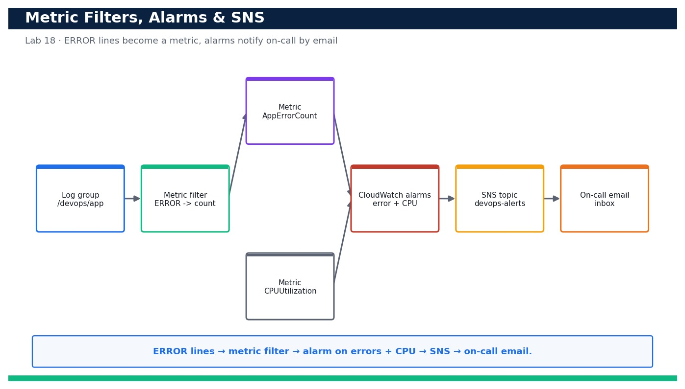

# Lab 18 — Turn Logs into Signals: Metric Filters, CloudWatch Alarms and SNS Notifications

**Course:** DevOps Engineering on AWS (TGS-2023040474)  ·  **Day 4**  ·  **Domain 04 — Monitoring and Logging**  ·  **LO4**  ·  Skills mapped: K5, A6



*Figure — reference architecture for Lab 18.*

## Objective
Create a metric filter that counts ERROR log lines, alarm on that metric and on high CPU, and notify an on-call engineer by email via SNS (LO4, K5, A6).

## Scenario
Logs are only useful if they page someone when things go wrong. In this lab you turn the centralised app logs from Lab 17 into a signal: a CloudWatch Logs metric filter counts ERROR lines into a metric, then two alarms — one on the error metric and one on high CPU — publish to an SNS topic that emails your on-call address. You then drive the error alarm into ALARM state and confirm the notification actually arrives.

## What you'll build
A metric filter converting ERROR log lines into a CloudWatch metric, two alarms (errors and high CPU) wired to an SNS topic with a confirmed email subscription, and a demonstrated ALARM-state email notification.
**Services:** Amazon CloudWatch (metric filters + alarms), Amazon CloudWatch Logs, Amazon SNS, AWS CloudFormation, IAM.

## Prerequisites
- An AWS account you control (an AWS Free Tier / sandbox account is sufficient for most steps).
- AWS CLI v2 installed and configured with a least-privilege named profile: `aws configure --profile devops` (Region e.g. ap-southeast-1).
- Confirm your identity before you start: `aws sts get-caller-identity --profile devops`.
- Git and a code editor; a modern browser for the AWS Management Console.
- Copy `.env.example` to `.env` and fill in YOUR values. `.env` is git-ignored — never commit real credentials.
- Run every command from this lab folder with your `devops` profile (append `--profile devops` or set `AWS_PROFILE=devops`).
- The /devops/app log group from Lab 17 (the metric filter attaches to it).
- An email address you can access to confirm the SNS subscription.

## Cost & safety
Metric filters, alarms and SNS email are effectively free at this scale (standard alarms and a handful of email notifications sit within the free allowance). The only care needed is deleting the alarms, filter and topic on teardown so no stray metric-based alarms linger.

- Use only your own AWS account and the placeholder values in `.env.example`.
- **Never commit real credentials.** Use IAM roles / the AWS CLI profile and the `.env` placeholders only.
- Run the **Clean up** section as soon as you finish to stop ongoing charges.

## Files in this lab
- `metric-filter.json`
- `alarm.yaml`
- `subscribe.sh`
- `.env.example`
- `lab-18-metric-filters-alarms-sns.jpg`
- `INSTRUCTIONS.pdf`

## Step-by-step
1. Confirm the /devops/app log group from Lab 17 exists (the metric filter attaches to it).

   ```bash
   aws logs describe-log-groups --log-group-name-prefix /devops/app --query 'logGroups[].logGroupName' --profile devops
   ```
   - **Expected output:** The list contains /devops/app.

2. Deploy the SNS topic and the two alarms from the provided CloudFormation template.

   ```bash
   aws cloudformation deploy --template-file alarm.yaml --stack-name devops-alerts --capabilities CAPABILITY_IAM --profile devops
   ```
   - **Expected output:** Stack devops-alerts reaches CREATE_COMPLETE and outputs a TopicArn.

3. Capture the SNS topic ARN from the stack outputs for the subscription step.

   ```bash
   aws cloudformation describe-stacks --stack-name devops-alerts --query 'Stacks[0].Outputs[?OutputKey==`TopicArn`].OutputValue' --output text --profile devops
   ```
   - **Expected output:** A topic ARN like arn:aws:sns:ap-southeast-1:<your-account-id>:devops-alerts is printed.

4. Subscribe your on-call email address to the topic with the provided helper script.

   ```bash
   bash subscribe.sh you@example.com <topic-arn>
   ```
   - **Expected output:** The script requests a subscription and prints 'confirmation email sent to you@example.com'.

5. Open the confirmation email and click 'Confirm subscription', then verify the subscription is confirmed.

   ```bash
   aws sns list-subscriptions-by-topic --topic-arn <topic-arn> --query 'Subscriptions[].SubscriptionArn' --profile devops
   ```
   - **Expected output:** The SubscriptionArn is a real ARN (not the string 'PendingConfirmation'), confirming the email is subscribed.

6. Create the metric filter that counts ERROR lines from the log group into the DevOps/App AppErrorCount metric.

   ```bash
   aws logs put-metric-filter --cli-input-json file://metric-filter.json --profile devops
   ```
   - **Expected output:** The command returns with no output; describe-metric-filters now lists app-error-count on /devops/app.

7. Confirm the metric filter is attached to the log group.

   ```bash
   aws logs describe-metric-filters --log-group-name /devops/app --query 'metricFilters[].filterName' --profile devops
   ```
   - **Expected output:** The list contains app-error-count.

8. Verify the error alarm was created and note its current state.

   ```bash
   aws cloudwatch describe-alarms --alarm-names devops-app-errors --query 'MetricAlarms[0].StateValue' --profile devops
   ```
   - **Expected output:** The state prints as OK or INSUFFICIENT_DATA (no errors have breached the threshold yet).

9. Verify the high-CPU alarm exists too.

   ```bash
   aws cloudwatch describe-alarms --alarm-names devops-high-cpu --query 'MetricAlarms[0].StateValue' --profile devops
   ```
   - **Expected output:** The high-CPU alarm is listed with state OK or INSUFFICIENT_DATA.

10. Generate ERROR log lines so the metric filter increments the AppErrorCount metric above the alarm threshold.

   ```bash
   for i in $(seq 1 10); do aws logs put-log-events --log-group-name /devops/app --log-stream-name test-errors --log-events timestamp=$(date +%s000),message='ERROR simulated failure' --profile devops; done
   ```
   - **Expected output:** Ten ERROR events are written; within a minute the AppErrorCount metric shows a Sum above the threshold of 5.

11. Confirm the metric filter is publishing the error count metric.

   ```bash
   aws cloudwatch get-metric-statistics --namespace DevOps/App --metric-name AppErrorCount --start-time $(date -u -d '-10 min' +%FT%TZ) --end-time $(date -u +%FT%TZ) --period 60 --statistics Sum --profile devops
   ```
   - **Expected output:** Datapoints are returned with a Sum reflecting the ERROR lines you generated.

12. Wait for the alarm evaluation period and confirm the error alarm transitions to ALARM.

   ```bash
   aws cloudwatch describe-alarms --alarm-names devops-app-errors --query 'MetricAlarms[0].StateValue' --profile devops
   ```
   - **Expected output:** The StateValue is now ALARM.

13. Confirm the on-call email received the ALARM notification (check your inbox).

   ```bash
   # Inbox: subject 'ALARM: devops-app-errors in ...'
   ```
   - **Expected output:** An email arrives from AWS Notifications describing the alarm transition to ALARM with the reason and metric.

14. Review the alarm's state-change history to see the transition and the SNS action firing.

   ```bash
   aws cloudwatch describe-alarm-history --alarm-name devops-app-errors --history-item-type StateUpdate --max-records 5 --profile devops
   ```
   - **Expected output:** The history shows a StateUpdate from OK/INSUFFICIENT_DATA to ALARM with the SNS action executed.

15. Stop generating errors and confirm the alarm returns to OK once the metric falls back below the threshold.

   ```bash
   aws cloudwatch describe-alarms --alarm-names devops-app-errors --query 'MetricAlarms[0].StateValue' --profile devops
   ```
   - **Expected output:** After the next evaluation period with no new errors the StateValue returns to OK (and an 'OK:' email arrives).

16. (Optional) Manually drive the alarm with set-alarm-state to demonstrate the notification path without waiting for real data.

   ```bash
   aws cloudwatch set-alarm-state --alarm-name devops-app-errors --state-value ALARM --state-reason 'manual test' --profile devops
   ```
   - **Expected output:** The alarm flips to ALARM immediately and a test notification email is delivered via SNS.

## Validation
`describe-metric-filters` lists app-error-count on /devops/app; both devops-app-errors and devops-high-cpu alarms exist; the email subscription shows a real (confirmed) SubscriptionArn; and generating ERROR lines drives devops-app-errors into ALARM with a matching state-change history entry.

## Expected outcome (Test it)
After you generate ERROR log lines, the metric filter increments AppErrorCount, the devops-app-errors alarm transitions to ALARM, and an 'ALARM:' email arrives at the confirmed on-call address — a full log-to-notification signal path. Stopping the errors returns the alarm to OK with an 'OK:' email.

## Evidence to capture
- `describe-metric-filters` output showing app-error-count attached to /devops/app.
- `list-subscriptions-by-topic` showing a real (confirmed) SubscriptionArn for your email.
- The devops-app-errors alarm StateValue reading ALARM after you generated ERROR lines.
- The 'ALARM: devops-app-errors' email received at the on-call address.

## Troubleshooting
- **No email ever arrives** — The subscription is still PendingConfirmation — click the link in the confirmation email, then check the SubscriptionArn is a real ARN.
- **Alarm never leaves INSUFFICIENT_DATA** — The metric has no data until the filter matches a line; generate ERROR lines and set TreatMissingData appropriately.
- **Metric filter matches nothing** — Check the filterPattern (case-sensitive 'ERROR') matches your log lines and the filter is on the correct log group.

## Clean up
Delete everything you created, in dependency order, to avoid ongoing charges:

```bash
aws logs delete-metric-filter --log-group-name /devops/app --filter-name app-error-count --profile devops
aws cloudformation delete-stack --stack-name devops-alerts --profile devops
```

Confirm nothing is left running (no active stacks, instances, dashboards or trails for this lab).

## Acceptance criteria
- Every step's **Expected output** is observed, and the **Validation** and **Test it** checks pass.
- The reference architecture is realised using the editable AWS-native source files in this folder.
- GitHub via AWS CodeConnections is used as the source path where a repository is required (CodeCommit optional).
- All **Evidence to capture** items are collected (screenshots / CLI output).
- No live credentials appear in any committed file; `.env` is not committed.
- The **Clean up** step has been run and no billable resources remain.

---
© 2026 Tertiary Infotech Academy Pte Ltd. UEN: 201200696W. For training use only.
