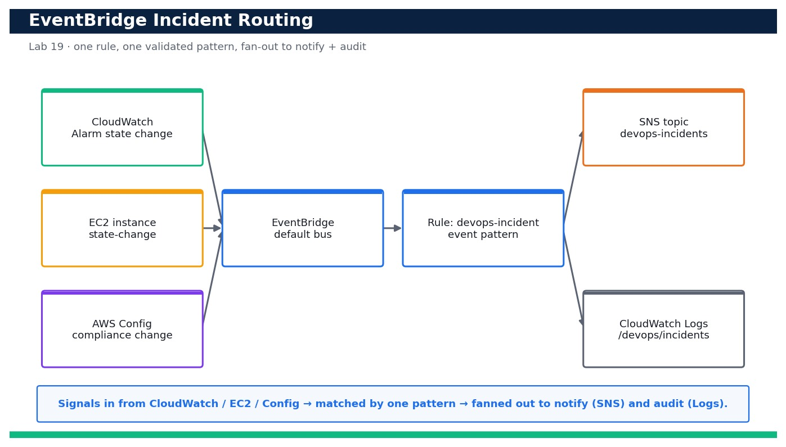

# Lab 19 — Route Incidents with Amazon EventBridge

**Course:** DevOps Engineering on AWS (TGS-2023040474)  ·  **Day 4**  ·  **Domain 05 — Incident and Event Response**  ·  **LO5**  ·  Skills mapped: K7, A5



*Figure — reference architecture for Lab 19.*

## Objective
Build an EventBridge rule that matches incident signals and fans them out to notify and log targets (LO5, K7, A5).

## Scenario
Your team wants a single 'routing brain' for operational incidents so that a CloudWatch alarm firing, an EC2 instance changing state, or an AWS Config compliance change all land in the same place. In this lab you author and validate a precise EventBridge event pattern, create a rule on the default event bus, and fan the matched events out to two targets — an SNS topic for human notification and a CloudWatch Logs group for an audit trail. You then prove the pattern with `aws events test-event-pattern` and simulate a real event.

## What you'll build
An enabled EventBridge rule on the default bus whose validated event pattern matches CloudWatch Alarm state changes, EC2 state-change notifications and AWS Config compliance-change events, fanning out to an SNS topic (notify) and a CloudWatch Logs group (audit) — proven with a simulated event.
**Services:** Amazon EventBridge, Amazon SNS, Amazon CloudWatch, CloudWatch Logs, IAM.

## Prerequisites
- An AWS account you control (an AWS Free Tier / sandbox account is sufficient for most steps).
- AWS CLI v2 installed and configured with a least-privilege named profile: `aws configure --profile devops` (Region e.g. ap-southeast-1).
- Confirm your identity before you start: `aws sts get-caller-identity --profile devops`.
- Git and a code editor; a modern browser for the AWS Management Console.
- Copy `.env.example` to `.env` and fill in YOUR values. `.env` is git-ignored — never commit real credentials.
- Run every command from this lab folder with your `devops` profile (append `--profile devops` or set `AWS_PROFILE=devops`).
- The `devops-incidents` SNS topic and the CloudWatch alarm from the Day-4 monitoring labs (Lab 16/17) so incidents have a real source.
- A confirmed email subscription on the SNS topic so you can observe the notify path.

## Cost & safety
EventBridge default-bus rules and AWS-service events are effectively free at lab scale; you pay only trivial amounts for SNS email notifications and CloudWatch Logs ingestion/storage. Delete the log group and rule the same day to keep this to a few cents.

- Use only your own AWS account and the placeholder values in `.env.example`.
- **Never commit real credentials.** Use IAM roles / the AWS CLI profile and the `.env` placeholders only.
- Run the **Clean up** section as soon as you finish to stop ongoing charges.

## Files in this lab
- `event-pattern.json`
- `eventbridge-rule.json`
- `sns-topic-policy.json`
- `put-rule.sh`
- `sample-alarm-event.json`
- `put-events-ec2.json`
- `.env.example`
- `lab-19-eventbridge-incident-routing.jpg`
- `INSTRUCTIONS.pdf`

## Step-by-step
1. Confirm your identity and Region before you start so every resource lands in the right account.

   ```bash
   aws sts get-caller-identity --profile devops
   ```
   - **Expected output:** Your own Account, UserId and ARN are printed (no error).

2. Reuse the incident SNS topic from the Day-4 monitoring labs, or create it if it does not exist, and capture its ARN.

   ```bash
   aws sns create-topic --name devops-incidents --profile devops --query TopicArn --output text
   ```
   - **Expected output:** An ARN like arn:aws:sns:ap-southeast-1:<your-account-id>:devops-incidents is returned.

3. Subscribe your email to the topic so you receive incident notifications, then confirm the subscription from your inbox.

   ```bash
   aws sns subscribe --topic-arn <topic-arn> --protocol email --notification-endpoint you@example.com --profile devops
   ```
   - **Expected output:** SubscriptionArn is 'pending confirmation'; after you click the link in the email it becomes a real ARN.

4. Create the CloudWatch Logs group that will hold the incident audit trail.

   ```bash
   aws logs create-log-group --log-group-name /devops/incidents --profile devops
   ```
   - **Expected output:** The command returns no output; the log group now exists.

5. Validate your event pattern BEFORE creating any rule, using a sample CloudWatch Alarm state-change event.

   ```bash
   aws events test-event-pattern --event-pattern file://event-pattern.json --event file://sample-alarm-event.json --profile devops
   ```
   - **Expected output:** The command prints { "Result": true } — the pattern matches the sample alarm event.

6. Confirm the same pattern also matches a sample EC2 state-change event (multi-source pattern works).

   ```bash
   aws events test-event-pattern --event-pattern file://event-pattern.json --event file://sample-ec2-event.json --profile devops
   ```
   - **Expected output:** { "Result": true } is printed for the EC2 sample event too.

7. Confirm the pattern REJECTS an unrelated event so you know it is precise, not a catch-all.

   ```bash
   aws events test-event-pattern --event-pattern file://event-pattern.json --event file://sample-unrelated-event.json --profile devops
   ```
   - **Expected output:** { "Result": false } is printed — an S3 object-created event does NOT match.

8. Create the EventBridge rule on the default bus from the reviewed rule definition.

   ```bash
   aws events put-rule --name devops-incident --event-pattern file://event-pattern.json --state ENABLED --description 'Route CloudWatch/EC2/Config incidents' --profile devops
   ```
   - **Expected output:** A RuleArn like arn:aws:events:ap-southeast-1:<your-account-id>:rule/devops-incident is returned.

9. Grant EventBridge permission to publish to your SNS topic by setting a topic policy allowing the events service.

   ```bash
   aws sns set-topic-attributes --topic-arn <topic-arn> --attribute-name Policy --attribute-value file://sns-topic-policy.json --profile devops
   ```
   - **Expected output:** The command returns no output; the topic now allows events.amazonaws.com to Publish.

10. Attach BOTH targets to the rule in one call — the SNS topic (notify) and the CloudWatch Logs group (audit).

   ```bash
   aws events put-targets --rule devops-incident --targets Id=notify,Arn=<topic-arn> Id=audit,Arn=arn:aws:logs:ap-southeast-1:<your-account-id>:log-group:/devops/incidents --profile devops
   ```
   - **Expected output:** FailedEntryCount is 0 — both targets were registered on the rule.

11. List the rule's targets and confirm the fan-out is in place.

   ```bash
   aws events list-targets-by-rule --rule devops-incident --profile devops --query 'Targets[].Id'
   ```
   - **Expected output:** The output lists both target Ids: [ "notify", "audit" ].

12. Simulate a live incident by putting a synthetic EC2 state-change event onto the default bus.

   ```bash
   aws events put-events --entries file://put-events-ec2.json --profile devops
   ```
   - **Expected output:** FailedEntryCount is 0 and an EventId is returned — the event was accepted by the bus.

13. Confirm the rule actually matched and invoked by inspecting its Invocations metric in CloudWatch.

   ```bash
   aws cloudwatch get-metric-statistics --namespace AWS/Events --metric-name Invocations --dimensions Name=RuleName,Value=devops-incident --start-time $(date -u -v-15M +%Y-%m-%dT%H:%M:%SZ) --end-time $(date -u +%Y-%m-%dT%H:%M:%SZ) --period 300 --statistics Sum --profile devops
   ```
   - **Expected output:** At least one datapoint with Sum >= 1 is returned, proving the rule fired.

14. Verify the audit target received the event by checking that the log group now has a log stream with content.

   ```bash
   aws logs describe-log-streams --log-group-name /devops/incidents --order-by LastEventTime --descending --profile devops --query 'logStreams[0].logStreamName'
   ```
   - **Expected output:** A log stream name is returned; opening it shows the routed EC2 state-change event JSON.

15. Confirm the notify path worked by checking your email for the SNS message about the simulated incident.
   - **Expected output:** Your inbox shows an 'AWS Notification' email containing the EC2 state-change event details.

## Validation
`aws events list-targets-by-rule` shows both the notify and audit targets; the three `test-event-pattern` runs return true/true/false; after `put-events` the AWS/Events Invocations metric shows a datapoint, the /devops/incidents log group has a stream containing the event, and an SNS email arrives — proving one validated pattern fans a matched incident out to both targets.

## Expected outcome (Test it)
You author a precise multi-source event pattern, prove it matches CloudWatch Alarm and EC2 events but rejects an unrelated S3 event, then simulate an incident and observe it routed to SNS (email received) and CloudWatch Logs (stream written) with the rule's Invocations metric incrementing.

## Evidence to capture
- The three `aws events test-event-pattern` results showing true / true / false for the alarm, EC2 and unrelated samples.
- `aws events list-targets-by-rule` output listing both targets (notify + audit).
- The AWS/Events Invocations metric showing a datapoint after your simulated `put-events`.
- The routed event in the /devops/incidents log stream AND the SNS incident email in your inbox.

## Troubleshooting
- **`test-event-pattern` returns false for a valid event** — Match detail-type and source EXACTLY (case-sensitive) to the sample event; a pattern field is an AND, values within a list are an OR.
- **Rule fires but no SNS email arrives** — Confirm the email subscription is CONFIRMED and that the SNS topic policy allows events.amazonaws.com to Publish.
- **Rule fires but nothing appears in the log group** — EventBridge needs a resource policy on the log group (aws logs put-resource-policy) allowing delivery.amazonaws.com/events to PutLogEvents.

## Clean up
Delete everything you created, in dependency order, to avoid ongoing charges:

```bash
aws events remove-targets --rule devops-incident --ids notify audit --profile devops
aws events delete-rule --name devops-incident --profile devops
aws logs delete-log-group --log-group-name /devops/incidents --profile devops
```

Confirm nothing is left running (no active stacks, instances, dashboards or trails for this lab).

## Acceptance criteria
- Every step's **Expected output** is observed, and the **Validation** and **Test it** checks pass.
- The reference architecture is realised using the editable AWS-native source files in this folder.
- GitHub via AWS CodeConnections is used as the source path where a repository is required (CodeCommit optional).
- All **Evidence to capture** items are collected (screenshots / CLI output).
- No live credentials appear in any committed file; `.env` is not committed.
- The **Clean up** step has been run and no billable resources remain.

---
© 2026 Tertiary Infotech Academy Pte Ltd. UEN: 201200696W. For training use only.
