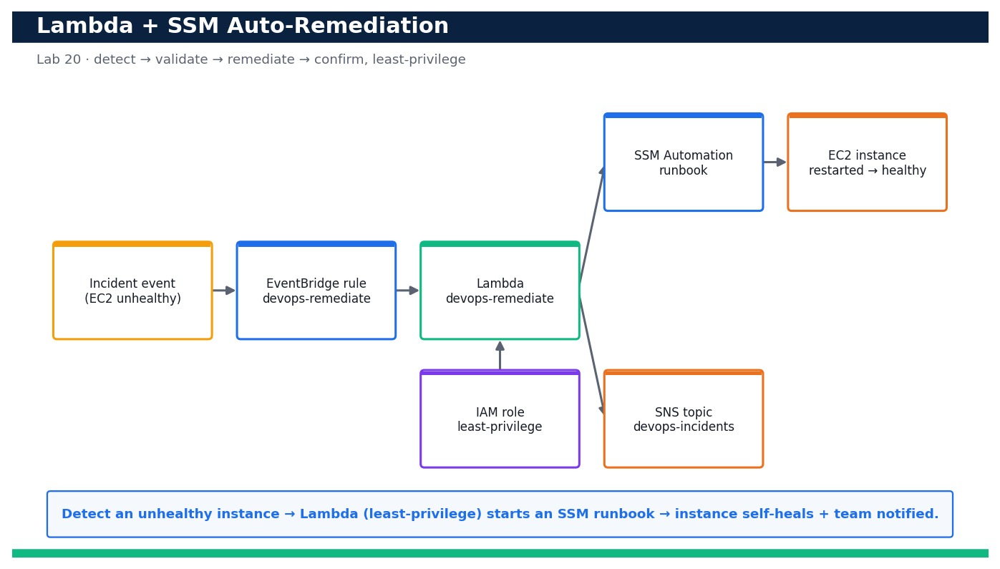

# Lab 20 — Automated Remediation with Lambda and Systems Manager

**Course:** DevOps Engineering on AWS (TGS-2023040474)  ·  **Day 4**  ·  **Domain 05 — Incident and Event Response**  ·  **LO5**  ·  Skills mapped: K7, A5



*Figure — reference architecture for Lab 20.*

## Objective
Wire an EventBridge target to a least-privilege Lambda that triggers an SSM Automation runbook so an unhealthy resource self-heals (LO5, K7, A5).

## Scenario
Notification alone does not resolve an incident — the on-call engineer still has to act. In this lab you close the loop: an EventBridge rule detects an unhealthy/stopped EC2 instance and invokes a Lambda function running under a tightly-scoped IAM role. The Lambda validates the event and starts an AWS Systems Manager Automation runbook that remediates the instance (restarts it), while also notifying the team over SNS. You deploy the whole stack with CloudFormation, simulate an incident, and confirm the resource returns to a healthy state automatically with no human intervention.

## What you'll build
A CloudFormation-deployed auto-remediation stack (EventBridge rule + least-privilege Lambda + SSM Automation runbook + SNS notify) that, on an unhealthy-instance event, restarts the instance automatically and returns it to a running/healthy state — proven end to end from a simulated incident.
**Services:** AWS Lambda, AWS Systems Manager Automation, Amazon EventBridge, AWS IAM, Amazon CloudWatch Logs, Amazon SNS, Amazon EC2.

## Prerequisites
- An AWS account you control (an AWS Free Tier / sandbox account is sufficient for most steps).
- AWS CLI v2 installed and configured with a least-privilege named profile: `aws configure --profile devops` (Region e.g. ap-southeast-1).
- Confirm your identity before you start: `aws sts get-caller-identity --profile devops`.
- Git and a code editor; a modern browser for the AWS Management Console.
- Copy `.env.example` to `.env` and fill in YOUR values. `.env` is git-ignored — never commit real credentials.
- Run every command from this lab folder with your `devops` profile (append `--profile devops` or set `AWS_PROFILE=devops`).
- Lab 19 completed so an EventBridge routing pattern and the `devops-incidents` SNS topic already exist.
- An S3 bucket (Block Public Access on) to hold the Lambda deployment package.
- A disposable t3.micro instance you can safely stop/start (or a tagged instance reused from Lab 3).

## Cost & safety
Lambda and SSM Automation are pay-per-use and effectively free at lab scale; one t3.micro test instance is the only real line item. Stop or terminate the test instance and delete the stack the same day to stay near-zero.

- Use only your own AWS account and the placeholder values in `.env.example`.
- **Never commit real credentials.** Use IAM roles / the AWS CLI profile and the `.env` placeholders only.
- Run the **Clean up** section as soon as you finish to stop ongoing charges.

## Files in this lab
- `response.yaml`
- `remediate.py`
- `ssm-runbook.yaml`
- `put-events-stopped.json`
- `.env.example`
- `lab-20-lambda-ssm-auto-remediation.jpg`
- `INSTRUCTIONS.pdf`

## Step-by-step
1. Confirm your identity and Region so the stack deploys into the right account.

   ```bash
   aws sts get-caller-identity --profile devops
   ```
   - **Expected output:** Your own Account, UserId and ARN are printed.

2. Launch a disposable t3.micro test instance tagged so the remediation logic can identify it (or reuse a tagged instance from Lab 3).

   ```bash
   aws ec2 run-instances --image-id resolve:ssm:/aws/service/ami-amazon-linux-latest/al2023-ami-kernel-default-x86_64 --instance-type t3.micro --tag-specifications 'ResourceType=instance,Tags=[{Key=Name,Value=devops-remediation-target},{Key=devops:remediate,Value=true}]' --profile devops --query 'Instances[0].InstanceId' --output text
   ```
   - **Expected output:** An InstanceId like i-0abcd1234efgh5678 is returned.

3. Package the Lambda handler into a deployment zip that CloudFormation will reference.

   ```bash
   zip remediate.zip remediate.py
   ```
   - **Expected output:** adding: remediate.py — a remediate.zip archive is created.

4. Upload the Lambda package to an S3 bucket you control (create one with Block Public Access if needed).

   ```bash
   aws s3 cp remediate.zip s3://devops-lambda-<your-account-id>/remediate.zip --profile devops
   ```
   - **Expected output:** upload: ./remediate.zip to s3://devops-lambda-<your-account-id>/remediate.zip.

5. Register the SSM Automation runbook document before wiring the stack so a syntax error does not surface at runtime.

   ```bash
   aws ssm create-document --name devops-restart-instance --document-type Automation --document-format YAML --content file://ssm-runbook.yaml --profile devops
   ```
   - **Expected output:** The document is created with Status Creating then Active; DocumentType is Automation.

6. Validate the CloudFormation template locally before deploying.

   ```bash
   aws cloudformation validate-template --template-body file://response.yaml --profile devops
   ```
   - **Expected output:** The template is valid; its Parameters and Capabilities (CAPABILITY_NAMED_IAM) are listed.

7. Deploy the auto-remediation stack (least-privilege role, Lambda, EventBridge rule and SNS wiring).

   ```bash
   aws cloudformation deploy --template-file response.yaml --stack-name devops-remediation --capabilities CAPABILITY_NAMED_IAM --parameter-overrides LambdaBucket=devops-lambda-<your-account-id> RunbookName=devops-restart-instance --profile devops
   ```
   - **Expected output:** Stack devops-remediation reaches CREATE_COMPLETE.

8. Confirm the Lambda's execution role is least-privilege — it can start ONLY the intended automation and EC2 actions.

   ```bash
   aws iam get-role-policy --role-name devops-remediate-role --policy-name devops-remediate-inline --profile devops --query 'PolicyDocument.Statement[].Action'
   ```
   - **Expected output:** The actions list is scoped to ssm:StartAutomationExecution, ec2:StartInstances/DescribeInstances, sns:Publish and CloudWatch Logs only — no Resource wildcard on the runbook.

9. Verify the EventBridge rule that triggers remediation is enabled and targets the Lambda.

   ```bash
   aws events list-targets-by-rule --rule devops-remediate --profile devops --query 'Targets[].Arn'
   ```
   - **Expected output:** The output shows the ARN of the devops-remediate Lambda function.

10. Create the incident: stop the test instance so it becomes 'unhealthy' from the app's point of view.

   ```bash
   aws ec2 stop-instances --instance-ids <instance-id> --profile devops
   ```
   - **Expected output:** The instance transitions to stopping then stopped.

11. Simulate the detection event that EventBridge would receive for the stopped instance (drives the remediation path deterministically).

   ```bash
   aws events put-events --entries file://put-events-stopped.json --profile devops
   ```
   - **Expected output:** FailedEntryCount is 0 and an EventId is returned.

12. Confirm the Lambda was invoked by tailing its CloudWatch Logs and seeing the remediation decision.

   ```bash
   aws logs tail /aws/lambda/devops-remediate --since 5m --profile devops
   ```
   - **Expected output:** The log shows 'Received event', the extracted instance-id, and 'Started SSM automation execution <id>'.

13. Confirm the SSM Automation runbook actually ran and succeeded.

   ```bash
   aws ssm describe-automation-executions --filters Key=DocumentNamePrefix,Values=devops-restart-instance --profile devops --query 'AutomationExecutionMetadataList[0].AutomationExecutionStatus'
   ```
   - **Expected output:** The status is Success (the runbook restarted the instance).

14. Confirm the resource returned to a healthy state automatically — the instance is running again.

   ```bash
   aws ec2 describe-instances --instance-ids <instance-id> --profile devops --query 'Reservations[0].Instances[0].State.Name'
   ```
   - **Expected output:** The state is 'running' — the instance self-healed with no human action.

15. Confirm the team was notified in parallel by checking your inbox for the SNS remediation message.
   - **Expected output:** An SNS email arrives describing the auto-remediation that was performed on the instance.

## Validation
`aws cloudformation describe-stacks` shows devops-remediation CREATE_COMPLETE; the Lambda log shows it received the event and started an SSM automation; `describe-automation-executions` reports Success; `describe-instances` shows the previously-stopped instance back in 'running'; and the IAM inline policy contains only the specific remediation actions (no broad wildcards).

## Expected outcome (Test it)
You stop the test instance to create an incident, EventBridge invokes the least-privilege Lambda, the Lambda starts the SSM Automation runbook, and within a couple of minutes the instance is running again and an SNS notification is received — proving the incident self-heals automatically end to end.

## Evidence to capture
- `aws iam get-role-policy` output proving the Lambda role is least-privilege (scoped runbook + tag-conditioned EC2, no broad wildcards).
- The Lambda CloudWatch log showing 'Received event' and 'Started SSM automation execution <id>'.
- `aws ssm describe-automation-executions` showing the runbook status Success.
- `aws ec2 describe-instances` showing the previously-stopped instance back in 'running' (self-healed) plus the SNS email.

## Troubleshooting
- **Lambda is never invoked** — Confirm the EventBridge rule is ENABLED, targets the function, and the AWS::Lambda::Permission for events.amazonaws.com exists.
- **Lambda runs but SSM automation is AccessDenied** — The inline policy must allow ssm:StartAutomationExecution on the runbook ARN and the instance must carry the devops:remediate=true tag for ec2:StartInstances.
- **Automation starts but instance never reaches running** — Increase the WaitUntilRunning timeout, and check the instance is not blocked by a stop-protection or a failed status check.

## Clean up
Delete everything you created, in dependency order, to avoid ongoing charges:

```bash
aws cloudformation delete-stack --stack-name devops-remediation --profile devops
aws ssm delete-document --name devops-restart-instance --profile devops
aws ec2 terminate-instances --instance-ids <instance-id> --profile devops
aws s3 rm s3://devops-lambda-<your-account-id>/remediate.zip --profile devops
```

Confirm nothing is left running (no active stacks, instances, dashboards or trails for this lab).

## Acceptance criteria
- Every step's **Expected output** is observed, and the **Validation** and **Test it** checks pass.
- The reference architecture is realised using the editable AWS-native source files in this folder.
- GitHub via AWS CodeConnections is used as the source path where a repository is required (CodeCommit optional).
- All **Evidence to capture** items are collected (screenshots / CLI output).
- No live credentials appear in any committed file; `.env` is not committed.
- The **Clean up** step has been run and no billable resources remain.

---
© 2026 Tertiary Infotech Academy Pte Ltd. UEN: 201200696W. For training use only.
