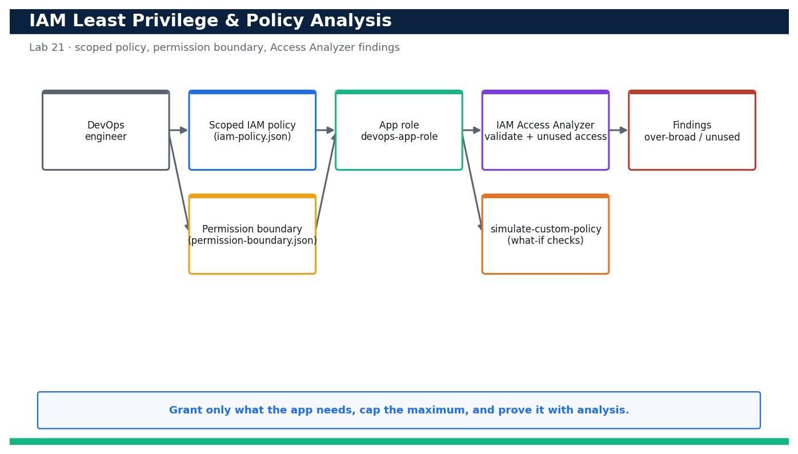

# Lab 21 — Enforce IAM Least Privilege and Analyse Policies for Over-Permissive Access

**Course:** DevOps Engineering on AWS (TGS-2023040474)  ·  **Day 5**  ·  **Domain 06 — Security and Compliance**  ·  **LO6**  ·  Skills mapped: K6, A4



*Figure — reference architecture for Lab 21.*

## Objective
Write a scoped IAM policy, cap it with a permission boundary, and prove least privilege with IAM Access Analyzer.

## Scenario
Broad permissions are the single most common cloud security failure. In this lab you replace a wildcard grant with a tightly scoped policy for the sample app's role, attach a permission boundary so the role can never exceed its remit, then use IAM Access Analyzer policy validation, `iam simulate-custom-policy` and an Access Analyzer external-access analyzer to find over-permissive grants and unused access. You tighten the policy until it validates cleanly and only the actions the app truly needs remain.

## What you'll build
A least-privilege IAM policy for the app role, capped by a permission boundary, that passes Access Analyzer validation with no security warnings and grants nothing beyond the app's real needs.
**Services:** AWS IAM, IAM Access Analyzer, AWS STS, AWS CloudFormation.

## Prerequisites
- An AWS account you control (an AWS Free Tier / sandbox account is sufficient for most steps).
- AWS CLI v2 installed and configured with a least-privilege named profile: `aws configure --profile devops` (Region e.g. ap-southeast-1).
- Confirm your identity before you start: `aws sts get-caller-identity --profile devops`.
- Git and a code editor; a modern browser for the AWS Management Console.
- Copy `.env.example` to `.env` and fill in YOUR values. `.env` is git-ignored — never commit real credentials.
- Run every command from this lab folder with your `devops` profile (append `--profile devops` or set `AWS_PROFILE=devops`).
- Permission to create IAM roles, policies and permission boundaries in your own (or a sandbox) AWS account.
- The sample app's S3 data bucket name (devops-sample-app-data) noted for the scoped resource ARN.

## Cost & safety
IAM policies, roles, permission boundaries and `simulate-custom-policy` are free. IAM Access Analyzer's external-access analyzer is free; the unused-access analyzer is billed per IAM role/user analysed per month, so delete the unused-access analyzer at the end to avoid a small recurring charge.

- Use only your own AWS account and the placeholder values in `.env.example`.
- **Never commit real credentials.** Use IAM roles / the AWS CLI profile and the `.env` placeholders only.
- Run the **Clean up** section as soon as you finish to stop ongoing charges.

## Files in this lab
- `iam-policy.json`
- `permission-boundary.json`
- `trust-policy.json`
- `analyze-access.sh`
- `.env.example`
- `lab-21-iam-least-privilege-analysis.jpg`
- `INSTRUCTIONS.pdf`

## Step-by-step
1. Review the deliberately over-broad starting policy so you understand what 'too much' looks like before you scope it.

   ```bash
   cat iam-policy.json
   ```
   - **Expected output:** The file shows the intended least-privilege policy; compare it against the broad `s3:*`/`logs:*` grant it replaces.

2. Create an app role that trusts EC2 (the sample app runs on EC2) so you have a real principal to scope.

   ```bash
   aws iam create-role --role-name devops-app-role --assume-role-policy-document file://trust-policy.json --profile devops
   ```
   - **Expected output:** Returns the role Arn arn:aws:iam::<your-account-id>:role/devops-app-role.

3. Create the permission-boundary policy that caps the maximum permissions the app role can ever hold.

   ```bash
   aws iam create-policy --policy-name devops-app-boundary --policy-document file://permission-boundary.json --profile devops
   ```
   - **Expected output:** Returns the boundary policy Arn arn:aws:iam::<your-account-id>:policy/devops-app-boundary.

4. Attach the permission boundary to the app role so later policy attachments can never escalate beyond it.

   ```bash
   aws iam put-role-permissions-boundary --role-name devops-app-role --permissions-boundary arn:aws:iam::<your-account-id>:policy/devops-app-boundary --profile devops
   ```
   - **Expected output:** The command succeeds; `get-role` now shows PermissionsBoundary set on the role.

5. Create the tightly scoped least-privilege policy from the reviewed JSON.

   ```bash
   aws iam create-policy --policy-name devops-app-least-priv --policy-document file://iam-policy.json --profile devops
   ```
   - **Expected output:** Returns the policy Arn arn:aws:iam::<your-account-id>:policy/devops-app-least-priv.

6. Attach the least-privilege policy to the app role.

   ```bash
   aws iam attach-role-policy --role-name devops-app-role --policy-arn arn:aws:iam::<your-account-id>:policy/devops-app-least-priv --profile devops
   ```
   - **Expected output:** The command succeeds; the role now grants only the scoped S3 and logs actions.

7. Run IAM Access Analyzer policy validation to catch over-permissive constructs (wildcards, missing conditions).

   ```bash
   aws accessanalyzer validate-policy --policy-document file://iam-policy.json --policy-type IDENTITY_POLICY --query 'findings[].{type:findingType,detail:findingDetails}'
   ```
   - **Expected output:** Returns an empty list (or only SUGGESTION/WARNING items you resolve) — no SECURITY_WARNING findings remain.

8. Simulate a WHAT-IF: prove the app role is allowed the one write it needs (put its data object).

   ```bash
   aws iam simulate-custom-policy --policy-input-list file://iam-policy.json --action-names s3:PutObject --resource-arns arn:aws:s3:::devops-sample-app-data/report.json --profile devops
   ```
   - **Expected output:** The EvalDecision for s3:PutObject on the app data bucket is 'allowed'.

9. Simulate a WHAT-IF: prove the role is DENIED an over-broad action it must never have (deleting any bucket).

   ```bash
   aws iam simulate-custom-policy --policy-input-list file://iam-policy.json --action-names s3:DeleteBucket --resource-arns arn:aws:s3:::any-other-bucket --profile devops
   ```
   - **Expected output:** The EvalDecision for s3:DeleteBucket is 'implicitDeny' — the scoped policy does not grant it.

10. Create an IAM Access Analyzer ACCOUNT analyzer to detect resources shared outside your account (external access).

   ```bash
   aws accessanalyzer create-analyzer --analyzer-name devops-account-analyzer --type ACCOUNT --profile devops
   ```
   - **Expected output:** Returns the analyzer Arn; the analyzer begins scanning IAM roles, S3 buckets and KMS keys for external access.

11. List any external-access findings so you can spot resources unintentionally shared with other principals.

   ```bash
   aws accessanalyzer list-findings --analyzer-arn <analyzer-arn> --query 'findings[?status==`ACTIVE`].{resource:resource,principal:principal}' --profile devops
   ```
   - **Expected output:** Returns ACTIVE findings (ideally an empty list once the app role and buckets are private) with the offending principal shown.

12. Create an UNUSED-ACCESS analyzer to surface permissions the app role has but has never used.

   ```bash
   aws accessanalyzer create-analyzer --analyzer-name devops-unused-access --type ACCOUNT_UNUSED_ACCESS --profile devops
   ```
   - **Expected output:** Returns the unused-access analyzer Arn; after its first evaluation it reports unused actions/roles you can remove.

13. Run the analyze-access.sh helper to bundle validation, both what-if simulations and the findings pull into one signal.

   ```bash
   bash analyze-access.sh
   ```
   - **Expected output:** Prints 'VALIDATION: clean', 'ALLOW put: allowed', 'DENY delete: implicitDeny' and 'EXTERNAL FINDINGS: 0' — a single green summary.

14. Tighten further: if the unused-access analyzer flags an action, remove it from iam-policy.json, update the policy and re-validate.

   ```bash
   aws iam create-policy-version --policy-arn arn:aws:iam::<your-account-id>:policy/devops-app-least-priv --policy-document file://iam-policy.json --set-as-default --profile devops
   ```
   - **Expected output:** A new default policy version is created; re-running validate-policy still returns no security warnings and the removed action no longer appears.

15. Confirm the boundary blocks privilege escalation even if a broad policy were attached later.

   ```bash
   aws iam simulate-custom-policy --policy-input-list file://permission-boundary.json --action-names iam:CreateUser --profile devops
   ```
   - **Expected output:** The EvalDecision for iam:CreateUser is 'implicitDeny' — the boundary caps escalation regardless of attached policies.

## Validation
The app role carries a permission boundary and a scoped least-privilege policy; `accessanalyzer validate-policy` returns no security warnings; `simulate-custom-policy` allows the one required write and implicit-denies over-broad actions; the account analyzer reports zero unintended external-access findings; and analyze-access.sh prints a fully green summary.

## Expected outcome (Test it)
You can prove, with Access Analyzer and policy simulation, that the app role grants exactly the actions the app needs and nothing more, that a permission boundary caps escalation, and that no resource is shared externally — then tighten the policy further based on unused-access findings and re-validate cleanly.

## Evidence to capture
- The `accessanalyzer validate-policy` output showing zero SECURITY_WARNING findings for iam-policy.json.
- The two `simulate-custom-policy` results: 'allowed' for the required PutObject and 'implicitDeny' for DeleteBucket.
- The Access Analyzer console (or list-findings output) showing zero active external-access findings.
- The analyze-access.sh run output printing 'VALIDATION: clean' and the allow/deny decisions.

## Troubleshooting
- **validate-policy reports a SECURITY_WARNING for a wildcard** — Replace the `*` action or resource with the specific action/ARN the app needs; re-run until only SUGGESTIONs remain.
- **simulate-custom-policy shows 'allowed' for an action you expected to be denied** — The action is granted somewhere in the input list — narrow the Action/Resource in iam-policy.json and re-simulate.
- **create-analyzer fails with 'analyzer already exists'** — An account can hold one analyzer of each type — reuse the existing analyzer ARN or delete the old one first.

## Clean up
Delete everything you created, in dependency order, to avoid ongoing charges:

```bash
aws iam detach-role-policy --role-name devops-app-role --policy-arn arn:aws:iam::<your-account-id>:policy/devops-app-least-priv --profile devops
aws iam delete-role-permissions-boundary --role-name devops-app-role --profile devops
aws iam delete-role --role-name devops-app-role --profile devops
aws iam delete-policy --policy-arn arn:aws:iam::<your-account-id>:policy/devops-app-least-priv --profile devops
aws iam delete-policy --policy-arn arn:aws:iam::<your-account-id>:policy/devops-app-boundary --profile devops
aws accessanalyzer delete-analyzer --analyzer-name devops-unused-access --profile devops
aws accessanalyzer delete-analyzer --analyzer-name devops-account-analyzer --profile devops
```

Confirm nothing is left running (no active stacks, instances, dashboards or trails for this lab).

## Acceptance criteria
- Every step's **Expected output** is observed, and the **Validation** and **Test it** checks pass.
- The reference architecture is realised using the editable AWS-native source files in this folder.
- GitHub via AWS CodeConnections is used as the source path where a repository is required (CodeCommit optional).
- All **Evidence to capture** items are collected (screenshots / CLI output).
- No live credentials appear in any committed file; `.env` is not committed.
- The **Clean up** step has been run and no billable resources remain.

---
© 2026 Tertiary Infotech Academy Pte Ltd. UEN: 201200696W. For training use only.
