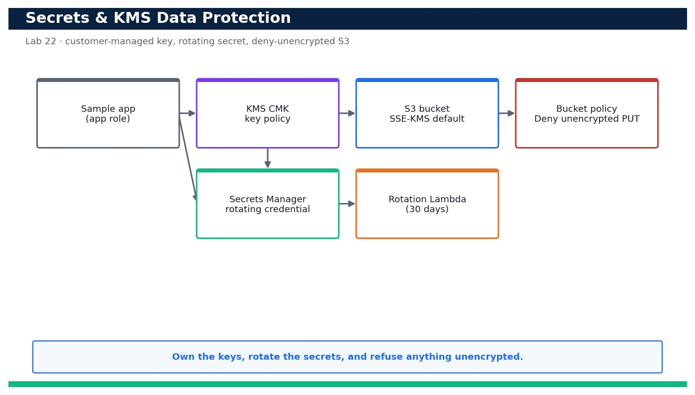

# Lab 22 — Protect Data with Secrets Manager and Customer-Managed KMS Encryption

**Course:** DevOps Engineering on AWS (TGS-2023040474)  ·  **Day 5**  ·  **Domain 06 — Security and Compliance**  ·  **LO6**  ·  Skills mapped: K6, A4



*Figure — reference architecture for Lab 22.*

## Objective
Create a customer-managed KMS key with a key policy, store a secret with rotation, and enforce encryption on S3.

## Scenario
Sensitive data must be encrypted with keys you control and secrets must never live in code. In this lab you create a customer-managed KMS key with a least-privilege key policy, store an application credential in AWS Secrets Manager (wiring up automatic rotation), then encrypt an S3 bucket with your key and add a bucket policy that DENIES any unencrypted upload. You demonstrate encrypt/decrypt with the CLI and prove the deny-unencrypted guardrail actually blocks a plaintext put.

## What you'll build
A customer-managed KMS key with a scoped key policy, a rotating Secrets Manager secret, and an S3 bucket that encrypts by default with your key and rejects any unencrypted upload.
**Services:** AWS KMS, AWS Secrets Manager, Amazon S3, AWS Lambda (rotation), AWS CloudFormation.

## Prerequisites
- An AWS account you control (an AWS Free Tier / sandbox account is sufficient for most steps).
- AWS CLI v2 installed and configured with a least-privilege named profile: `aws configure --profile devops` (Region e.g. ap-southeast-1).
- Confirm your identity before you start: `aws sts get-caller-identity --profile devops`.
- Git and a code editor; a modern browser for the AWS Management Console.
- Copy `.env.example` to `.env` and fill in YOUR values. `.env` is git-ignored — never commit real credentials.
- Run every command from this lab folder with your `devops` profile (append `--profile devops` or set `AWS_PROFILE=devops`).
- The devops-app-role from Lab 21 present (referenced by the KMS key policy).
- A small local file (report.json / plain.txt) to use as upload payloads.

## Cost & safety
A customer-managed KMS key costs about US$1/month plus a tiny per-request charge; Secrets Manager is about US$0.40 per secret per month plus per-10k API calls; S3 storage at lab scale is cents. Schedule the KMS key for deletion (7-day window) and delete the secret with a short recovery window at the end to stop the monthly charges.

- Use only your own AWS account and the placeholder values in `.env.example`.
- **Never commit real credentials.** Use IAM roles / the AWS CLI profile and the `.env` placeholders only.
- Run the **Clean up** section as soon as you finish to stop ongoing charges.

## Files in this lab
- `kms-key.yaml`
- `secret.yaml`
- `bucket-encryption.json`
- `deny-unencrypted.json`
- `secret-value.json`
- `encrypt-demo.sh`
- `.env.example`
- `lab-22-secrets-kms-encryption.jpg`
- `INSTRUCTIONS.pdf`

## Step-by-step
1. Deploy the KMS key and its scoped key policy from the template (the policy grants the app role decrypt, not admin).

   ```bash
   aws cloudformation deploy --template-file kms-key.yaml --stack-name devops-kms --capabilities CAPABILITY_NAMED_IAM --profile devops
   ```
   - **Expected output:** Stack devops-kms reaches CREATE_COMPLETE and outputs the KeyId and KeyArn of your customer-managed key.

2. Confirm the key exists and is customer-managed (KeyManager = CUSTOMER), not an AWS-managed key.

   ```bash
   aws kms describe-key --key-id alias/devops-app --query 'KeyMetadata.{Id:KeyId,Manager:KeyManager,State:KeyState}' --profile devops
   ```
   - **Expected output:** Returns KeyManager 'CUSTOMER' and KeyState 'Enabled' for the alias/devops-app key.

3. Confirm automatic key rotation is enabled so the key material rotates yearly without changing the key ARN.

   ```bash
   aws kms get-key-rotation-status --key-id alias/devops-app --profile devops
   ```
   - **Expected output:** Returns KeyRotationEnabled true.

4. Store the application credential in Secrets Manager encrypted with your customer-managed key (value from a placeholder file, never inline).

   ```bash
   aws secretsmanager create-secret --name devops/app/db --kms-key-id alias/devops-app --secret-string file://secret-value.json --profile devops
   ```
   - **Expected output:** Returns the secret ARN; the secret is encrypted with alias/devops-app, not the default aws/secretsmanager key.

5. Deploy the rotation configuration (Lambda + schedule) so the secret rotates automatically every 30 days.

   ```bash
   aws cloudformation deploy --template-file secret.yaml --stack-name devops-secret --capabilities CAPABILITY_NAMED_IAM --profile devops
   ```
   - **Expected output:** Stack devops-secret reaches CREATE_COMPLETE; the secret now has RotationEnabled true with a 30-day schedule.

6. Verify rotation is configured on the secret.

   ```bash
   aws secretsmanager describe-secret --secret-id devops/app/db --query '{Rotation:RotationEnabled,Days:RotationRules.AutomaticallyAfterDays}' --profile devops
   ```
   - **Expected output:** Returns Rotation true and Days 30.

7. Retrieve the secret at runtime the way the app would (decrypts transparently via KMS).

   ```bash
   aws secretsmanager get-secret-value --secret-id devops/app/db --query SecretString --output text --profile devops
   ```
   - **Expected output:** Returns the JSON secret value — proving the app role can decrypt it through the KMS key policy.

8. Create the encrypted data bucket and apply the deny-unencrypted bucket policy.

   ```bash
   aws s3api create-bucket --bucket devops-sample-app-data-<your-account-id> --region ap-southeast-1 --create-bucket-configuration LocationConstraint=ap-southeast-1 --profile devops
   ```
   - **Expected output:** The bucket is created; you will now enforce SSE-KMS and Block Public Access on it.

9. Set default SSE-KMS encryption on the bucket using your customer-managed key.

   ```bash
   aws s3api put-bucket-encryption --bucket devops-sample-app-data-<your-account-id> --server-side-encryption-configuration file://bucket-encryption.json --profile devops
   ```
   - **Expected output:** The command succeeds; get-bucket-encryption shows SSEAlgorithm aws:kms with your KeyId.

10. Attach the bucket policy that DENIES any PutObject that is not encrypted with your KMS key.

   ```bash
   aws s3api put-bucket-policy --bucket devops-sample-app-data-<your-account-id> --policy file://deny-unencrypted.json --profile devops
   ```
   - **Expected output:** The command succeeds; the bucket now rejects any upload without the correct SSE-KMS header.

11. Demonstrate the guardrail works: attempt an UNENCRYPTED upload and confirm it is denied.

   ```bash
   aws s3api put-object --bucket devops-sample-app-data-<your-account-id> --key plain.txt --body ./plain.txt --profile devops
   ```
   - **Expected output:** The upload fails with AccessDenied (An error occurred ... explicit deny in a resource-based policy).

12. Now upload correctly WITH SSE-KMS and confirm it succeeds.

   ```bash
   aws s3api put-object --bucket devops-sample-app-data-<your-account-id> --key report.json --body ./report.json --server-side-encryption aws:kms --ssekms-key-id alias/devops-app --profile devops
   ```
   - **Expected output:** The upload succeeds and returns the ETag plus ServerSideEncryption aws:kms and the SSEKMSKeyId.

13. Verify the stored object is encrypted with YOUR key, not an AWS-managed default.

   ```bash
   aws s3api head-object --bucket devops-sample-app-data-<your-account-id> --key report.json --query '{SSE:ServerSideEncryption,Key:SSEKMSKeyId}' --profile devops
   ```
   - **Expected output:** Returns ServerSideEncryption aws:kms and the SSEKMSKeyId of alias/devops-app.

14. Demonstrate raw encrypt/decrypt with the CLI to show the app can round-trip data through the key.

   ```bash
   aws kms encrypt --key-id alias/devops-app --plaintext fileb://report.json --query CiphertextBlob --output text --profile devops | base64 --decode > report.enc && aws kms decrypt --ciphertext-blob fileb://report.enc --query Plaintext --output text --profile devops | base64 --decode | head -c 40
   ```
   - **Expected output:** The encrypt returns ciphertext and the decrypt returns the original first bytes of report.json — a clean round-trip.

## Validation
describe-key shows a CUSTOMER-managed, Enabled key with rotation on; the secret is stored under your key with rotation enabled (30 days); the S3 bucket defaults to SSE-KMS with your KeyId; an unencrypted PutObject is denied while an SSE-KMS PutObject succeeds; and head-object confirms the object is encrypted with alias/devops-app.

## Expected outcome (Test it)
You can store and rotate a secret in Secrets Manager under a customer-managed KMS key, retrieve it via KMS decrypt, and prove the S3 bucket refuses unencrypted uploads while accepting SSE-KMS uploads encrypted with your own key — an end-to-end data-protection guardrail.

## Evidence to capture
- describe-key output showing KeyManager CUSTOMER, KeyState Enabled and rotation enabled for alias/devops-app.
- describe-secret output showing RotationEnabled true with AutomaticallyAfterDays 30.
- The failed unencrypted PutObject (AccessDenied) alongside the successful SSE-KMS PutObject.
- head-object output showing the stored object is encrypted with your alias/devops-app KMS key.

## Troubleshooting
- **get-secret-value returns AccessDeniedException from KMS** — The key policy must grant the caller kms:Decrypt — add the app role (or your user) to AllowAppRoleUseOfKey in kms-key.yaml.
- **The SSE-KMS upload is also denied** — The x-amz-server-side-encryption header or the KMS key ARN did not match the bucket policy condition — pass --server-side-encryption aws:kms and the correct --ssekms-key-id.
- **KMS key cannot be deleted immediately** — Keys can only be scheduled for deletion with a 7–30 day pending window; run schedule-key-deletion and note it will finalise later.

## Clean up
Delete everything you created, in dependency order, to avoid ongoing charges:

```bash
aws s3 rm s3://devops-sample-app-data-<your-account-id> --recursive --profile devops
aws s3api delete-bucket --bucket devops-sample-app-data-<your-account-id> --profile devops
aws secretsmanager delete-secret --secret-id devops/app/db --recovery-window-in-days 7 --profile devops
aws cloudformation delete-stack --stack-name devops-secret --profile devops
aws cloudformation delete-stack --stack-name devops-kms --profile devops
aws kms schedule-key-deletion --key-id alias/devops-app --pending-window-in-days 7 --profile devops
```

Confirm nothing is left running (no active stacks, instances, dashboards or trails for this lab).

## Acceptance criteria
- Every step's **Expected output** is observed, and the **Validation** and **Test it** checks pass.
- The reference architecture is realised using the editable AWS-native source files in this folder.
- GitHub via AWS CodeConnections is used as the source path where a repository is required (CodeCommit optional).
- All **Evidence to capture** items are collected (screenshots / CLI output).
- No live credentials appear in any committed file; `.env` is not committed.
- The **Clean up** step has been run and no billable resources remain.

---
© 2026 Tertiary Infotech Academy Pte Ltd. UEN: 201200696W. For training use only.
