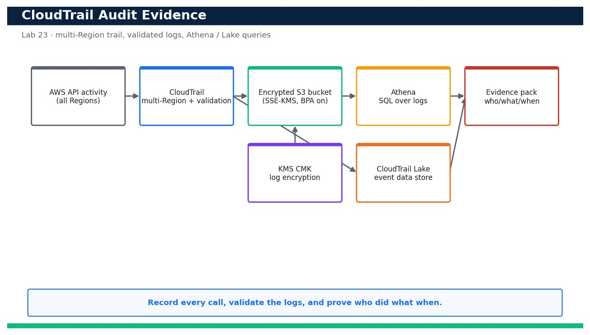

# Lab 23 — Produce CloudTrail Audit Evidence and Answer Who-Did-What-When

**Course:** DevOps Engineering on AWS (TGS-2023040474)  ·  **Day 5**  ·  **Domain 06 — Security and Compliance**  ·  **LO6**  ·  Skills mapped: K6, A4



*Figure — reference architecture for Lab 23.*

## Objective
Stand up a multi-Region CloudTrail with log-file validation and query it to export audit evidence.

## Scenario
Auditors and incident responders need a tamper-evident record of every API call. In this lab you create a multi-Region CloudTrail with log-file validation that delivers to an encrypted, access-blocked S3 bucket, then query the events two ways: with `cloudtrail lookup-events` for quick answers and with Athena over the S3 logs (plus a CloudTrail Lake event data store as the modern alternative) to answer precise 'who did what when' questions. You export the result as a signed evidence artifact.

## What you'll build
A validated, multi-Region CloudTrail delivering encrypted logs to S3, plus Athena/CloudTrail Lake queries that answer who-did-what-when and an exported evidence pack.
**Services:** AWS CloudTrail, Amazon S3, Amazon Athena, CloudTrail Lake, AWS KMS.

## Prerequisites
- An AWS account you control (an AWS Free Tier / sandbox account is sufficient for most steps).
- AWS CLI v2 installed and configured with a least-privilege named profile: `aws configure --profile devops` (Region e.g. ap-southeast-1).
- Confirm your identity before you start: `aws sts get-caller-identity --profile devops`.
- Git and a code editor; a modern browser for the AWS Management Console.
- Copy `.env.example` to `.env` and fill in YOUR values. `.env` is git-ignored — never commit real credentials.
- Run every command from this lab folder with your `devops` profile (append `--profile devops` or set `AWS_PROFILE=devops`).
- Permission to create CloudTrail trails, a KMS key and an Athena workgroup/results bucket in your account.
- An S3 bucket for Athena query results (separate from the trail log bucket).

## Cost & safety
CloudTrail's first copy of management events is free; extra trails and data events bill per event delivered. S3 storage and Athena scanning are cents at lab scale (Athena bills per TB scanned — partition and LIMIT your queries). CloudTrail Lake bills per GB ingested/scanned, so delete the event data store at the end.

- Use only your own AWS account and the placeholder values in `.env.example`.
- **Never commit real credentials.** Use IAM roles / the AWS CLI profile and the `.env` placeholders only.
- Run the **Clean up** section as soon as you finish to stop ongoing charges.

## Files in this lab
- `cloudtrail.yaml`
- `athena-create-table.sql`
- `athena-query.sql`
- `lookup-events.sh`
- `.env.example`
- `lab-23-cloudtrail-audit-evidence.jpg`
- `INSTRUCTIONS.pdf`

## Step-by-step
1. Deploy the trail stack: an encrypted, access-blocked S3 bucket, a KMS key for log encryption and a multi-Region trail with log-file validation.

   ```bash
   aws cloudformation deploy --template-file cloudtrail.yaml --stack-name devops-trail --capabilities CAPABILITY_NAMED_IAM --profile devops
   ```
   - **Expected output:** Stack devops-trail reaches CREATE_COMPLETE and outputs the TrailArn and the log bucket name.

2. Confirm the trail is multi-Region with log-file validation enabled.

   ```bash
   aws cloudtrail describe-trails --trail-name-list devops-trail --query 'trailList[0].{Multi:IsMultiRegionTrail,Validation:LogFileValidationEnabled,Kms:KmsKeyId}' --profile devops
   ```
   - **Expected output:** Returns IsMultiRegionTrail true, LogFileValidationEnabled true and a KmsKeyId (SSE-KMS on the delivered logs).

3. Confirm the trail is actively logging.

   ```bash
   aws cloudtrail get-trail-status --name devops-trail --query '{Logging:IsLogging,LastDelivery:LatestDeliveryTime}' --profile devops
   ```
   - **Expected output:** Returns IsLogging true and a recent LatestDeliveryTime once the first log file is delivered.

4. Generate some auditable activity so there is something to find (a harmless describe call attributed to you).

   ```bash
   aws ec2 describe-instances --profile devops >/dev/null && aws s3api list-buckets --profile devops >/dev/null
   ```
   - **Expected output:** The calls succeed; within a few minutes they will appear as CloudTrail events attributed to your identity.

5. Quick answer with lookup-events: find recent console/CLI sign-ins or a specific event name.

   ```bash
   aws cloudtrail lookup-events --lookup-attributes AttributeKey=EventName,AttributeValue=RunInstances --max-results 5 --query 'Events[].{Time:EventTime,User:Username,Event:EventName}' --profile devops
   ```
   - **Expected output:** Returns a table of matching events with EventTime, the Username who called it and the EventName.

6. Validate log-file integrity to prove the logs have not been tampered with.

   ```bash
   aws cloudtrail validate-logs --trail-arn <trail-arn> --start-time 2026-08-23T00:00:00Z --profile devops
   ```
   - **Expected output:** Reports that all log files in the window pass digest validation (no gaps, no modified files).

7. Verify the delivered log objects are encrypted with your KMS key.

   ```bash
   aws s3api head-object --bucket <trail-bucket> --key AWSLogs/<your-account-id>/CloudTrail/ap-southeast-1/2026/08/23/<file>.json.gz --query ServerSideEncryption --profile devops
   ```
   - **Expected output:** Returns aws:kms — confirming the logs are encrypted at rest with the CMK.

8. Create the Athena table over the CloudTrail S3 logs (run the DDL from athena-query.sql).

   ```bash
   aws athena start-query-execution --query-string file://athena-create-table.sql --result-configuration OutputLocation=s3://<athena-results-bucket>/ --profile devops
   ```
   - **Expected output:** The query succeeds and creates the external table cloudtrail_logs pointing at the trail's S3 prefix.

9. Run the who-did-what-when Athena query to list actions by a given principal in a time window.

   ```bash
   aws athena start-query-execution --query-string file://athena-query.sql --result-configuration OutputLocation=s3://<athena-results-bucket>/ --profile devops
   ```
   - **Expected output:** Returns a QueryExecutionId; the results list eventtime, useridentity, eventname and sourceipaddress for the target principal.

10. Fetch the Athena results and confirm they answer the audit question.

   ```bash
   aws athena get-query-results --query-execution-id <qid> --query 'ResultSet.Rows[0:5]' --profile devops
   ```
   - **Expected output:** Returns rows showing each API call the principal made, when, from which IP and against which resource.

11. Create a CloudTrail Lake event data store as the modern, SQL-native alternative to Athena.

   ```bash
   aws cloudtrail create-event-data-store --name devops-lake --retention-period 7 --multi-region-enabled --profile devops
   ```
   - **Expected output:** Returns the EventDataStore ARN; management events begin flowing into the Lake store.

12. Query CloudTrail Lake directly with SQL to answer the same question without managing tables.

   ```bash
   aws cloudtrail start-query --query-statement "SELECT eventTime, userIdentity.arn, eventName FROM <eds-id> WHERE eventName = 'RunInstances' ORDER BY eventTime DESC LIMIT 20" --profile devops
   ```
   - **Expected output:** Returns a QueryId; get-query-results returns the matching events directly from the Lake store.

13. Run the lookup-events.sh helper to bundle a targeted lookup + Athena question into one evidence run.

   ```bash
   bash lookup-events.sh
   ```
   - **Expected output:** Prints the matched events and writes evidence-<date>.json with the who/what/when rows for the pack.

14. Export the evidence: copy the query results and the validate-logs report into a dated evidence file for the audit pack.

   ```bash
   aws s3 cp s3://<athena-results-bucket>/<qid>.csv ./evidence/who-did-what-when.csv --profile devops
   ```
   - **Expected output:** The CSV is saved locally under evidence/ and, together with the integrity report, forms the exportable audit evidence.

## Validation
describe-trails shows a multi-Region trail with log-file validation and KMS encryption; get-trail-status shows IsLogging true with recent delivery; validate-logs reports no tampering; head-object shows aws:kms on the log objects; and both an Athena query and a CloudTrail Lake query return the who/what/when rows for a chosen principal.

## Expected outcome (Test it)
You can answer 'who did what when' from CloudTrail two independent ways (Athena over S3 and CloudTrail Lake SQL), prove the logs are integrity-validated and encrypted, and export a dated evidence artifact suitable for an audit.

## Evidence to capture
- describe-trails output showing multi-Region true, log-file validation true and a KMS key on devops-trail.
- The validate-logs report confirming no tampering across the audited window.
- The Athena (or CloudTrail Lake) query results answering who-did-what-when for a chosen principal.
- The exported evidence file (who-did-what-when.csv / evidence-<date>.json) in the evidence/ folder.

## Troubleshooting
- **No events appear in lookup-events yet** — CloudTrail delivery can lag several minutes; wait and retry, and confirm get-trail-status shows IsLogging true.
- **Athena query returns zero rows** — Check the table LOCATION matches the trail's S3 prefix and the eventTime window covers your activity; CloudTrail times are UTC.
- **CloudTrail cannot write to the bucket** — The bucket policy must allow cloudtrail.amazonaws.com s3:PutObject with bucket-owner-full-control — redeploy cloudtrail.yaml.

## Clean up
Delete everything you created, in dependency order, to avoid ongoing charges:

```bash
aws cloudtrail delete-event-data-store --event-data-store <eds-id> --profile devops
aws cloudtrail stop-logging --name devops-trail --profile devops
aws s3 rm s3://<trail-bucket> --recursive --profile devops
aws cloudformation delete-stack --stack-name devops-trail --profile devops
aws athena start-query-execution --query-string 'DROP TABLE IF EXISTS cloudtrail_logs' --result-configuration OutputLocation=s3://<athena-results-bucket>/ --profile devops
```

Confirm nothing is left running (no active stacks, instances, dashboards or trails for this lab).

## Acceptance criteria
- Every step's **Expected output** is observed, and the **Validation** and **Test it** checks pass.
- The reference architecture is realised using the editable AWS-native source files in this folder.
- GitHub via AWS CodeConnections is used as the source path where a repository is required (CodeCommit optional).
- All **Evidence to capture** items are collected (screenshots / CLI output).
- No live credentials appear in any committed file; `.env` is not committed.
- The **Clean up** step has been run and no billable resources remain.

---
© 2026 Tertiary Infotech Academy Pte Ltd. UEN: 201200696W. For training use only.
