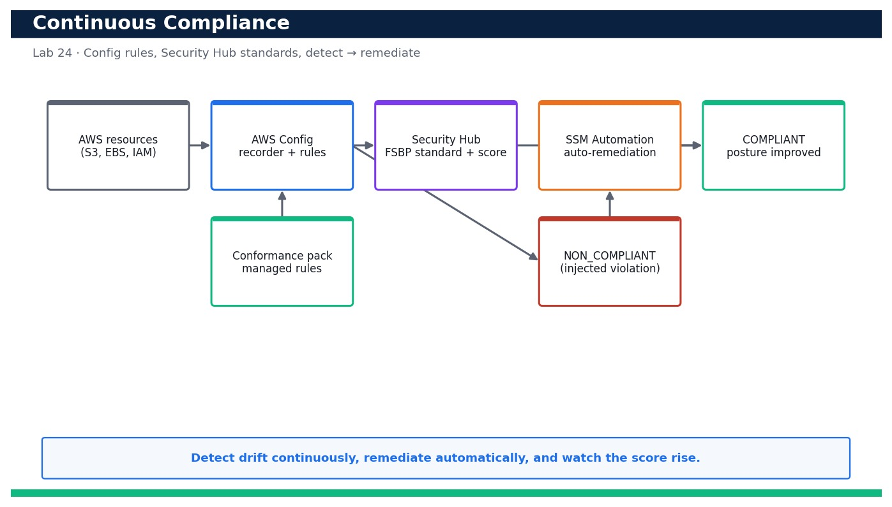

# Lab 24 — Run Continuous Compliance with AWS Config and Security Hub

**Course:** DevOps Engineering on AWS (TGS-2023040474)  ·  **Day 5**  ·  **Domain 06 — Security and Compliance**  ·  **LO6**  ·  Skills mapped: K6, A4



*Figure — reference architecture for Lab 24.*

## Objective
Enable AWS Config managed rules and Security Hub standards, inject a violation and remediate to COMPLIANT.

## Scenario
Compliance is not a one-off audit — it must run continuously. In this lab you turn on the AWS Config recorder with managed rules (s3-bucket-public-read-prohibited, encrypted-volumes and more) delivered as a conformance pack, enable AWS Security Hub with the AWS Foundational Security Best Practices standard, then inject a real violation and watch it flip to NON_COMPLIANT. You remediate it back to COMPLIANT (by hand and via an auto-remediation) and read the Security Hub posture score before and after.

## What you'll build
A continuously evaluating AWS Config + Security Hub setup that detects an injected violation as NON_COMPLIANT, auto-remediates it to COMPLIANT, and shows the posture score improve.
**Services:** AWS Config, AWS Security Hub, AWS Systems Manager Automation, Amazon S3, AWS CloudFormation, conformance packs.

## Prerequisites
- An AWS account you control (an AWS Free Tier / sandbox account is sufficient for most steps).
- AWS CLI v2 installed and configured with a least-privilege named profile: `aws configure --profile devops` (Region e.g. ap-southeast-1).
- Confirm your identity before you start: `aws sts get-caller-identity --profile devops`.
- Git and a code editor; a modern browser for the AWS Management Console.
- Copy `.env.example` to `.env` and fill in YOUR values. `.env` is git-ignored — never commit real credentials.
- Run every command from this lab folder with your `devops` profile (append `--profile devops` or set `AWS_PROFILE=devops`).
- A disposable test S3 bucket you can safely (and briefly) make public to exercise the Config rule.
- An SSM Automation assume-role (devops-config-remediation) for the auto-remediation step.

## Cost & safety
AWS Config bills per configuration item recorded and per rule evaluation; Security Hub bills per security check and per finding ingested. At lab scale this is a few US$ if left running, so stop the configuration recorder, disable the Security Hub standard and delete the conformance pack promptly at the end.

- Use only your own AWS account and the placeholder values in `.env.example`.
- **Never commit real credentials.** Use IAM roles / the AWS CLI profile and the `.env` placeholders only.
- Run the **Clean up** section as soon as you finish to stop ongoing charges.

## Files in this lab
- `config-setup.yaml`
- `config-rules.yaml`
- `conformance-pack.yaml`
- `remediation.json`
- `remediate-violation.sh`
- `.env.example`
- `lab-24-config-securityhub-compliance.jpg`
- `INSTRUCTIONS.pdf`

## Step-by-step
1. Create the Config delivery bucket and turn on the configuration recorder + delivery channel so resource history is captured.

   ```bash
   aws cloudformation deploy --template-file config-setup.yaml --stack-name devops-config-base --capabilities CAPABILITY_NAMED_IAM --profile devops
   ```
   - **Expected output:** Stack devops-config-base reaches CREATE_COMPLETE with an encrypted delivery bucket and the recorder role.

2. Start the configuration recorder so evaluations can begin.

   ```bash
   aws configservice start-configuration-recorder --configuration-recorder-name default --profile devops
   ```
   - **Expected output:** The recorder starts; describe-configuration-recorder-status shows recording true.

3. Deploy the AWS Config managed rules directly (s3-bucket-public-read-prohibited, encrypted-volumes, iam-user-no-policies-check).

   ```bash
   aws cloudformation deploy --template-file config-rules.yaml --stack-name devops-config --capabilities CAPABILITY_IAM --profile devops
   ```
   - **Expected output:** Stack devops-config reaches CREATE_COMPLETE and the three Config rules are created.

4. Deploy a conformance pack so a whole set of best-practice rules is applied and tracked as a unit.

   ```bash
   aws configservice put-conformance-pack --conformance-pack-name devops-ops-best-practices --template-body file://conformance-pack.yaml --delivery-s3-bucket <config-bucket> --profile devops
   ```
   - **Expected output:** Returns the conformance pack ARN; describe-conformance-pack-status shows CREATE_COMPLETE.

5. Enable AWS Security Hub in the Region (this auto-enables the CIS/FSBP checks it manages).

   ```bash
   aws securityhub enable-security-hub --enable-default-standards --profile devops
   ```
   - **Expected output:** Security Hub is enabled; a HubArn is returned and default standards begin subscribing.

6. Confirm the AWS Foundational Security Best Practices standard is enabled.

   ```bash
   aws securityhub get-enabled-standards --query 'StandardsSubscriptions[].StandardsArn' --profile devops
   ```
   - **Expected output:** The output lists the aws-foundational-security-best-practices standard subscription ARN.

7. Read the BASELINE compliance posture before you inject a violation.

   ```bash
   aws securityhub get-findings --filters '{"ComplianceStatus":[{"Value":"FAILED","Comparison":"EQUALS"}]}' --query 'length(Findings)' --profile devops
   ```
   - **Expected output:** Returns a baseline count of failed checks — your starting posture number.

8. Inject a deliberate violation: make a disposable test bucket publicly readable to trip s3-bucket-public-read-prohibited.

   ```bash
   aws s3api put-public-access-block --bucket <test-bucket> --public-access-block-configuration BlockPublicAcls=false,IgnorePublicAcls=false,BlockPublicPolicy=false,RestrictPublicBuckets=false --profile devops
   ```
   - **Expected output:** The bucket's Block Public Access is (deliberately) disabled — a compliance violation to be detected.

9. Force a re-evaluation and confirm AWS Config marks the bucket NON_COMPLIANT.

   ```bash
   aws configservice start-config-rules-evaluation --config-rule-names s3-bucket-public-read-prohibited --profile devops && aws configservice get-compliance-details-by-config-rule --config-rule-name s3-bucket-public-read-prohibited --query 'EvaluationResults[?ComplianceType==`NON_COMPLIANT`]' --profile devops
   ```
   - **Expected output:** The test bucket appears with ComplianceType NON_COMPLIANT.

10. Confirm the same violation surfaces in Security Hub as a FAILED finding.

   ```bash
   aws securityhub get-findings --filters '{"ResourceId":[{"Value":"<test-bucket>","Comparison":"PREFIX"}]}' --query 'Findings[].{Title:Title,Status:Compliance.Status}' --profile devops
   ```
   - **Expected output:** A finding with Compliance.Status FAILED for the public-access control appears for the test bucket.

11. Attach a Config auto-remediation (SSM Automation) so the rule self-heals public buckets going forward.

   ```bash
   aws configservice put-remediation-configurations --remediation-configurations file://remediation.json --profile devops
   ```
   - **Expected output:** The remediation configuration is registered against s3-bucket-public-read-prohibited using AWS-DisableS3BucketPublicReadWrite (or re-enable BPA).

12. Remediate now: re-enable Block Public Access on the test bucket (or let the auto-remediation run).

   ```bash
   aws s3api put-public-access-block --bucket <test-bucket> --public-access-block-configuration BlockPublicAcls=true,IgnorePublicAcls=true,BlockPublicPolicy=true,RestrictPublicBuckets=true --profile devops
   ```
   - **Expected output:** Block Public Access is restored on the test bucket.

13. Re-evaluate and confirm the resource returns to COMPLIANT.

   ```bash
   aws configservice start-config-rules-evaluation --config-rule-names s3-bucket-public-read-prohibited --profile devops && aws configservice get-compliance-details-by-config-rule --config-rule-name s3-bucket-public-read-prohibited --query 'EvaluationResults[?ComplianceType==`COMPLIANT`]' --profile devops
   ```
   - **Expected output:** On re-evaluation the test bucket is reported COMPLIANT again.

14. Read the Security Hub posture AFTER remediation and compare against the baseline.

   ```bash
   aws securityhub get-findings --filters '{"ComplianceStatus":[{"Value":"FAILED","Comparison":"EQUALS"}]}' --query 'length(Findings)' --profile devops
   ```
   - **Expected output:** The failed-check count has dropped (the public-bucket finding is now RESOLVED/PASSED) — the posture score improved.

15. Run remediate-violation.sh to bundle inject → detect → remediate → confirm into one repeatable demonstration.

   ```bash
   bash remediate-violation.sh <test-bucket>
   ```
   - **Expected output:** Prints 'INJECTED', 'NON_COMPLIANT confirmed', 'REMEDIATED' and 'COMPLIANT confirmed' — a full closed-loop compliance run.

## Validation
The Config recorder is recording, the three managed rules and the conformance pack are active, and Security Hub's FSBP standard is enabled; the injected public bucket is reported NON_COMPLIANT in both Config and Security Hub, then COMPLIANT after remediation; and the Security Hub failed-check count (posture score) improves between the baseline and the post-remediation read.

## Expected outcome (Test it)
You can run a full continuous-compliance loop: inject a real violation, watch AWS Config and Security Hub flag it NON_COMPLIANT/FAILED, remediate it (manually and via auto-remediation), confirm it returns to COMPLIANT and show the posture score improving.

## Evidence to capture
- describe-configuration-recorder-status showing recording true and get-enabled-standards showing FSBP enabled.
- The Config compliance detail showing the test bucket NON_COMPLIANT after the injected violation.
- The Security Hub finding for the public-bucket control (FAILED) and its later RESOLVED/PASSED state.
- Before/after Security Hub failed-check counts (posture score) showing the improvement after remediation.

## Troubleshooting
- **Config rule stays NON_COMPLIANT after remediation** — Trigger start-config-rules-evaluation and confirm the remediation actually changed the resource; evaluations can lag a minute.
- **enable-security-hub fails with ResourceConflictException** — Security Hub is already enabled in this Region — call get-enabled-standards instead of re-enabling.
- **Auto-remediation never runs** — The AutomationAssumeRole must trust ssm.amazonaws.com and have permission to change the resource; check the SSM Automation execution history.

## Clean up
Delete everything you created, in dependency order, to avoid ongoing charges:

```bash
aws configservice delete-remediation-configuration --config-rule-name s3-bucket-public-read-prohibited --profile devops
aws configservice delete-conformance-pack --conformance-pack-name devops-ops-best-practices --profile devops
aws securityhub disable-security-hub --profile devops
aws configservice stop-configuration-recorder --configuration-recorder-name default --profile devops
aws cloudformation delete-stack --stack-name devops-config --profile devops
aws cloudformation delete-stack --stack-name devops-config-base --profile devops
```

Confirm nothing is left running (no active stacks, instances, dashboards or trails for this lab).

## Acceptance criteria
- Every step's **Expected output** is observed, and the **Validation** and **Test it** checks pass.
- The reference architecture is realised using the editable AWS-native source files in this folder.
- GitHub via AWS CodeConnections is used as the source path where a repository is required (CodeCommit optional).
- All **Evidence to capture** items are collected (screenshots / CLI output).
- No live credentials appear in any committed file; `.env` is not committed.
- The **Clean up** step has been run and no billable resources remain.

---
© 2026 Tertiary Infotech Academy Pte Ltd. UEN: 201200696W. For training use only.
