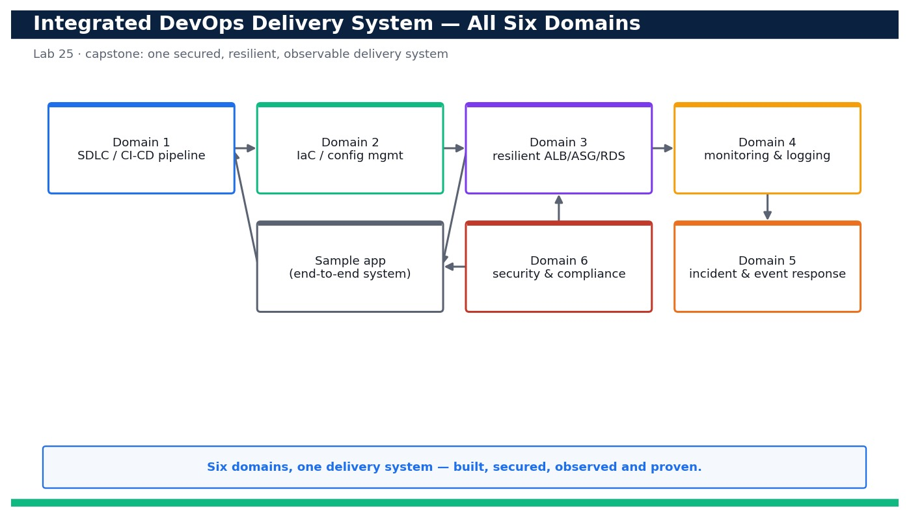

# Lab 25 — Capstone — Blueprint, Well-Architected Review and Evidence Pack for the Whole Delivery System

**Course:** DevOps Engineering on AWS (TGS-2023040474)  ·  **Day 5**  ·  **Domain 06 — Security and Compliance**  ·  **LO1–LO6**  ·  Skills mapped: K1, K2, K3, K4, K5, K6, K7, A1, A2, A3, A4, A5, A6



*Figure — reference architecture for Lab 25.*

## Objective
Synthesise Labs 1–24 into one secured, resilient, observable delivery system with a blueprint, an operational review and an evidence pack.

## Scenario
This capstone ties the entire course together. You produce a single technical blueprint that connects all six domains — SDLC automation (Domain 1), configuration management & IaC (Domain 2), resilient architecture (Domain 3), monitoring & logging (Domain 4), incident & event response (Domain 5) and security & compliance (Domain 6) — into one end-to-end delivery system for the sample app. You then run a Well-Architected-style operational review across all six pillars, assemble an evidence pack that maps every learning outcome to a concrete artifact from the prior 24 labs, and present the whole solution. A top-level CloudFormation template documents/nests the stacks built across the course.

## What you'll build
A completed technical blueprint, a Well-Architected pillar review with scores and actions, and an evidence pack that proves the whole secured/resilient/observable delivery system against LO1–LO6.
**Services:** AWS CodePipeline/CodeBuild/CodeDeploy, CloudFormation, EC2/ALB/Auto Scaling, RDS, CloudWatch, EventBridge, SNS, Lambda, IAM, KMS, Secrets Manager, CloudTrail, AWS Config, Security Hub.

## Prerequisites
- An AWS account you control (an AWS Free Tier / sandbox account is sufficient for most steps).
- AWS CLI v2 installed and configured with a least-privilege named profile: `aws configure --profile devops` (Region e.g. ap-southeast-1).
- Confirm your identity before you start: `aws sts get-caller-identity --profile devops`.
- Git and a code editor; a modern browser for the AWS Management Console.
- Copy `.env.example` to `.env` and fill in YOUR values. `.env` is git-ignored — never commit real credentials.
- Run every command from this lab folder with your `devops` profile (append `--profile devops` or set `AWS_PROFILE=devops`).
- Completion of Labs 1–24 (this capstone synthesises and references their artifacts).
- The evidence artifacts (screenshots, CLI outputs, templates) from the prior labs collected locally.

## Cost & safety
The capstone is mostly documentation and review, so it is nearly free if you reuse (or read from) the stacks from prior labs. If you deploy the top-level capstone-architecture.yaml to validate nesting, tear it down the same day; otherwise run it in --dry-run / validate-only mode to avoid any spend.

- Use only your own AWS account and the placeholder values in `.env.example`.
- **Never commit real credentials.** Use IAM roles / the AWS CLI profile and the `.env` placeholders only.
- Run the **Clean up** section as soon as you finish to stop ongoing charges.

## Files in this lab
- `blueprint.md`
- `operational-review.md`
- `evidence-pack-checklist.md`
- `capstone-architecture.yaml`
- `validate-evidence.sh`
- `.env.example`
- `lab-25-capstone-blueprint-evidence-pack.jpg`
- `INSTRUCTIONS.pdf`

## Step-by-step
1. Open blueprint.md and fill Section 1 (Domain 1 — SDLC automation) referencing your Lab 1 CI/CD pipeline: source, build, test, approval and rollback.

   ```bash
   cat blueprint.md
   ```
   - **Expected output:** The blueprint template shows one section per domain; Section 1 now describes your CodePipeline flow and links to the Lab 1 evidence.

2. Fill Section 2 (Domain 2 — IaC & configuration management) referencing your CloudFormation stacks and parameterised, reproducible environments.

   ```bash
   aws cloudformation list-stacks --stack-status-filter CREATE_COMPLETE UPDATE_COMPLETE --query 'StackSummaries[].StackName' --profile devops
   ```
   - **Expected output:** The list shows your course stacks (devops-net, devops-app, devops-ha, devops-mon, devops-trail, devops-config...) which you cite as IaC evidence.

3. Fill Section 3 (Domain 3 — resilience) referencing your multi-AZ ALB + Auto Scaling + RDS design and stated RTO/RPO.

   ```bash
   aws elbv2 describe-load-balancers --query 'LoadBalancers[].{Name:LoadBalancerName,AZs:AvailabilityZones[].ZoneName}' --profile devops
   ```
   - **Expected output:** The ALB spans at least two AZs; you record the AZ list and your RTO/RPO in the blueprint.

4. Fill Section 4 (Domain 4 — observability) referencing your CloudWatch dashboard, metric filters, alarms and Logs Insights queries.

   ```bash
   aws cloudwatch list-dashboards --query 'DashboardEntries[].DashboardName' --profile devops
   ```
   - **Expected output:** Your monitoring dashboard is listed; you attach its screenshot and alarm ARNs as observability evidence.

5. Fill Section 5 (Domain 5 — incident & event response) referencing your EventBridge rule, SNS topic and remediation Lambda.

   ```bash
   aws events list-rules --query 'Rules[].Name' --profile devops
   ```
   - **Expected output:** Your incident-response rule is listed; you document the detect → notify → auto-remediate flow in the blueprint.

6. Fill Section 6 (Domain 6 — security & compliance) referencing Labs 21–24: least-privilege IAM, KMS/Secrets, CloudTrail and Config/Security Hub.

   ```bash
   aws securityhub get-findings --filters '{"ComplianceStatus":[{"Value":"FAILED","Comparison":"EQUALS"}]}' --query 'length(Findings)' --profile devops
   ```
   - **Expected output:** You record the current posture score and cite the least-privilege, encryption, audit and compliance controls.

7. Validate the top-level capstone-architecture.yaml that documents/nests the course stacks (validate-only, no deploy needed).

   ```bash
   aws cloudformation validate-template --template-body file://capstone-architecture.yaml --profile devops
   ```
   - **Expected output:** The template validates; its Parameters/Resources reference the nested stack URLs for Domains 1–6 as one system.

8. Optionally deploy the capstone stack (or a change-set preview) to prove the pieces compose into one system.

   ```bash
   aws cloudformation deploy --template-file capstone-architecture.yaml --stack-name devops-capstone --capabilities CAPABILITY_NAMED_IAM --no-execute-changeset --profile devops
   ```
   - **Expected output:** A change-set is created showing the nested stacks (net, app, ha, mon, ir, security) that make up the whole system.

9. Open operational-review.md and score each Well-Architected pillar (Operational Excellence, Security, Reliability, Performance Efficiency, Cost Optimization, Sustainability).

   ```bash
   cat operational-review.md
   ```
   - **Expected output:** Each pillar has a checklist; you mark each item Met/Partly/Gap and record a per-pillar score and top risk.

10. Run a lightweight Well-Architected self-review question set and capture the highest-priority improvement per pillar.

   ```bash
   aws wellarchitected list-lens-review-improvements --workload-id <workload-id> --lens-alias wellarchitected --query 'ImprovementSummaries[].{Pillar:PillarId,Risk:RiskCounts}' --profile devops
   ```
   - **Expected output:** For each pillar you record the top improvement and its risk (HIGH/MEDIUM) in operational-review.md. (If you did not create a Workbench workload, complete the checklist manually.)

11. Open evidence-pack-checklist.md and map every learning outcome (LO1–LO6) to a specific artifact from the prior labs.

   ```bash
   cat evidence-pack-checklist.md
   ```
   - **Expected output:** Each LO row lists the lab, the artifact (screenshot/CLI output/template) and where it is stored — no LO is left without evidence.

12. Assemble the evidence folder: gather the referenced screenshots, CLI outputs and templates into evidence/ organised by domain.

   ```bash
   ls -R evidence/ | head -40
   ```
   - **Expected output:** evidence/ contains one subfolder per domain (01-sdlc ... 06-security) each holding the artifacts cited in the checklist.

13. Validate completeness: confirm every LO in the checklist has at least one non-empty evidence artifact.

   ```bash
   bash validate-evidence.sh
   ```
   - **Expected output:** Prints 'LO1 OK ... LO6 OK' and 'EVIDENCE PACK COMPLETE' — every outcome has a mapped, present artifact.

14. Cross-check security posture one final time so the pack reflects a clean, compliant end state.

   ```bash
   aws configservice describe-compliance-by-config-rule --query 'ComplianceByConfigRules[?Compliance.ComplianceType==`NON_COMPLIANT`].ConfigRuleName' --profile devops
   ```
   - **Expected output:** The list of NON_COMPLIANT rules is empty (or only the deliberately-documented exceptions), matching the blueprint's stated posture.

15. Present the solution: walk the blueprint (system view), the Well-Architected review (risks & actions) and the evidence pack (proof) as one 10-minute story.
   - **Expected output:** You can narrate how a commit flows through CI/CD, deploys to a resilient multi-AZ system, is observed and auto-remediated, and is secured/audited/compliant — backed at each step by an evidence artifact.

16. Package and hand over: zip the completed blueprint, operational review, checklist and evidence folder as the capstone deliverable.

   ```bash
   zip -r capstone-deliverable.zip blueprint.md operational-review.md evidence-pack-checklist.md capstone-architecture.yaml evidence/
   ```
   - **Expected output:** A single capstone-deliverable.zip is produced containing the blueprint, review, checklist, top-level template and all evidence.

## Validation
The blueprint has all six domain sections completed and cross-referenced to the relevant labs; capstone-architecture.yaml validates and its change-set shows the nested Domain 1–6 stacks; operational-review.md has a score and top risk for every Well-Architected pillar; and evidence-pack-checklist.md maps each of LO1–LO6 to a present, non-empty artifact (validate-evidence.sh prints EVIDENCE PACK COMPLETE) with a clean final compliance posture.

## Expected outcome (Test it)
You can present one coherent delivery system — a commit flowing through CI/CD to a resilient, observed, auto-remediating, secured and continuously-compliant environment — and, for every learning outcome LO1–LO6, point to a specific evidence artifact drawn from the prior 24 labs, with the whole solution scored against the Well-Architected pillars.

## Evidence to capture
- The completed blueprint.md with all six domain sections filled and cross-referenced to the labs.
- The completed operational-review.md showing a score and top risk for each Well-Architected pillar.
- The evidence-pack-checklist.md with every LO1–LO6 row mapped to a present artifact, plus the validate-evidence.sh 'EVIDENCE PACK COMPLETE' output.
- The capstone-deliverable.zip and a screenshot of the capstone-architecture.yaml validate/change-set showing the nested Domain 1–6 stacks.

## Troubleshooting
- **validate-template fails on capstone-architecture.yaml** — The nested TemplateURL parameters must be reachable S3 URLs (or left as documentation defaults); validate the child templates individually first.
- **validate-evidence.sh reports an LO as MISSING** — Create the domain subfolder under evidence/ and drop in the artifact cited in the checklist; empty files do not count.
- **A Config rule still shows NON_COMPLIANT at final cross-check** — Either remediate it (Lab 24) or document it as an accepted, explained exception in the blueprint's risks section before sign-off.

## Clean up
Delete everything you created, in dependency order, to avoid ongoing charges:

```bash
aws cloudformation delete-stack --stack-name devops-capstone --profile devops
aws wellarchitected delete-workload --workload-id <workload-id> --profile devops
rm -f capstone-deliverable.zip
```

Confirm nothing is left running (no active stacks, instances, dashboards or trails for this lab).

## Acceptance criteria
- Every step's **Expected output** is observed, and the **Validation** and **Test it** checks pass.
- The reference architecture is realised using the editable AWS-native source files in this folder.
- GitHub via AWS CodeConnections is used as the source path where a repository is required (CodeCommit optional).
- All **Evidence to capture** items are collected (screenshots / CLI output).
- No live credentials appear in any committed file; `.env` is not committed.
- The **Clean up** step has been run and no billable resources remain.

---
© 2026 Tertiary Infotech Academy Pte Ltd. UEN: 201200696W. For training use only.
